# amct-coder 模块分析与子能力映射

> 粗→细阅读路径：先看 **4 大模块划分与流程主链**，再看 **模块与子能力对应关系**，最后下钻到**每个子能力的 OWN/NEED/PRODUCE/RIPPLE**。

---

## 一、粗粒度主链：四大模块

AMCT LLM CLI 按**隔离边界**压缩为 4 大模块 + 2 个中介层。每条命令（eval / extract_ptq_data / ptq / deploy）从入口到产物都穿过这条主链：

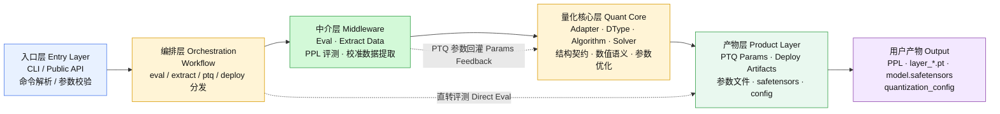
### 流程与模块对照
按照我之前的理解的流程，对应的主链阶段

| 分步描述 | 对应模块层 | 实际代码入口 |
|---|---|---|
| 解析参数 | **入口层 Entry** | `cli/llm/args.py` |
| 依次量化（直转评测） | **编排层 → 中介 Eval（计算PPL）** | `llm_eval.py` blockwise，fake_quant 全开 |
| 保存输入输出（extract） | **编排层 → 中介 Extract** | `llm_extract_ptq_data.py` 存 `block_*_in.pkl` |
| 再次重新进行 ptq | **量化核心层 Quant Core** | `llm_ptq.py` 加载离线输入 → solver → 存 `layer_*.pt` |
| 保存优化参数 | **量化核心层 Quant Core** | solver `finalize()` → `_save_unit_result()` |
| 导出 | **产物层 Product** | `llm_deploy.py` 读 PTQ 参数 → `export_deploy()` → safetensors |


### 四大模块职责

| 模块 Module | 主要职责 Responsibility | 典型目录 Directory | 不该做什么 NOT |
|---|---|---|---|
| **入口层 Entry**<br/>CLI / Public API | 解析命令和参数，选择 eval / extract / ptq / deploy 流程 | `amct_pytorch/cli/llm/`、顶层 `__init__.py`、docs/examples | 不写模型结构，不写算法细节 |
| **编排层 Orchestration**<br/>Workflow | 串起四类流程，决定何时加载模型、数据、量化模块、PTQ 参数和导出逻辑 | `amct_pytorch/workflows/llm_*.py` | 不硬编码具体模型 attention/MLP/MoE 结构 |
| **量化核心层 Quant Core**<br/>Adapter · DType · Algorithm · Solver | 表达"模型哪里可量化"、"怎么 fake/real quant"、"哪些参数可训练"、"如何优化和保存参数" | `common/models/llm/`、`quantization/`、`algorithms/`、`common/optimization/` | 通用模块不写模型名分支 |
| **产物层 Product**<br/>PTQ Params · Deploy Artifacts | 保存 PTQ 参数、导出 safetensors 和 `quantization_config` | `common/models/llm/common/ptq_params.py`、`workflows/llm_deploy.py`、`deploy_export.py` | 不重新定义 dtype / algorithm / adapter 语义 |

### 中介层 Middleware：Eval · Extract Data

| 中介层 Middleware | 职责 Responsibility | 典型目录 Directory | 连接关系 Connection |
|---|---|---|---|
| **Eval 评测** | 计算 PPL 等量化质量指标 | `common/evaluate/`、`workflows/llm_eval.py` | Workflow → **Eval** → Quant Core（直转评测） |
| **Extract Data 数据提取** | 提取 PTQ 校准数据和 GT | `common/datasets/`、`workflows/llm_extract_ptq_data.py` | Workflow → **Extract** → Solver（校准输入） |

Eval 和 Extract Data 既不属于纯编排（它们包含具体的数据处理和评测逻辑），也不属于量化核心（它们不涉及 dtype / algorithm 语义）。把它们放在中介层，可以保持 Workflow 只做编排、Quant Core 只做量化语义。

---

## 二、四步任务流

量化、PTQ、优化参数和导出的任务流可以先按四步理解：

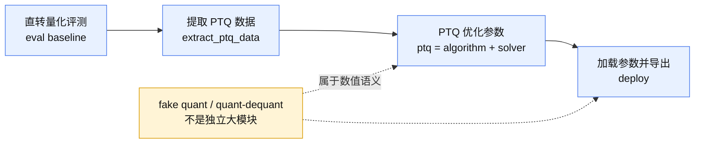

阅读顺序建议：
1. fake quant隶属于ptq层，属于训练后反量化。
2. 先用粗粒度主链判断请求落在入口层、编排层、量化核心层还是产物层。
3. 再根据任务流判断它是在 eval、extract_ptq_data、ptq 还是 deploy 阶段。
4. 最后下钻到后半部分的 9 个子能力，确认 OWN/NEED/PRODUCE/RIPPLE。

---

## 三、模块 ↔ 子能力对应关系

四大模块 + 独立体系与 9 个子能力的归属关系：

| 模块 Module | 包含子能力 Sub-capabilities |
|---|---|
| **入口层 Entry** | `public-api-tests`（CLI choices、build、tests、docs/examples） |
| **编排层 Orchestration** | `llm-data-workflow`（workflow 编排 + dataloader + eval） |
| **量化核心层 Quant Core** | `dtype-quant-module`（数值语义）、`llm-algorithm`（算法）、`llm-model-unit`（模型契约）、`ptq-solver-params`（参数优化与保存） |
| **产物层 Product** | `deploy-export-code`（权重导出 + config） |
| **独立体系 Independent** | `classic-graph`（classic 量化）、`ops-boundary`（NPU 算子边界） |

```
                          ┌──────────────────────┐
                          │    入口层 Entry       │
                          │  public-api-tests     │
                          └──────────┬───────────┘
                                     │
                          ┌──────────▼───────────┐
                          │   编排层 Orchestration │
                          │  llm-data-workflow     │
                          └──────────┬───────────┘
                                     │
                    ┌────────────────┼────────────────┐
                    │                │                │
          ┌─────────▼──────┐  ┌─────▼──────┐  ┌──────▼──────────┐
          │ 中介 Middleware │  │ 中介 Middle│  │ 量化核心层       │
          │ Eval           │  │ Extract    │  │ Quant Core       │
          └────────────────┘  └────────────┘  │ dtype-quant      │
                                              │ llm-algorithm    │
                    ┌─────────────────────────│ llm-model-unit   │
                    │                         │ ptq-solver-params│
                    │                         └──────────────────┘
          ┌─────────▼───────────┐
          │   产物层 Product      │
          │  deploy-export-code   │
          └─────────────────────┘

          独立体系 Independent:
          ┌──────────────┐  ┌──────────────┐
          │ classic-graph │  │ ops-boundary  │
          └──────────────┘  └──────────────┘
```

同一模块内的子能力共享相近的 OWN 目录层级，跨模块调用必须通过显式接口（PRODUCE/NEED）。

---

## 四、细粒度子能力映射

每个子能力先给 **OWN/NEED/PRODUCE/RIPPLE 表格**，再给**横向双语流程图**一一对应。

### 诊断维度

| 维度 Dimension | 含义 Meaning |
|---|---|
| **OWN 核心目录** | 这个子能力唯一拥有写入权的位置。改这里不需要通知其它子能力。 |
| **NEED 消费接口** | 这个子能力从其它子能力那里读取/调用的内容。如果上游变了，这里要同步。 |
| **PRODUCE 生产接口** | 这个子能力提供给其它子能力的内容。如果这里变了，下游要同步。 |
| **RIPPLE 跨层影响** | 本子能力的改动必然波及哪些其它子能力——这些是**必要耦合**，不能消除，只能显式化。 |

---

### 4.1 dtype-quant-module

| 维度 Dimension | 内容 Content |
|---|---|
| **OWN** | `quantization/dtypes/`、`quantization/modules/`、`quantization/bit_policy.py` |
| **NEED** | 无（本层定义数值语义，不依赖其它子能力） |
| **PRODUCE** | `DTYPE_REGISTRY` 条目、`export_deploy()` 返回字段（dtype payload）、`ActivationQuantizer`/`WeightQuantizer` 实例化接口、CLI `--quant_dtype` choices、bit policy 规则 |
| **RIPPLE** | 新增 dtype 必然波及：`public-api-tests`（CLI choices + config）、`deploy-export-code`（deploy payload 字段）、`ops-boundary`（若需 NPU 加速） |

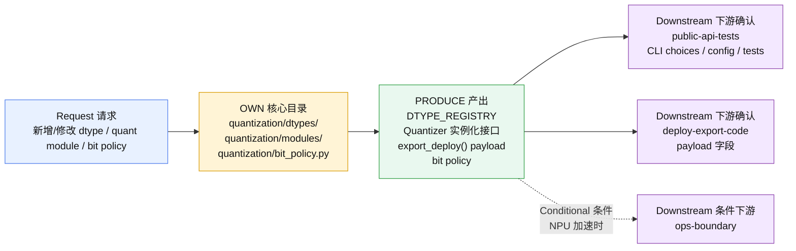

---

### 4.2 llm-algorithm

| 维度 Dimension | 内容 Content |
|---|---|
| **OWN** | `algorithms/quant/`、`algorithms/registry_factory.py` |
| **NEED** | dtype 的 quantizer hook（通过 `quant_base.py` 的 `build_algorithms_by_target()` 连接） |
| **PRODUCE** | `ALGO_REGISTRY` 条目、`trainable_params()`、`export_ptq_params()` / `load_ptq_params()`、`export_deploy()` |
| **RIPPLE** | 新增算法必然波及：`ptq-solver-params`（solver 消费 trainable_params）、`deploy-export-code`（若算法有 deploy hook）、`public-api-tests`（CLI `--algos` choices） |

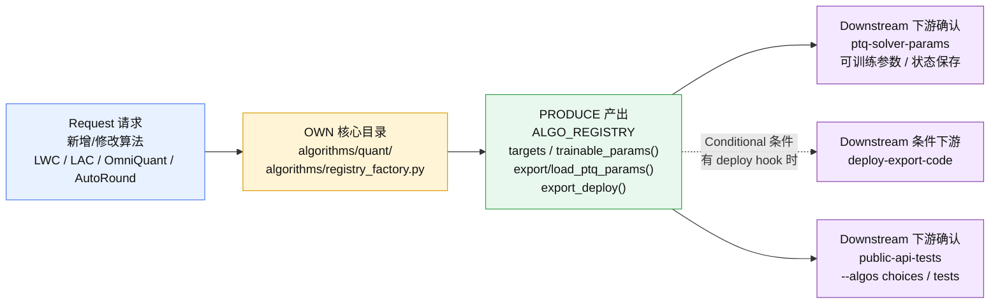

---

### 4.3 llm-model-unit（模型层契约）

| 维度 Dimension | 内容 Content |
|---|---|
| **OWN** | 无——模型层实现归 `model-adapter`。本子能力只做：契约对齐检查、review、局部 bug 修复。 |
| **NEED** | adapter 的 `PtqUnit.kind`、`iter_ptq_units()`、hook 名、blockwise kwargs 命名 |
| **PRODUCE** | 契约检查结论（`PtqUnit.kind` vs extract 命名一致性、deploy binding 完整性） |
| **RIPPLE** | 模型层契约改变必然波及：`llm-data-workflow`（extract/PTQ 文件名和 kwargs 名）、`ptq-solver-params`（unit save_name）、`deploy-export-code`（bindings） |

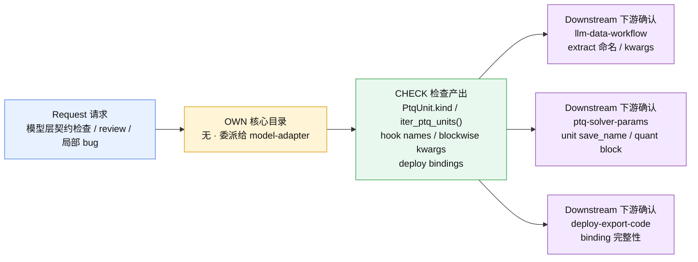

---

### 4.4 llm-data-workflow（数据与编排）

| 维度 Dimension | 内容 Content |
|---|---|
| **OWN** | `workflows/llm_eval.py`、`workflows/llm_extract_ptq_data.py`、`workflows/llm_ptq.py`（编排部分）、`common/datasets/`、`common/evaluate/` |
| **NEED** | adapter 的 `PtqUnit.kind`（文件名对齐）、`do_embedding_forward()` / `do_block_forward()` hook 名、blockwise kwargs 命名、quant block 构建 |
| **PRODUCE** | PTQ 输入文件、GT、PPL 结果、solver 的 input/GT provider、eval 口径 |
| **RIPPLE** | 改 workflow 编排一般不波及其它子能力；改数据格式必然波及 `ptq-solver-params`（provider 接口） |

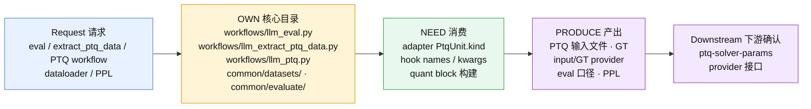

---

### 4.5 ptq-solver-params（参数优化与保存）

| 维度 Dimension | 内容 Content |
|---|---|
| **OWN** | `common/optimization/`（solver、factory）、`common/models/llm/common/ptq_params.py` |
| **NEED** | adapter 的 `build_quant_block()`、`iter_ptq_units()`；algorithm 的 `trainable_params()`；data workflow 的 provider（load_unit_inputs、materialize_gt） |
| **PRODUCE** | PTQ 参数文件 `layer_<idx>_<unit.save_name>.pt`、参数 store/handler 接口 |
| **RIPPLE** | 改 solver 策略一般不波及；改参数保存命名必然波及 `deploy-export-code`（加载路径） |

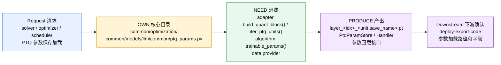

---

### 4.6 deploy-export-code（产物导出）

| 维度 Dimension | 内容 Content |
|---|---|
| **OWN** | `workflows/llm_deploy.py`（编排）、`common/models/llm/common/deploy_export.py` |
| **NEED** | dtype 的 `export_deploy()` 返回字段、algorithm 的 export_deploy hook、adapter 的 deploy binding（`iter_deploy_bindings()`、ignore layers）、PTQ 参数 store |
| **PRODUCE** | safetensors 文件、`model.safetensors.index.json`、`config.json`（quantization_config） |
| **RIPPLE** | 新增 dtype 必然波及 deploy（新 payload 字段）；新增算法 deploy hook 必然波及；改 adapter binding 必然波及。deploy 是**最下游汇合点**，本身不改时也被动接收上游所有变化。 |

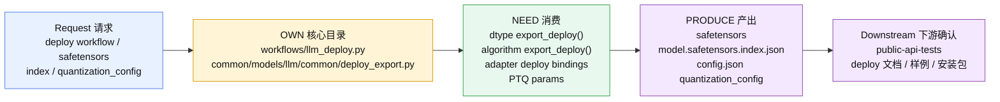

---

### 4.7 classic-graph（独立体系）
跟 LLM 主链完全没关系的两套逻辑：
- classic-graph：走的是 amct_pytorch.quantize() 这种老 API，用来做 eager 模式量化、图压缩、QAT 微调。不依赖模型注册、block-wise forward、safetensors 导出那套 LLM 流程。
- ops-boundary：管的是 amct_ops/ 目录下的 NPU 自定义算子——哪些算子需要 C++ 加速、Python fallback 怎么写、package_data 怎么配。
之所以叫"独立体系"，因为 classic/ 里没有任何 from amct_pytorch.workflows 或 from amct_pytorch.common.models.llm 这样的 import——两套代码互相看不见。

| 维度 Dimension | 内容 Content |
|---|---|
| **OWN** | `classic/`、`algorithms/__init__.py`（AlgorithmRegistry）、`common/config/`（classic 侧） |
| **NEED** | 无（独立代码体系，不依赖 AMCT LLM CLI 任何模块） |
| **PRODUCE** | classic public API（`quantize()`、`convert()`、`algorithm_register()`） |
| **RIPPLE** | 与 AMCT LLM CLI 的依赖链**零耦合**，只共享顶层 `__init__.py` 的包导出空间。 |

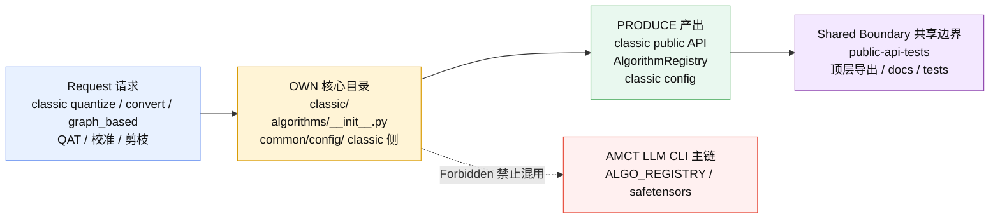

---

### 4.8 ops-boundary（NPU 算子边界）

| 维度 Dimension | 内容 Content |
|---|---|
| **OWN** | 本子能力只处理 `amct_pytorch` 侧调用边界。kernel 实现归 `amct-ops-dev`。 |
| **NEED** | dtype / algorithm 是否需要 NPU 加速 |
| **PRODUCE** | Python fallback 策略、`torch.ops.amct.*` 调用契约、软依赖声明 |
| **RIPPLE** | 新增 ops 必然波及 `public-api-tests`（package_data、build 脚本）；改 ops schema 必然波及 `dtype-quant-module`（若 dtype 消费该 ops） |

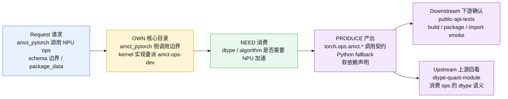

---

### 4.9 public-api-tests（公共 API 与测试）

1. 用户能 import 什么 — __init__.py 里写 __all__，决定 import amct_pytorch 后你能调用什么
2. pip 怎么装 — setup.py / build.sh，决定哪个文件进 wheel 包
3. 用户命令行能填什么选项 — cli/llm/args.py 里 choices=["mlp", "moe", "attn-linear", ...]，这些 choices 的值不是自己编的，是从 dtype/algorithm 子能力同步来的
它就是用户和代码之间的翻译层，自己不干活，只把其他子能力产出的东西包装成"用户能用的样子"。

| 维度 Dimension | 内容 Content |
|---|---|
| **OWN** | `__init__.py`、`setup.py`、`build.sh`、`pyproject.toml`、`tests/`（选择策略）、docs/examples（同步规则） |
| **NEED** | 所有子能力的「用户可见」输出：CLI choices、dtype 名、算法名、granularity、config yaml |
| **PRODUCE** | 公共 API 契约、pip install 路径、测试选择指南、文档样例基线 |
| **RIPPLE** | 被所有子能力波及，但本子能力的改动**不主动波及**其它子能力——它是纯下游消费者。 |

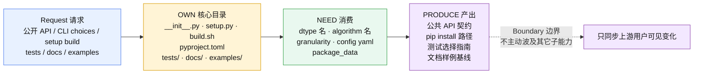

---

## 五、细粒度隔离方阵

矩阵单元含义：
- **`P` (Producer)**：本子能力生产了该代码目录的内容（有写入权）
- **`C` (Consumer)**：本子能力消费了该代码目录的内容（只读，需要读取或调用）
- **`-`**：无直接关系

### AMCT LLM CLI 子能力

| 代码目录 / 层 | 归属模块 | dtype-quant-module | llm-algorithm | llm-model-unit | llm-data-workflow | ptq-solver-params | deploy-export-code |
|---|---|---|---|---|---|---|---|
| `cli/llm/` | 入口层 | C (choices) | C (algos) | - | - | C (granularity) | - |
| `workflows/llm_eval.py`, `llm_extract_ptq_data.py`, `llm_ptq.py` | 编排层 | - | - | - | **P** | C (save/load) | - |
| `workflows/llm_deploy.py` | 产物层 | - | - | - | - | C (PTQ params) | **P** |
| `common/models/llm/...` | 量化核心 | C (quant config) | - | **P** (contract) | C (hook names) | C (quant block) | C (bindings) |
| `common/models/llm/common/` | 量化核心 | C (deploy_export) | - | **P** (contract) | C (base model) | **P** (ptq_params) | **P** (deploy_export) |
| `quantization/dtypes/` | 量化核心 | **P** | - | - | - | - | C (export_deploy) |
| `quantization/modules/` | 量化核心 | **P** | C (algo hooks) | - | - | C (quant block) | C (export) |
| `algorithms/quant/` | 量化核心 | - | **P** | - | - | C (trainable_params) | C (export_deploy) |
| `common/datasets/` | 编排层 | - | - | - | **P** | C (provider) | - |
| `common/evaluate/` | 编排层 | - | - | - | **P** | - | - |
| `common/optimization/` | 量化核心 | - | - | - | - | **P** | C (PTQ params) |
| `__init__.py`, `setup.py` | 入口层 | C (choices) | C (algos) | - | - | - | - |

### 独立子能力

| 代码目录 | 归属 | classic-graph | ops-boundary |
|---|---|---|---|
| `classic/` | 独立体系 | **P** | - |
| `algorithms/__init__.py` | 独立体系 | **P** (AlgorithmRegistry) | - |
| `common/config/` | 独立体系 | **P** (classic 侧) | - |
| `amct_ops/` | 独立体系 | - | **P** (boundary check) |
| `quantization/dtypes/` | 量化核心 | - | C (NPU need) |

### public-api-tests 的消费关系

| 代码目录 | 关系 |
|---|---|
| `__init__.py` | **P** |
| `setup.py` / `build.sh` | **P** |
| `cli/llm/` | C（同步 choices） |
| `quantization/dtypes/` | C（同步 dtype choices） |
| `algorithms/quant/` | C（同步 algo choices） |
| `common/optimization/` | C（同步 granularity choices） |

---

## 六、细粒度契约接口图

以下用 ASCII 图表示 AMCT LLM CLI 的数据流和契约接口。**方框 = 子能力拥有的核心目录，箭头 = 数据/契约流向，虚线上标注接口名。**

```
                          ┌──────────────────────────────────────────────┐
                          │          入口层 · public-api-tests            │
                          │  OWN: __init__, setup, build.sh, tests/,    │
                          │       docs/examples 同步规则                 │
                          │  ←── 消费所有子能力的用户可见输出            │
                          └──────────────────────────────────────────────┘
                                               ▲
                                               │ (CLI choices, build config, test entry)
                                               │
┌─────────────────┐     --algos/quant_dtype/   ┌──────────────────────┐
│  入口层          │ ──── granularity/args ──►  │  编排层               │
│  cli/llm/       │                             │  workflows/          │
│  OWN: public-   │                             │  OWN: llm-data-     │
│       api-tests │                             │       workflow       │
│  (args parsing) │                             │  (编排入口)           │
└─────────────────┘                             └──────┬───────────────┘
                                                        │
                          ┌──────────────────────────────┤
                          │                              │
                          ▼                              ▼
           ┌────────────────────────┐        ┌──────────────────────────┐
           │ 量化核心                │        │ 中介 · 编排层(数据)      │
           │ common/models/llm/     │        │ common/datasets/         │
           │ (adapter)              │        │ common/evaluate/         │
           │                        │        │ OWN: llm-data-workflow   │
           │ PRODUCE:               │        │                          │
           │  • PtqUnit.kind ───────┼────►   │ NEED: PtqUnit.kind      │
           │  • hook names ────────┼────►   │       → 文件名对齐       │
           │  • blockwise kwargs ──┼────►   │       → 输入/GT 生成     │
           │  • quant_block ───────┼────►   │       → eval 口径        │
           │  • deploy bindings ───┼────►   │                          │
           └────────────────────────┘        └──────────┬───────────────┘
                     │         │                         │
                     │         │                         │ (load_unit_inputs,
                     │         │                         │  materialize_gt)
                     ▼         ▼                         ▼
           ┌──────────────────┐   ┌──────────────────────────────┐
           │ 量化核心           │   │ 量化核心                      │
           │ quantization/     │   │ common/optimization/         │
           │ dtypes/ + modules │   │ OWN: ptq-solver-params       │
           │ OWN: dtype-       │   │                              │
           │      quant-module │   │ NEED:                        │
           │                   │   │  • build_quant_block()       │
           │ PRODUCE:          │   │  • iter_ptq_units()          │
           │  • export_deploy  │   │  • load_unit_inputs/GT       │
           │    ──────────────┼───┼─►• trainable_params()        │
           │  • quantizer cls  │   │                              │
           │  • DTYPE_REGISTRY │   │ PRODUCE:                     │
           └──────────────────┘   │  • layer_<idx>_<name>.pt    │
                     ▲            │  • PtqParamHandler/Store     │
                     │            └──────────────┬───────────────┘
           ┌────────┴────────┐                   │ (PTQ params)
           │ 量化核心          │                   │
           │ algorithms/     │                   ▼
           │ quant/          │   ┌──────────────────────────────┐
           │ OWN: llm-       │   │ 产物层                        │
           │      algorithm  │   │ workflows/llm_deploy.py      │
           │                 │   │ common/models/llm/common/   │
           │ PRODUCE:        │   │   deploy_export.py           │
           │  • trainable_   │   │ OWN: deploy-export-code      │
           │    params() ────┼───┼─►                            │
           │  • export_ptq_  │   │ NEED:                        │
           │    params()     │   │  • export_deploy() ── from dtypes│
           │  • export_deploy│   │  • deploy bindings ── from adapter│
           │    ─────────────┼───┼─►• export_deploy() ── from algo  │
           │  • ALGO_REGISTRY│   │  • PTQ params ───────── from solver│
           └─────────────────┘   └──────────────────────────────┘
```

### 独立体系（与 AMCT LLM CLI 不共享数据流）

```
┌──────────────────────┐    ┌──────────────────────┐
│  独立体系              │    │  独立体系              │
│  classic/             │    │  amct_ops/            │
│  OWN: classic-graph   │    │  OWN: ops-boundary    │
│  (eager + graph_based │    │  (boundary check)     │
│   + QAT + ...)        │    │  NEED: NPU need from  │
│                       │    │    dtype/algorithm     │
│  不依赖 LLM 注册链    │    │  PRODUCE: torch.ops.  │
│  不共享 safetensors   │    │    amct.* schema      │
│  只共享 __init__.py   │    │                       │
│  顶层导出空间         │    │  kernel impl →        │
│                       │    │    amct-ops-dev       │
└──────────────────────┘    └──────────────────────┘
```

---

## 七、子能力隔离原则（建议）

### 原则 1：每个子能力只 OWN 自己的核心目录

改动者只应在一个子能力的核心目录中做「自由修改」——不需要通知任何人。

```
入口层 Entry:
  public-api-tests    →  __init__.py, setup.py, build.sh, tests/（选择策略）

编排层 Orchestration:
  llm-data-workflow   →  workflows/llm_eval.py, workflows/llm_extract_ptq_data.py,
                          workflows/llm_ptq.py（编排逻辑）, common/datasets/, common/evaluate/

量化核心层 Quant Core:
  dtype-quant-module  →  quantization/dtypes/, quantization/modules/, quantization/bit_policy.py
  llm-algorithm       →  algorithms/quant/, algorithms/registry_factory.py
  llm-model-unit      →  无核心目录（委派给 model-adapter）
  ptq-solver-params   →  common/optimization/, common/models/llm/common/ptq_params.py

产物层 Product:
  deploy-export-code  →  workflows/llm_deploy.py, common/models/llm/common/deploy_export.py

独立体系 Independent:
  classic-graph       →  classic/, common/config/（classic 侧）
  ops-boundary        →  无核心目录（只做边界检查）
```

### 原则 2：消费必须通过显式接口名

当子能力 A 需要改动子能力 B 的生产物时，必须在 A 的 playbook「上下游依赖」一节写明：

> **改这个目录时，要通知 xxx 子能力确认 xxx 接口没变。**

而不是仅在「必读文件」里列上下游文件。文件列表是一个 flat 清单，不表达「如果你是改这个位置，你需要去确认 xxx」。

### 原则 3：RIPPLE 方向决定补读顺序

子能力有四种 RIPPLE 模式：

| RIPPLE 模式 | 含义 | 补读策略 |
|---|---|---|
| **纯上游**（dtype, algorithm） | 改自己的核心目录不影响别人，但别人改了会影响自己 | 只读自己的 playbook；被下游找上门再做契约对齐 |
| **纯下游**（public-api-tests） | 自己不改代码，但别人改了要自己同步 | 需要在「上下游」中写明监控哪些上游信号 |
| **汇合点**（deploy-export-code） | 自己被多个上游消费，上游任一改动自己都要同步 | 每个上游 playbook 都要标注「deploy」为必经下游 |
| **管道中段**（data-workflow, solver） | 既消费上游又生产给下游 | 补读上游的「PRODUCE」节 + 下游的「NEED」节 |

### 原则 4：跨子能力改动分两步

用户请求同时命中子能力 A（核心改动）和子能力 B（连锁改动）时：

1. 先完成子能力 A 的核心改动（改 A 的 OWN 目录）。
2. 再执行子能力 B 的连锁改动（改 B 的 OWN 目录——因为这就是 B 的正常工作）。

不要在一次改动中同时修改 A 的 OWN 目录和 B 的 OWN 目录——即使它们在同一层目录相邻（如 `workflows/` 属于数据流、`common/optimization/` 属于 solver）。**因为相邻文件并不意味它们属于同一个子能力**，跨 OWN 的修改应该分步进行，并在最终回复说明**各步分别命中了哪个子能力**。

---

## 八、当前文档的隔离缺口

以下条目是当前 reference playbook 中写得不够隔离的地方，此处仅审查部分，后续对于子能力开发，需要持续更新更改，按优先级排列：

1. `dtype-quant-module` 需要把"新增 dtype → public-api-tests + deploy-export-code + 条件 ops-boundary"写成显式下游，而不是只列文件。
2. `llm-algorithm` 需要把 `targets`、`trainable_params()`、`export_ptq_params()`、`export_deploy()` 分别标成 solver / deploy / public API 的消费接口。
3. `llm-model-unit` 需要继续强调 OWN 为空：结构实现转 `model-adapter`，这里只做契约检查和 review。
4. `llm-data-workflow` 需要拆开 `llm_eval.py`、`llm_extract_ptq_data.py`、`llm_ptq.py`，避免把 `llm_deploy.py` 误归到数据流。
5. `ptq-solver-params` 需要把参数文件命名和 store/handler 接口标成对 deploy 的稳定契约。
6. `deploy-export-code` 需要写成汇合点：dtype payload、algorithm deploy hook、adapter binding、PTQ params 任一变化都会在这里收口。
7. `classic-graph` 与 AMCT LLM CLI 应继续保持零数据流耦合，只共享顶层导出和包空间。
8. `ops-boundary` 需要明确只处理 `amct_pytorch` 侧调用边界，kernel/C++/Meta 实现委派 `amct-ops-dev`。
9. `public-api-tests` 需要写成纯下游消费者：同步 choices、公开 API、安装包、测试和 docs/examples，不主动改变上游语义。
