# amct-coder 子能力隔离与模块关系分析

> 本文档用于把 `amct-coder` 的模块关系整理成“上粗下细”的阅读路径。
> 先看 LLM 量化主链的大模块关系，再按实际改动点下钻到 9 个子能力的 OWN/NEED/PRODUCE/RIPPLE。

---

## 一、粗粒度主链

AMCT LLM new-path 先看用户真正会执行的四类流程：`eval`、`extract_ptq_data`、`ptq`、`deploy`。粗粒度主链只回答“一个任务从入口到产物会经过哪些大模块”，不替代后面的细粒度 OWN/NEED/PRODUCE/RIPPLE。

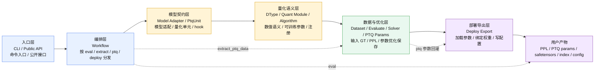

压成四个大模块：

| 大模块 | 主要职责 | 典型目录 / 文件 | 不该做什么 |
| --- | --- | --- | --- |
| 入口层：CLI / Public API | 解析命令和参数，选择 `eval` / `extract_ptq_data` / `ptq` / `deploy` 流程 | `amct_pytorch/cli/llm/`、顶层 `__init__.py`、docs/examples | 不写模型结构逻辑，不写算法细节 |
| 编排层：Workflow | 串起 `eval` / `extract_ptq_data` / `ptq` / `deploy` 四类流程，决定何时加载模型、数据、量化模块、PTQ 参数和导出逻辑 | `amct_pytorch/workflows/llm_*.py` | 不硬编码具体模型 attention/MLP/MoE 结构 |
| 量化核心层：模型契约 + dtype/module + algorithm + solver | 表达“模型哪里可量化”“怎么 fake/real quant”“哪些参数可训练”“如何优化和保存参数” | `common/models/llm/`、`quantization/`、`algorithms/quant/`、`common/optimization/` | 通用量化模块和 solver 不写模型名分支 |
| 产物层：Eval 结果 / PTQ 数据 / PTQ 参数 / Deploy artifacts | 保存 eval 指标、extract 输入和 GT、PTQ 参数，导出 safetensors 和 `quantization_config` | `common/evaluate/`、`common/datasets/`、`common/models/llm/common/ptq_params.py`、`workflows/llm_deploy.py`、`deploy_export.py` | 不重新定义 dtype / algorithm / adapter 语义 |

这里的“反量化”不是一个独立大模块。它通常是 fake quant / quant-dequant 数值语义的一部分，归到 `quantization/dtypes/` 和 `quantization/modules/` 内部。

---

## 二、四步任务流

量化、PTQ、优化参数和导出的任务流可以先按四步理解：

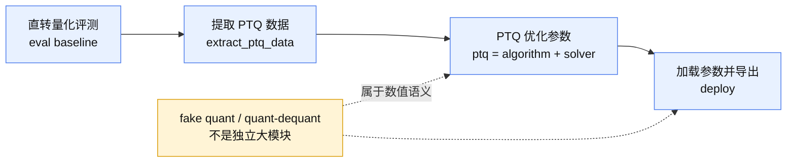

阅读顺序建议：

1. 先用粗粒度主链判断请求落在入口层、编排层、量化核心层还是产物层。
2. 再根据任务流判断它是在 eval、extract_ptq_data、ptq 还是 deploy 阶段。
3. 最后下钻到后半部分的 9 个子能力，确认 OWN/NEED/PRODUCE/RIPPLE。

---

## 三、为什么需要细粒度建模

当前子能力按「领域职责」切分——dtype 定义数值语义、adapter 定义结构、solver 定义优化——这在概念上是合理的。但在实际编码中，一个子能力的「隐含消费链」覆盖了多个代码层：

```
例：dtype-quant-module
  ┌─ 核心层：quantization/dtypes/ ← 真正的数值语义
  ├─ 向上游：cli/llm/args.py      ← CLI choices（公共 API 侧）
  ├─ 向旁路：common/models/llm/common/deploy_export.py ← deploy payload（deploy 侧）
  ├─ 向下游：workflows/llm_deploy.py ← 消费 export_deploy() 字段
  └─ 向测试：tests/unit_test/quantization/...
```

结果：**同一个子能力的改动者需要同时知道 dtype、CLI、deploy、test 四个知识域**，每个都要读不同的 playbook。这不是知识不够用的问题，而是「跨模块消费关系没有被显式建模」——改 dtype 的人不知道他还要改 CLI 和 deploy，等到 review 才发现反工。

---

## 四、细粒度映射诊断（9 个子能力 × 4 维度）

每个子能力先给一张“请求入口 → OWN/NEED → PRODUCE → 下游确认”的下钻图，再给对应表格。图中颜色沿用粗粒度主链：蓝色表示请求入口，黄色表示本子能力 OWN/CHECK，绿色表示 NEED/中间输入，紫色表示 PRODUCE 或下游确认。

### 诊断维度

| 维度 | 含义 |
| --- | --- |
| **核心目录（OWN）** | 这个子能力唯一拥有写入权的位置。改这里不需要通知其它子能力。 |
| **消费接口（NEED）** | 这个子能力从其它子能力那里读取/调用的内容。如果上游变了，这里要同步。 |
| **生产接口（PRODUCE）** | 这个子能力提供给其它子能力的内容。如果这里变了，下游要同步。 |
| **跨层影响（RIPPLE）** | 本子能力的改动必然波及哪些其它子能力——这些是**必要耦合**，不能消除，只能显式化。 |

### dtype-quant-module

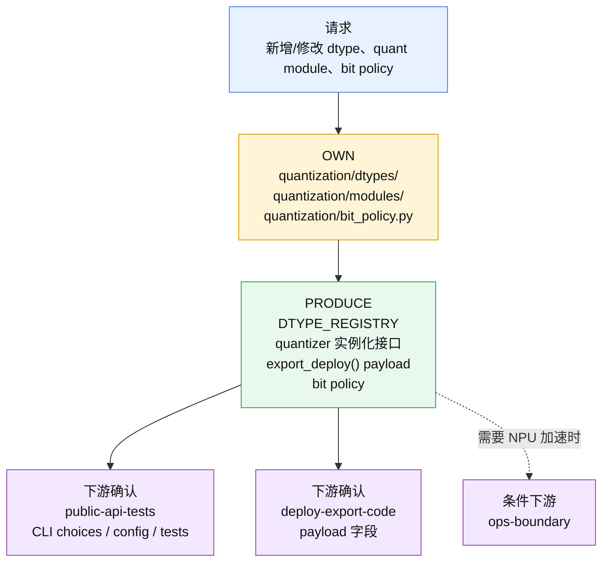

| 维度 | 内容 |
| --- | --- |
| **OWN** | `quantization/dtypes/`、`quantization/modules/`、`quantization/bit_policy.py` |
| **NEED** | 无（本层定义数值语义，不依赖其它子能力） |
| **PRODUCE** | `DTYPE_REGISTRY` 条目、`export_deploy()` 返回字段（dtype payload）、`ActivationQuantizer`/`WeightQuantizer` 实例化接口、CLI `--quant_dtype` choices、bit policy 规则 |
| **RIPPLE** | 「新增 dtype」必然波及：`public-api-tests`（CLI choices + config yaml）、`deploy-export-code`（deploy payload 字段）、`ops-boundary`（若需 NPU 加速） |

### llm-algorithm

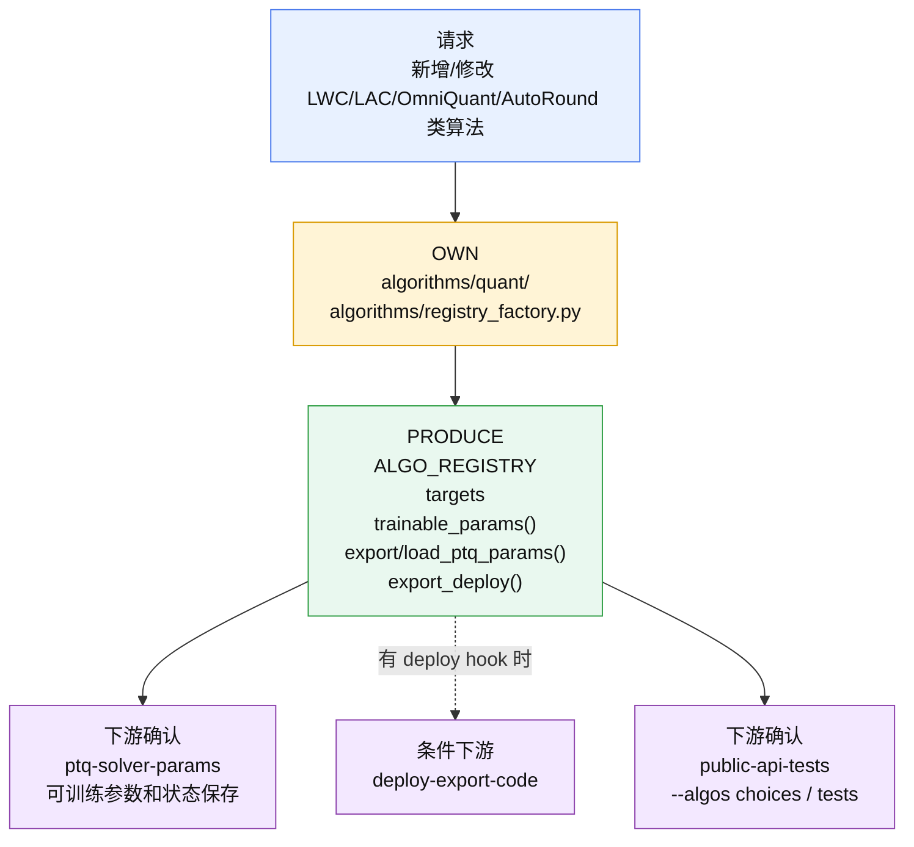

| 维度 | 内容 |
| --- | --- |
| **OWN** | `algorithms/quant/`、`algorithms/registry_factory.py` |
| **NEED** | dtype 的 quantizer hook（通过 `quant_base.py` 的 `build_algorithms_by_target()` 连接） |
| **PRODUCE** | `ALGO_REGISTRY` 条目、`trainable_params()`、`export_ptq_params()`/`load_ptq_params()`、`export_deploy()` |
| **RIPPLE** | 「新增算法」必然波及：`ptq-solver-params`（solver 要消费 trainable_params）、`deploy-export-code`（若算法有 deploy hook）、`public-api-tests`（CLI `--algos` choices） |

### llm-model-unit (模型层契约)

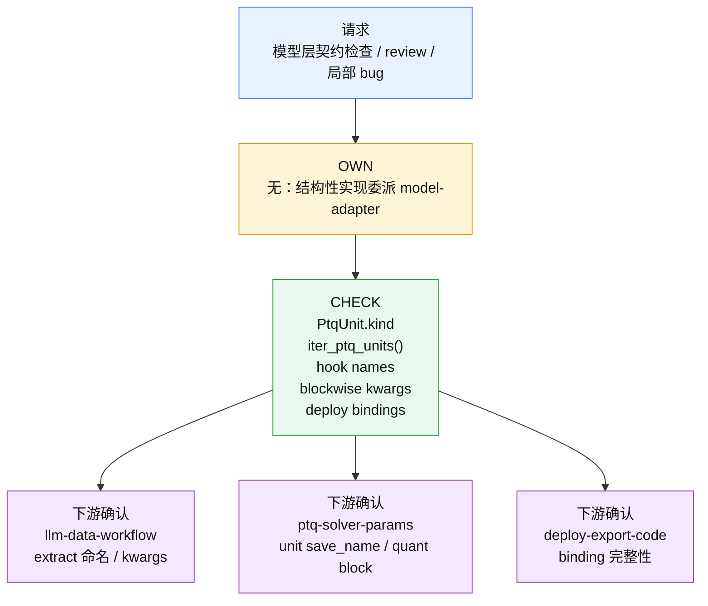

| 维度 | 内容 |
| --- | --- |
| **OWN** | 无——模型层实现归 `model-adapter`。本子能力只做：契约对齐检查、review、局部 bug 修复。 |
| **NEED** | adapter 的 `PtqUnit.kind`、`iter_ptq_units()`、hook 名、blockwise kwargs 命名 |
| **PRODUCE** | 契约检查结论（`PtqUnit.kind` vs extract 命名一致性、deploy binding 完整性） |
| **RIPPLE** | 模型层契约改变必然波及：`llm-data-workflow`（extract/PTQ 的文件名和 kwargs 名）、`ptq-solver-params`（unit save_name）、`deploy-export-code`（bindings） |

### llm-data-workflow

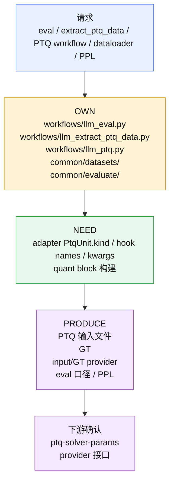

| 维度 | 内容 |
| --- | --- |
| **OWN** | `workflows/llm_eval.py`、`workflows/llm_extract_ptq_data.py`、`workflows/llm_ptq.py`（编排部分）、`common/datasets/`、`common/evaluate/` |
| **NEED** | adapter 的 `PtqUnit.kind`（文件名对齐）、`do_embedding_forward()`/`do_block_forward()` hook 名、blockwise kwargs 命名、quant block 构建 |
| **PRODUCE** | PTQ 输入文件、GT、PPL 结果、solver 的 input/GT provider、eval 口径 |
| **RIPPLE** | 「改 workflow 编排」一般不波及其它子能力；「改数据格式」必然波及 `ptq-solver-params`（provider 接口） |

### ptq-solver-params

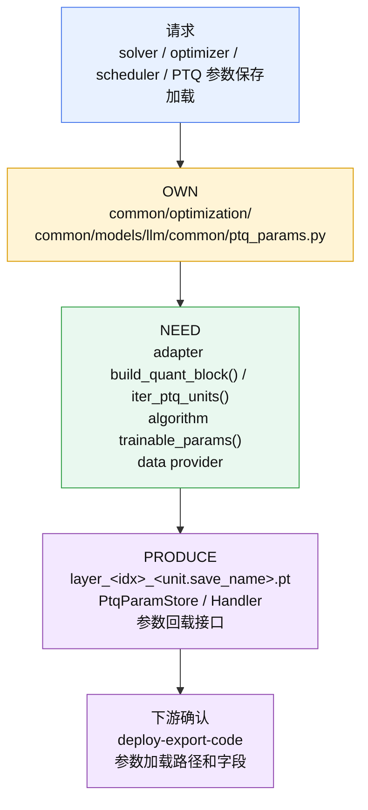

| 维度 | 内容 |
| --- | --- |
| **OWN** | `common/optimization/`（solver、factory）、`common/models/llm/common/ptq_params.py` |
| **NEED** | adapter 的 `build_quant_block()`、`iter_ptq_units()`；algorithm 的 `trainable_params()`；data workflow 的 provider（load_unit_inputs、materialize_gt） |
| **PRODUCE** | PTQ 参数文件 `layer_<idx>_<unit.save_name>.pt`、参数 store/handler 接口 |
| **RIPPLE** | 「改 solver 策略」一般不波及；「改参数保存命名」必然波及 `deploy-export-code`（加载路径） |

### deploy-export-code

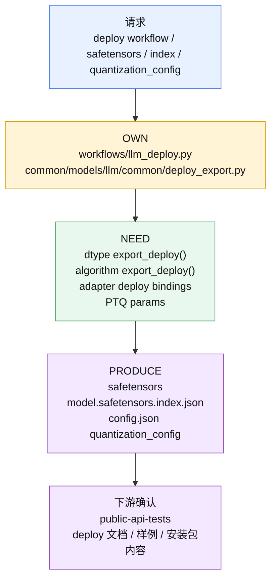

| 维度 | 内容 |
| --- | --- |
| **OWN** | `workflows/llm_deploy.py`（编排）、`common/models/llm/common/deploy_export.py` |
| **NEED** | dtype 的 `export_deploy()` 返回字段、algorithm 的 export_deploy hook、adapter 的 deploy binding（`iter_deploy_bindings()`、ignore layers）、PTQ 参数 store |
| **PRODUCE** | safetensors 文件、`model.safetensors.index.json`、`config.json`（quantization_config） |
| **RIPPLE** | 「新增 dtype」必然波及 deploy（新 payload 字段）；「新增算法 deploy hook」必然波及 deploy；「改 adapter binding」必然波及 deploy。deploy 是**最下游汇合点**，本身不改的时候也被动接收上游所有变化。 |

### classic-graph

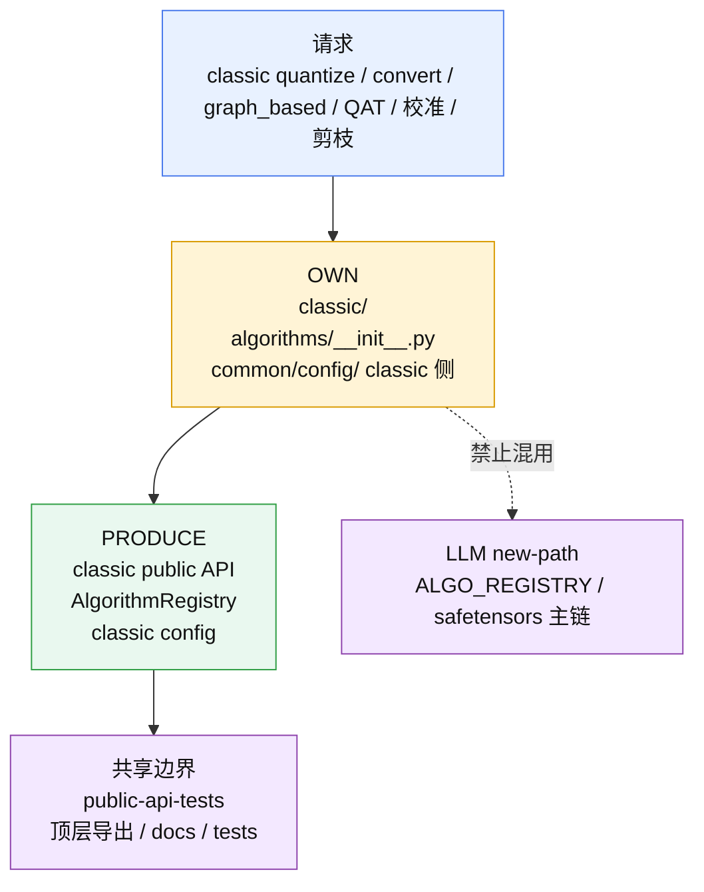

| 维度 | 内容 |
| --- | --- |
| **OWN** | `classic/`、`algorithms/__init__.py`（AlgorithmRegistry）、`common/config/`（classic 侧） |
| **NEED** | 无（独立代码体系，不依赖 LLM new-path 任何模块） |
| **PRODUCE** | classic public API（`quantize()`、`convert()`、`algorithm_register()`） |
| **RIPPLE** | 与 LLM new-path 的依赖链**零耦合**，只共享顶层 `__init__.py` 的包导出空间。 |

### ops-boundary

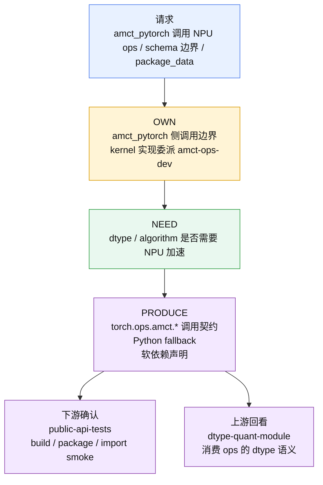

| 维度 | 内容 |
| --- | --- |
| **OWN** | 本子能力只处理 `amct_pytorch` 侧调用边界。kernel 实现归 `amct-ops-dev`。 |
| **NEED** | dtype/algorithm 是否需要 NPU 加速 |
| **PRODUCE** | Python fallback 策略、`torch.ops.amct.*` 调用契约、软依赖声明 |
| **RIPPLE** | 「新增 ops」必然波及 `public-api-tests`（package_data、build 脚本）；「改 ops schema」必然波及 `dtype-quant-module`（若 dtype 消费该 ops） |

### public-api-tests

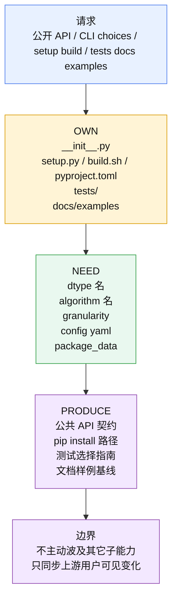

| 维度 | 内容 |
| --- | --- |
| **OWN** | `__init__.py`、`setup.py`、`build.sh`、`pyproject.toml`、`tests/`（选择策略）、docs/examples（同步规则） |
| **NEED** | 所有子能力的「用户可见」输出：CLI choices、dtype 名、算法名、granularity、config yaml |
| **PRODUCE** | 公共 API 契约、pip install 路径、测试选择指南、文档样例基线 |
| **RIPPLE** | 被所有子能力波及，但本子能力的改动**不主动波及**其它子能力——它是纯下游消费者。 |

---

## 五、细粒度隔离方阵

矩阵单元含义：
- **`P` (Producer)**：本子能力生产了该代码目录的内容（有写入权）
- **`C` (Consumer)**：本子能力消费了该代码目录的内容（只读，需要读取或调用）
- **`-`**：无直接关系

### LLM new-path 子能力

| 代码目录 / 层 | dtype-quant-module | llm-algorithm | llm-model-unit | llm-data-workflow | ptq-solver-params | deploy-export-code |
|---|---|---|---|---|---|---|
| `cli/llm/` | C (choices) | C (algos) | - | - | C (granularity) | - |
| `workflows/llm_eval.py`, `llm_extract_ptq_data.py`, `llm_ptq.py` | - | - | - | **P** | C (save/load) | - |
| `workflows/llm_deploy.py` | - | - | - | - | C (PTQ params) | **P** |
| `common/models/llm/...` | C (quant config) | - | **P** (contract) | C (hook names) | C (quant block) | C (bindings) |
| `common/models/llm/common/` | C (deploy_export) | - | **P** (contract) | C (base model) | **P** (ptq_params) | **P** (deploy_export) |
| `quantization/dtypes/` | **P** | - | - | - | - | C (export_deploy) |
| `quantization/modules/` | **P** | C (algo hooks) | - | - | C (quant block) | C (export) |
| `algorithms/quant/` | - | **P** | - | - | C (trainable_params) | C (export_deploy) |
| `common/datasets/` | - | - | - | **P** | C (provider) | - |
| `common/evaluate/` | - | - | - | **P** | - | - |
| `common/optimization/` | - | - | - | - | **P** | C (PTQ params) |
| `__init__.py`, `setup.py` | C (choices) | C (algos) | - | - | - | - |

### 独立子能力

| 代码目录 | classic-graph | ops-boundary |
|---|---|---|
| `classic/` | **P** | - |
| `algorithms/__init__.py` | **P** (AlgorithmRegistry) | - |
| `common/config/` | **P** (classic 侧) | - |
| `amct_ops/` | - | **P** (boundary check) |
| `quantization/dtypes/` | - | C (NPU need) |

### public-api-tests 的消费关系

| 代码目录 | 关系 |
|---|---|
| `__init__.py` | **P** |
| `setup.py` / `build.sh` | **P** |
| `cli/llm/` | C（同步 choices） |
| `quantization/dtypes/` | C（同步 dtype choices） |
| `algorithms/quant/` | C（同步 algo choices） |
| `common/optimization/` | C（同步 granularity choices） |

---

## 六、细粒度契约接口图

以下用 ASCII 图表示 LLM new-path 的数据流和契约接口。**方框 = 子能力拥有的核心目录，箭头 = 数据/契约流向，虚线上标注接口名。**

```
                          ┌──────────────────────────────────────────────┐
                          │              public-api-tests                │
                          │  OWN: __init__, setup, build.sh, tests/,    │
                          │       docs/examples 同步规则                 │
                          │  ←── 消费所有子能力的用户可见输出            │
                          └──────────────────────────────────────────────┘
                                              ▲
                                              │ (CLI choices, build config, test entry)
                                              │
┌─────────────────┐     --algos/quant_dtype/   ┌──────────────────────┐
│  cli/llm/       │ ──── granularity/args ──►  │  workflows/          │
│  OWN: public-   │                             │  OWN: llm-data-     │
│       api-tests │                             │       workflow       │
│  (args parsing) │                             │  (编排入口)           │
└─────────────────┘                             └──────┬───────────────┘
                                                       │
                         ┌──────────────────────────────┤
                         │                              │
                         ▼                              ▼
          ┌────────────────────────┐        ┌──────────────────────────┐
          │ common/models/llm/     │        │ common/datasets/         │
          │ (adapter)              │        │ common/evaluate/         │
          │                        │        │ OWN: llm-data-workflow   │
          │ PRODUCE:               │        │                          │
          │  • PtqUnit.kind ───────┼────►   │ NEED: PtqUnit.kind      │
          │  • hook names ────────┼────►   │       → 文件名对齐       │
          │  • blockwise kwargs ──┼────►   │       → 输入/GT 生成     │
          │  • quant_block ───────┼────►   │       → eval 口径        │
          │  • deploy bindings ───┼────►   │                          │
          └────────────────────────┘        └──────────┬───────────────┘
                    │         │                         │
                    │         │                         │ (load_unit_inputs,
                    │         │                         │  materialize_gt)
                    ▼         ▼                         ▼
          ┌──────────────────┐   ┌──────────────────────────────┐
          │ quantization/    │   │ common/optimization/         │
          │ dtypes/ + modules│   │ OWN: ptq-solver-params       │
          │ OWN: dtype-      │   │                              │
          │      quant-module│   │ NEED:                        │
          │                  │   │  • build_quant_block()       │
          │ PRODUCE:         │   │  • iter_ptq_units()          │
          │  • export_deploy │   │  • load_unit_inputs/GT       │
          │    ──────────────┼───┼─►• trainable_params()        │
          │  • quantizer cls │   │                              │
          │  • DTYPE_REGISTRY│   │ PRODUCE:                     │
          └──────────────────┘   │  • layer_<idx>_<name>.pt    │
                    ▲            │  • PtqParamHandler/Store     │
                    │            └──────────────┬───────────────┘
          ┌────────┴────────┐                   │ (PTQ params)
          │ algorithms/     │                   │
          │ quant/          │                   ▼
          │ OWN: llm-       │   ┌──────────────────────────────┐
          │      algorithm  │   │ workflows/llm_deploy.py      │
          │                 │   │ common/models/llm/common/   │
          │ PRODUCE:        │   │   deploy_export.py           │
          │  • trainable_   │   │ OWN: deploy-export-code      │
          │    params() ────┼───┼─►                            │
          │  • export_ptq_  │   │ NEED:                        │
          │    params()     │   │  • export_deploy() ── from dtypes│
          │  • export_deploy│   │  • deploy bindings ── from adapter│
          │    ─────────────┼───┼─►• export_deploy() ── from algo  │
          │  • ALGO_REGISTRY│   │  • PTQ params ───────── from solver│
          └─────────────────┘   └──────────────────────────────┘
```

### 独立体系（与 LLM new-path 不共享数据流）

```
┌──────────────────────┐    ┌──────────────────────┐
│  classic/            │    │  amct_ops/            │
│  OWN: classic-graph  │    │  OWN: ops-boundary    │
│  (eager + graph_based│    │  (boundary check)     │
│   + QAT + ...)       │    │  NEED: NPU need from  │
│                      │    │    dtype/algorithm     │
│  不依赖 LLM 注册链   │    │  PRODUCE: torch.ops.  │
│  不共享 safetensors  │    │    amct.* schema      │
│  只共享 __init__.py  │    │                       │
│  顶层导出空间        │    │  kernel impl →        │
│                      │    │    amct-ops-dev       │
└──────────────────────┘    └──────────────────────┘
```

---

## 七、子能力隔离原则（建议）

### 原则 1：每个子能力只 OWN 自己的核心目录

改动者只应在一个子能力的核心目录中做「自由修改」——不需要通知任何人。

```
dtype-quant-module  →  quantization/dtypes/, quantization/modules/, quantization/bit_policy.py
llm-algorithm       →  algorithms/quant/, algorithms/registry_factory.py
llm-model-unit      →  无核心目录（委派给 model-adapter）
llm-data-workflow   →  workflows/llm_eval.py, workflows/llm_extract_ptq_data.py, workflows/llm_ptq.py（编排逻辑）, common/datasets/, common/evaluate/
ptq-solver-params   →  common/optimization/, common/models/llm/common/ptq_params.py
deploy-export-code  →  workflows/llm_deploy.py, common/models/llm/common/deploy_export.py
classic-graph       →  classic/, common/config/（classic 侧）
ops-boundary        →  无核心目录（只做边界检查）
public-api-tests    →  __init__.py, setup.py, build.sh, tests/（选择策略）
```

### 原则 2：消费必须通过显式接口名

当子能力 A 需要改动子能力 B 的生产物时，必须在 A 的 playbook「上下游依赖」一节写明：

> **改这个目录时，要通知 xxx 子能力确认 xxx 接口没变。**

而不是仅在「必读文件」里列上下游文件。文件列表是一个 flat 清单，不表达「如果你是改这个位置，你需要去确认 xxx」。

### 原则 3：RIPPLE 方向决定补读顺序

子能力有四种 RIPPLE 模式：

| RIPPLE 模式 | 含义 | 补读策略 |
|---|---|---|
| **纯上游**（dtype, algorithm） | 改自己的核心目录不影响别人，但别人改了会影响自己 | 只读自己的 playbook；被下游找上门再做契约对齐 |
| **纯下游**（public-api-tests） | 自己不改代码，但别人改了要自己同步 | 需要在「上下游」中写明监控哪些上游信号 |
| **汇合点**（deploy-export-code） | 自己被多个上游消费，上游任一改动自己都要同步 | 每个上游 playbook 都要标注「deploy」为必经下游 |
| **管道中段**（data-workflow, solver） | 既消费上游又生产给下游 | 补读上游的「PRODUCE」节 + 下游的「NEED」节 |

### 原则 4：跨子能力改动分两步

用户请求同时命中子能力 A（核心改动）和子能力 B（连锁改动）时：

1. 先完成子能力 A 的核心改动（改 A 的 OWN 目录）。
2. 再执行子能力 B 的连锁改动（改 B 的 OWN 目录——因为这就是 B 的正常工作）。

不要在一次改动中同时修改 A 的 OWN 目录和 B 的 OWN 目录——即使它们在同一层目录相邻（如 `workflows/` 属于数据流、`common/optimization/` 属于 solver）。**因为相邻文件并不意味它们属于同一个子能力**，跨 OWN 的修改应该分步进行，并在最终回复说明**各步分别命中了哪个子能力**。

---

## 八、当前文档的隔离缺口

以下条目是当前 reference playbook 中写得不够隔离的地方，按优先级排列：

1. `dtype-quant-module` 需要把 “新增 dtype → public-api-tests + deploy-export-code + 条件 ops-boundary” 写成显式下游，而不是只列文件。
2. `llm-algorithm` 需要把 `targets`、`trainable_params()`、`export_ptq_params()`、`export_deploy()` 分别标成 solver / deploy / public API 的消费接口。
3. `llm-model-unit` 需要继续强调 OWN 为空：结构实现转 `model-adapter`，这里只做契约检查和 review。
4. `llm-data-workflow` 需要拆开 `llm_eval.py`、`llm_extract_ptq_data.py`、`llm_ptq.py`，避免把 `llm_deploy.py` 误归到数据流。
5. `ptq-solver-params` 需要把参数文件命名和 store/handler 接口标成对 deploy 的稳定契约。
6. `deploy-export-code` 需要写成汇合点：dtype payload、algorithm deploy hook、adapter binding、PTQ params 任一变化都会在这里收口。
7. `classic-graph` 与 LLM new-path 应继续保持零数据流耦合，只共享顶层导出和包空间。
8. `ops-boundary` 需要明确只处理 `amct_pytorch` 侧调用边界，kernel/C++/Meta 实现委派 `amct-ops-dev`。
9. `public-api-tests` 需要写成纯下游消费者：同步 choices、公开 API、安装包、测试和 docs/examples，不主动改变上游语义。
