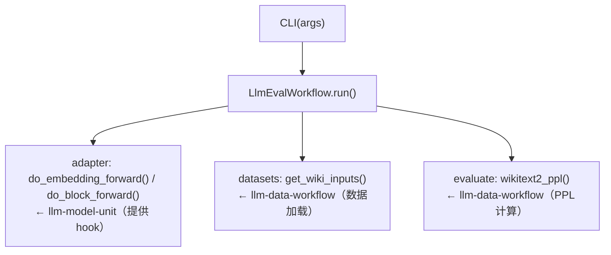
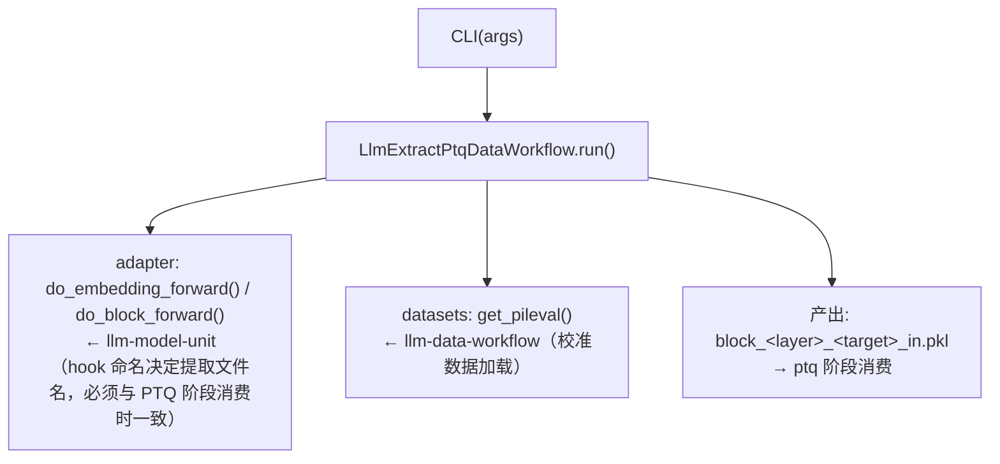
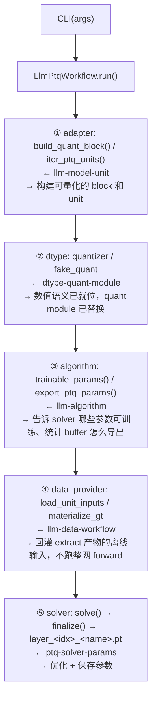
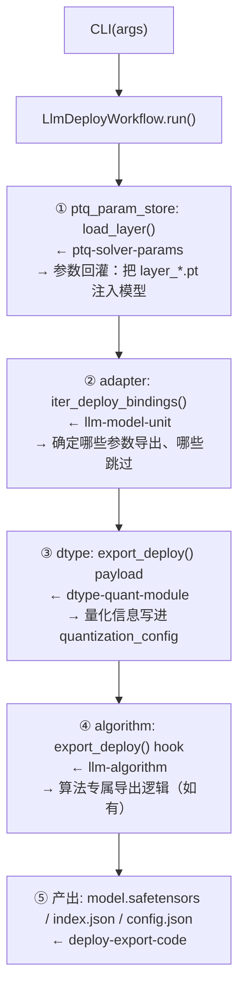
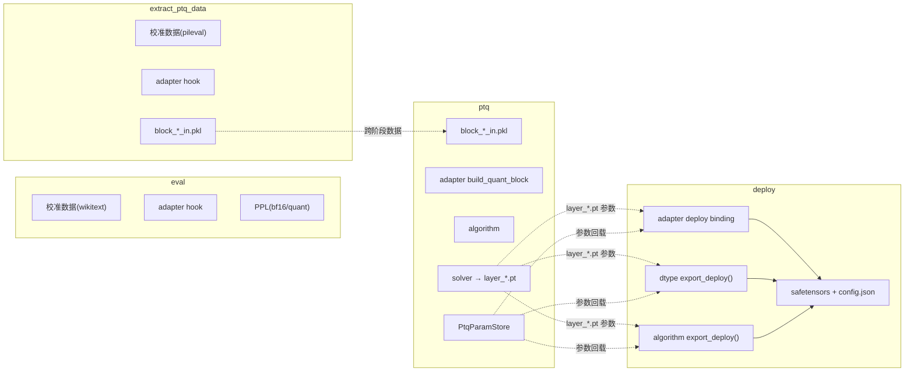

# analysis_v2：按阶段视角的子能力协作视图

## 动机

现有 `amct-coder-module-analysis.md` 按**架构分层**（入口/编排/量化核心/产物/独立体系）划分子能力，回答的是"代码放哪、改这个会不会影响那个"。这对维护者防越界有用，但对**编码辅助**场景不够——开发者更关心的是"我的需求属于 eval / extract / ptq / deploy 哪个阶段？这个阶段里哪些子能力要配合？数据怎么流转？"

`analysis_v2` 补充第二个视角：**按任务阶段展开子能力协作链**。两个视角并存，互不替代。

---

## 阶段一：eval（精度评测）

### 识别信号
- CLI 命令：`eval`
- 代码路径：`workflows/llm_eval.py`、`common/evaluate/`、`common/datasets/`
- 关键词：PPL、评测、bf16、quant、eval_mode、wikitext、seq_len、perplexity
- 产物文件：日志中的 PPL 值、`wikitext_final_out`（可选）

**入口**：`python -m amct_pytorch.eval` → `LlmEvalWorkflow.run()`

**调用链**：

**产出**：PPL（bf16 或 quant）

**典型改动场景**：改评测口径、改 seq_len、改 PPL 计算方法、加新的评测数据集

**越界红线**：不在 eval 里做 PTQ 参数优化或算法训练

---

## 阶段二：extract_ptq_data（校准数据提取）

### 识别信号
- CLI 命令：`extract_ptq_data`
- 代码路径：`workflows/llm_extract_ptq_data.py`、`common/datasets/preproc.py`
- 关键词：校准、提取、extract、pileval、nsamples、calibration data、离线数据
- 产物文件：`block_<layer>_<target>_in.pkl`

**入口**：`python -m amct_pytorch.extract_ptq_data` → `LlmExtractPtqDataWorkflow.run()`

**调用链**：

**产出**：离线 block 输入 tensor

**典型改动场景**：换校准数据集、改 nsamples、改 hook 命名（必须同步改 adapter）

**越界红线**：不在此阶段做量化或参数优化

---

## 阶段三：ptq（参数优化）

### 识别信号
- CLI 命令：`ptq`
- 代码路径：`workflows/llm_ptq.py`、`common/optimization/`、`algorithms/quant/`、`common/datasets/ptq_provider.py`
- 关键词：solver、训练、优化、LWC、LAC、OmniQuant、AutoRound、trainable_params、algos、epochs、学习率、blockwise、量化参数
- 产物文件：`layer_*.pt`
- 消费上游产物：`block_*_in.pkl`（来自 extract 阶段）

**入口**：`python -m amct_pytorch.ptq` → `LlmPtqWorkflow.run()`

**调用链（按执行顺序）**：

**产出**：`layer_*.pt`（PTQ 优化后的参数文件）

**典型改动场景**：新增算法、改 solver 策略、改 optimizer、新增可训练参数、改参数保存格式

**越界红线**：不在 solver 里写模型名分支；不在 workflow 里写模型结构计算

---

## 阶段四：deploy（权重导出）

### 识别信号
- CLI 命令：`deploy`
- 代码路径：`workflows/llm_deploy.py`、`common/models/llm/common/deploy_export.py`
- 关键词：导出、safetensors、权重、quantization_config、deploy、index.json、权重合并
- 产物文件：`model.safetensors`、`model.safetensors.index.json`、`config.json`
- 消费上游产物：`layer_*.pt`（来自 ptq 阶段）

**入口**：`python -m amct_pytorch.deploy` → `LlmDeployWorkflow.run()`

**调用链（按执行顺序）**：

**产出**：safetensors 权重文件 + 配置文件

**典型改动场景**：改导出格式、新增 quantization_config 字段、改 deploy binding

**越界红线**：不在 deploy 里重跑 PTQ 或评测

---

## 跨阶段数据流总览

## 独立体系（不参与四个阶段）

以下子能力与 eval/extract/ptq/deploy 四个阶段的流程无关，单独识别。

### classic-graph
- API 入口：`amct_pytorch.quantize()` / `convert()` / `algorithm_register()`（不走 `python -m` 子命令）
- 代码路径：`amct_pytorch/classic/`、`algorithms/__init__.py`（classic 侧 AlgorithmRegistry）
- 关键词：图压缩、QAT、剪枝、蒸馏、tensor decomposition、eager 模式量化、graph_based、校准、自动校准
- 关键约束：与 LLM new-path 零耦合，不共享 ALGO_REGISTRY、workflow、safetensors 导出

### ops-boundary
- 入口：不独立运行，被 dtype/algorithm 调用
- 代码路径：`amct_ops/`（kernel 实现，归 amct-ops-dev）、`amct_pytorch` 侧调用边界
- 关键词：NPU 算子、Ascend C kernel、`torch.ops.amct.*`、Meta kernel、wheel 打包、package_data
- 关键约束：amct_pytorch 侧只处理调用契约，kernel 实现转 amct-ops-dev

### public-api-tests
- 入口：纯下游消费者，不独立运行
- 代码路径：`amct_pytorch/__init__.py`、`setup.py`、`build.sh`、`pyproject.toml`、`tests/`、`docs/`、`examples/`
- 关键词：公开 API、`__all__`、懒加载、CLI choices、pip 安装、wheel 打包、测试入口、文档同步
- 关键约束：自己不产生语义，只把其他子能力的产出同步到用户界面

## 子能力与阶段参与关系

参与角色如下（`—` 表示不参与该阶段）：

| 子能力 | eval | extract_ptq_data | ptq | deploy | 备注 |
| --- | --- | --- | --- | --- | --- |
| `llm-data-workflow` | 主编排 | 主编排 | 数据回灌 | — | |
| `llm-model-unit` | hook | hook | build_quant_block | deploy binding | 全四阶段 |
| `dtype-quant-module` | 量化评估 | — | fake_quant | export payload | |
| `llm-algorithm` | — | — | trainable_params | export hook | |
| `ptq-solver-params` | — | — | solver 主产出 | 参数回载 | |
| `deploy-export-code` | — | — | — | safetensors 主产出 | |
| `public-api-tests` | 纯下游同步 | 纯下游同步 | 纯下游同步 | 纯下游同步 | 跨阶段，不产生语义 |
| `classic-graph` | — | — | — | — | 不参与（独立体系） |
| `ops-boundary` | 条件参与 | 条件参与 | 条件参与 | 条件参与 | 仅 NPU 加速时 |

## 与现有分层的关系

两个维度交叉定位一个改动，不替代：

- **架构分层**（现有 `module-analysis.md`）：回答"这个文件该放哪个目录、不该 import 什么"
- **阶段协作**（本文件）：回答"我这个需求走哪个流程、要调哪些子能力、数据怎么流"

落地方式：在 `amct-coder` skill 中新增 `stage-flow.md` reference，主文件路由先判阶段、再定子能力。
