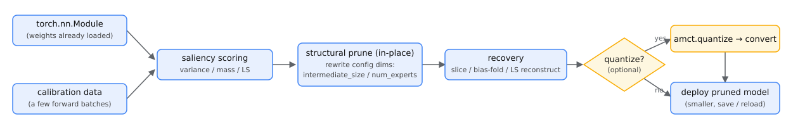
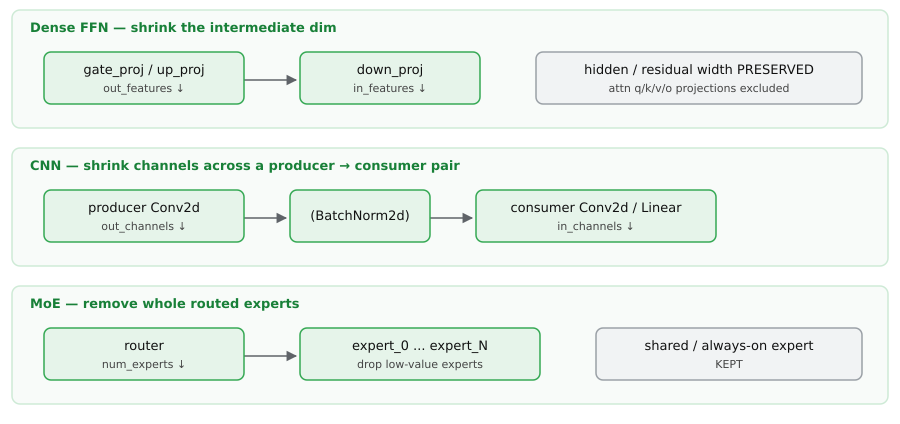
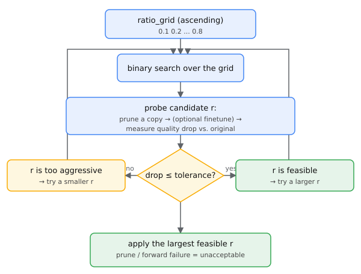
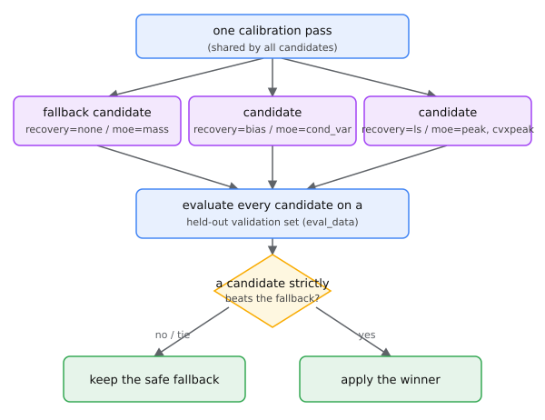
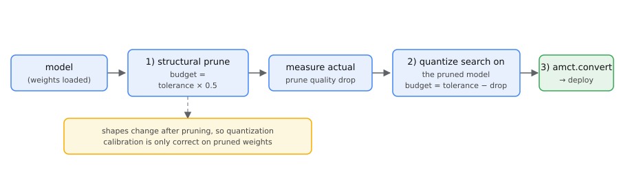

# Structured Pruning (amct_pytorch.pruning)

Structured pruning of an instantiated `torch.nn.Module` (dense FFN intermediate dim / CNN channels /
MoE experts). The model is modified in-place; statistics are returned via an optional `report=PruneReport()`
sink and the value returned by `accuracy_based_auto_prune` / `size_budget_prune`. Pruning rewrites the
model `config` dims (`intermediate_size` / `num_experts`) in place so the pruned model saves/reloads
correctly. The library never downloads models; the caller instantiates them.

## How it works (start with this picture)

Structured pruning runs in four steps: **score -> prune -> recover -> (optional) quantize**.



You hand it a model with **weights already loaded** plus a **little calibration data** (a few forward
batches). The tool does one forward pass over that data, assigns an "importance score" to every prunable
structure (FFN intermediate channels / CNN channels / MoE experts), removes the lowest-scoring part, and
optionally applies a light compensation to the surviving weights (**recovery**), then optionally chains
quantization. Everything happens **in-place**, and the `config` dims are rewritten too, so the pruned model
`save/load`s directly with no extra conversion step.

### The three prunable domains

What can be pruned, and what stays fixed afterwards, depends on the "domain". The tool only prunes
dimensions whose **producer -> consumer interface can be verified**, and conservatively skips anything
uncertain, so tensor shapes always stay self-consistent:



- **Dense FFN** -- shrinks the intermediate dim only: the **out_features** of `gate/up_proj` and the
  **in_features** of `down_proj` shrink together; the hidden / residual width is untouched, and attention
  q/k/v/o projections are auto-excluded.
- **CNN channels** -- resizes along the chain "producer conv out-channels -> (optional BatchNorm) ->
  consumer in-channels"; the conv feeding a residual `add`, Concat (Inception) consumers, and
  grouped / depthwise convs are not pruned.
- **MoE experts** -- removes whole routed experts and shrinks the router accordingly; shared
  (always-active) experts are kept and hidden in/out is unchanged.

> The concrete network structures supported per domain are listed at the end in
> [Supported prunable structures](#supported-prunable-structures).

## Tolerance-driven auto pruning

Specify only the acceptable accuracy loss; the largest prune ratio satisfying the tolerance is searched
(binary search over `ratio_grid`) and applied.



You don't have to guess how much to prune -- you only give an acceptable accuracy loss `tolerance`, and the
tool runs a **binary search** over `ratio_grid`: for each candidate ratio `r` it prunes a copy,
(optionally finetunes), and measures how much quality dropped; if the drop is within tolerance it can afford
to be more aggressive (try a larger `r`), otherwise it backs off (try a smaller `r`). It applies the
**largest ratio that satisfies the tolerance**. Any prune/forward failure is treated as unacceptable (no
exception), so under non-monotonicity the search conservatively prunes less.

```python
import amct_pytorch as amct

res = amct.accuracy_based_auto_prune(model, data=calib, tolerance=0.02)
print(res.summary())
```

When `finetune_fn` is provided, each candidate ratio is finetuned before evaluation, so the selected ratio
is the one usable after prune + recovery:

```python
from amct_pytorch.pruning import prune_finetune
amct.prune(model, cfg, data=calib, tolerance=0.05, evaluator=test_acc,
           finetune_fn=lambda m: prune_finetune(m, train_data, steps=300))
```

- Default fidelity metric needs no labels: quality = top-1 prediction agreement with the original model on
  the calibration data. An `evaluator` (`callable(model)->float` or `AutoCalibrationEvaluatorBase`) can be passed instead.
- `safe_skip_attention=True` (default): skips `self_attn/attention/attn`.
- Any prune/forward failure while probing a ratio is treated as unacceptable (no exception). Under
  non-monotonicity the search prunes less.

### Parameters

| Parameter | Required | Default | Description |
|------|------|--------|------|
| `model` | yes | - | `torch.nn.Module` to prune (in-place) |
| `data` | depends | `None` | Calibration data; required by variance-based methods, default eval set |
| `tolerance` | no | `0.02` | Upper bound on acceptable accuracy loss (same scale as `evaluator`); defaults to `0.02` |
| `evaluator` | no | top-1 fidelity | `callable(model)->float` or `AutoCalibrationEvaluatorBase` |
| `eval_data` | no | falls back to `data` | Evaluation batch for the default fidelity metric |
| `ratio_grid` | no | `0.1..0.8` | Candidate prune ratios (ascending) |
| `safe_skip_attention` | no | `True` | Skip attention projections |

Signature: `accuracy_based_auto_prune(model, config=None, *, data, tolerance, ...) -> AutoTuneResult`.
`amct.prune(..., tolerance=...)` is the equivalent wrapper.

## Fixed prune ratio

```python
from amct_pytorch.pruning import PruneReport
cfg = {"methods": {"dense": {"name": "low_variance", "kwargs": {"prune_ratio": 0.5}}}}
rep = PruneReport()
amct.prune(model, cfg, data=calib, report=rep)
print(rep.as_dict())
```

`methods` only overrides per-domain defaults; omitted domains are still pruned at default ratio
(cnn 0.30 / dense 0.50 / moe 0.50). To prune only one domain, pin the others to `prune_ratio: 0.0`.

## CNN channel pruning

`variance_channel` slices channels by activation variance (same-parent sibling conv heuristic).
`reconstruct` removes low-saliency channels then reconstructs the consumer conv weights via im2col least
squares to preserve the output (no finetuning):

```python
from amct_pytorch.pruning import CNN_RECONSTRUCT_PRUNE_CFG
amct.prune(model, CNN_RECONSTRUCT_PRUNE_CFG, data=calib)
# custom: {"methods": {"cnn": {"name": "reconstruct",
#                              "kwargs": {"prune_ratio": 0.3, "ridge": 1e-2}}}}
```

- The output head (last Linear) and `skip_layers` matches are ignored automatically.
- Calibration must supply enough rows (>= keep x k x k) to solve the least squares; when underdetermined or
  the consumer is not Conv2d, a warning is emitted and naive slicing is used.
- In a residual (ResNet) block the interior conv->conv coupling is pruned; the conv feeding the residual
  `add` is auto-excluded. Concat (Inception) consumers and grouped/depthwise convs are not pruned.

## MoE expert pruning (variance criterion menu)

> Advanced (not in `__all__`) -- import via `from amct_pytorch.pruning import ...`.

Pass `MOE_VARIANCE_MENU_CFG` to `accuracy_based_auto_prune` to run one calibration, prune a copy per
criterion in the menu, pick the best on a small validation set, and apply the winner:



The "menu"-style configs follow one pattern: **calibrate once, then pick the best of several candidates**.
They share a single calibration pass, prune one copy per menu candidate, measure each on a **separate small
validation set** (`eval_data`), and keep a candidate only if it **strictly beats the safe fallback**; on a
tie or a loss the fallback is kept. This way a fancy candidate that merely looks good on the calibration set
but is unstable on validation will not be mis-selected. In the MoE variance menu the candidates are the
different importance-scoring criteria (`mass` / `cond_var` / `peak` / `cvxpeak`), with `mass` as the safe
fallback.

```python
from amct_pytorch.pruning import MOE_VARIANCE_MENU_CFG
res = amct.accuracy_based_auto_prune(
    model, MOE_VARIANCE_MENU_CFG, data=calib, eval_data=val, evaluator=ev)  # keep val != calib
print(res.summary())
```

- Menu: `mass` (= `activation_count`, fallback) / `cond_var` / `peak` / `cvxpeak`.
- A variance criterion replaces `mass` only on a strict win on the validation set, else falls back to `mass`.
- Per-criterion score is the `mass_variance` kwarg `variance_score` in {`cond` (default), `peak`, `cvxpeak`},
  with depth split `boundary`: mass on layers <= boundary, variance on layers > boundary (default `10`;
  `-1` = all-variance; `"auto"` = per-layer; `list[int]` = those layers). `MOE_VARIANCE_MENU_CFG` defaults to
  `boundary=-1`; pass a custom menu with `boundary=K` to search depth splits.

## Recovery menu (dense FFN / CNN channel pruning)

> Advanced (not in `__all__`) -- import via `from amct_pytorch.pruning import ...`.

Pass `DENSE_RECOVERY_MENU_CFG` to search the post-prune recovery menu:

The recovery menu reuses the **exact same best-of-menu mechanism** as the previous section
(see the [figure above](#moe-expert-pruning-variance-criterion-menu)); only the candidates change to
post-prune compensation strategies -- still one calibration, best-of-menu on a held-out validation set,
replace the fallback only on a strict win.

```python
from amct_pytorch.pruning import DENSE_RECOVERY_MENU_CFG
res = amct.accuracy_based_auto_prune(
    model, DENSE_RECOVERY_MENU_CFG, data=calib, eval_data=val, evaluator=ev)
print(res.summary())
```

- Menu: `none` (naive slice, fallback) / `bias` (mean-fold into consumer bias) / `ls` (least-squares
  reconstruction). Backed by the `reconstruct` kwarg `recovery` in {`ls` (default), `bias`, `none`}.
- The fallback is replaced only on a strict win on the validation set; use `eval_data` representative of deployment.
- Ample calib favors `ls`; calib < intermediate width makes `ls` underdetermined, `bias` is more robust.
- `bias`-fold can overfit the calibration mean on a shifted test set; to keep a test-side floor, drop `bias`
  from `cfg["methods"]["dense"]["menu"]`. CNN im2col rows are abundant, so `ls` is not underdetermined there.
- Scope: no-fine-tune regime; with post-prune fine-tuning the naive slice may catch up.

## Advanced configuration

```python
import amct_pytorch as amct
from amct_pytorch.pruning import (
    SENSITIVITY_ALLOC_PRUNE_CFG,
    MOE_OUTPUT_MERGE_PRUNE_CFG,
)

# cross-layer sensitivity allocation (default uniform)
amct.prune(model, SENSITIVITY_ALLOC_PRUNE_CFG, data=calib)
# config["allocation"] = {"strategy": "sensitivity", "ref_ratio": 0.5,
#                          "min_ratio": 0.05, "max_ratio": 0.9, "guard": "calib_nll"}

# MoE output-space expert merge (LS residual pairing + drop fallback)
amct.prune(model, MOE_OUTPUT_MERGE_PRUNE_CFG, data=calib)
# moe kwargs: keep_ratio=0.5, selector='calib_nll'|'none'

# quantization-aware saliency
cfg["methods"]["dense"]["kwargs"]["quant_cfg"] = {
    "weights_cfg": {"strategy": "channel", "symmetric": True, "dtype": "int8"}}

# size budget (keep 70%); budget_scope='total' (default) | 'prunable'
amct.prune(model, data=calib, size_budget=0.7)
# full control (target_params / budget_scope): size_budget_prune
```

## Combined use with quantization

Prune first, then quantize, then convert (pruning changes tensor shapes, so quantization calibration is
only correct on the pruned weights):



```python
import amct_pytorch as amct
from amct_pytorch.pruning import accuracy_based_auto_prune

accuracy_based_auto_prune(model, data=calib, tolerance=0.02)  # 1) structured pruning
amct.quantize(model, quant_cfg)                                # 2) quantize on the pruned model
amct.convert(model)                                            # 3) convert the deployment model
```

To split one accuracy budget across the two steps, give pruning part of the budget, measure its loss, and
run the quantization search on the pruned model with the remainder (as in the figure above):

```python
total_tolerance = 0.03
res = amct.accuracy_based_auto_prune(model, data=calib,
                               tolerance=total_tolerance * 0.5, evaluator=ev)
prune_drop = res.quality_drop or 0.0
remaining = max(0.0, total_tolerance - prune_drop)
amct.accuracy_based_auto_calibration(model, ev, quant_cfg, ...)   # quant budget = remaining
```

The pruning `evaluator=` and quantization `accuracy_based_auto_calibration` share the same evaluator: a
subclass of `AutoCalibrationEvaluatorBase` whose `evaluate(model)` returns an accuracy metric (higher is better).

```python
class MyEvaluator(AutoCalibrationEvaluatorBase):
    def evaluate(self, model):
        return my_top1_accuracy(model)

ev = MyEvaluator()
accuracy_based_auto_prune(model, data=calib, tolerance=0.02, evaluator=ev)
amct.accuracy_based_auto_calibration(model, ev, quant_cfg, ...)
```

> The built-in `amct.ModelEvaluator` is a data feeder for quantization calibration; its
> `evaluate(model, iterations)` returns None and cannot be used for accuracy search. For accuracy search use
> a metric-returning `AutoCalibrationEvaluatorBase` subclass. The pruning side accepts both `evaluate(model)`
> and `evaluate(model, iterations)`.

## Supported prunable structures

Only dimensions whose producer<->consumer interface can be verified are pruned; the rest are skipped.

- **Dense FFN** -- prunes the intermediate dim only (`gate/up.out_features` + `down.in_features`); hidden/residual
  width is preserved. Attention projections (q/k/v/o) are auto-excluded.
- **CNN channels** -- producer `Conv2d` (`groups=1`) -> optional `BatchNorm2d` -> consumer `Conv2d`/`Linear` with
  matching channels, co-resized. Residual `add`-feeding conv auto-excluded; Concat consumers and
  grouped/depthwise convs not pruned.
- **MoE experts** -- whole routed experts removed; hidden in/out unchanged. Shared (always-active) experts excluded.

| Domain | Supported | Notes |
|----|------|------|
| dense | yes | Three-Linear `gate/up/down_proj`, fused `gate_up_proj` (Phi-3/GLM-4), adjacent two Linear/Conv1D (incl. Bloom-style). Llama/Qwen2/Mistral/Qwen3 prune without manual `skip_layers`. |
| cnn | yes | `variance_channel` (heuristic slicing); `reconstruct` (im2col least squares). ResNet-style independent blocks not recognized by same-level detection. |
| moe | yes | Legacy `nn.ModuleList` + `nn.Linear` gate, fused batched experts (`MixtralExperts`/`Qwen3MoeExperts` + `*TopKRouter`), grouped routers (DeepseekV3-style), sibling two-tensor fused experts (GraniteMoE), nested router-bias (Ernie4.5). |

Mechanical prunability is covered on 2-layer micro models across common architecture families
(Llama/Qwen/Mixtral/GLM/Phi/GPT/DeepseekV3/GraniteMoE/Ernie4.5, etc.); see
`tests/amct_pytorch/test_pruning_real_hf_models.py` and
`tests/amct_pytorch/test_pruning_auto_prune.py`.
