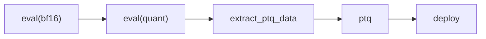
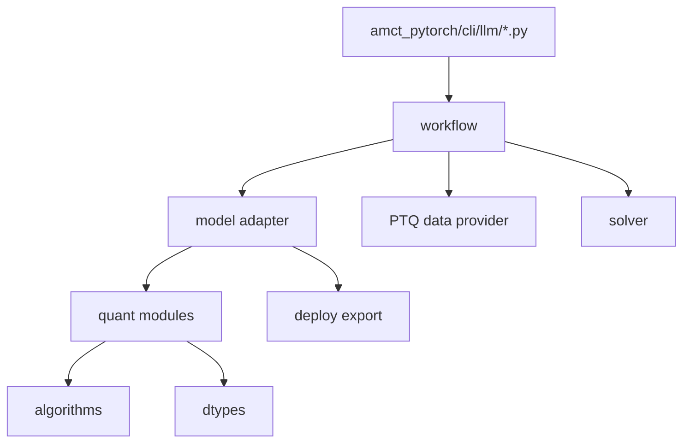

# amct_llm 单页架构说明

## 使用边界

这是一份收敛版说明，只保留当前仓内已经能直接确认的信息。

- 这里优先写代码、workflow、导出逻辑中能直接验证的事实
- 涉及 infer 的内容，只写基于当前导出物能够成立的对接建议
- 主流框架对比、方法论展开和外部资料，请看 `amct-quantization-framework-guide.md`

---

## 一句话定位

`amct_llm` 是一个面向大模型的离线量化研发与导出框架，覆盖：

- `BF16` 基线评测
- 直转量化评测
- `PTQ` 数据提取与最小单元重建
- deploy-ready 量化工件导出

它不是推理 runtime，本仓的主职责是“产出可消费的量化工件”。

---

## 仓内主链路

按仓内代码，四个核心 workflow 分别对应：

- `amct_pytorch/workflows/llm_eval.py`
- `amct_pytorch/workflows/llm_extract_ptq_data.py`
- `amct_pytorch/workflows/llm_ptq.py`
- `amct_pytorch/workflows/llm_deploy.py`

其中：

- `eval` 支持 `bf16` 和 `quant`
- `ptq` 当前要求一次只处理单个 `quant_target`
- `deploy` 当前走 blockwise 导出路径

---

## 代码分层

按职责可以收成 6 层：

1. `amct_pytorch/cli/llm/`：命令入口和参数解析
2. `amct_pytorch/workflows/`：串联 `eval / extract / ptq / deploy`
3. `amct_pytorch/common/models/llm/`：模型适配、按层加载、量化 block 构建
4. `amct_pytorch/common/datasets/`：PTQ 输入缓存与读取
5. `amct_pytorch/common/optimization/`：PTQ solver
6. `amct_pytorch/quantization/`：量化模块、算法和 dtype

---

## 三个最关键的抽象

### 1. `BaseModel`

它定义了模型适配边界，负责：

- 加载原始模型配置与 tokenizer
- 按层加载权重
- 构建 block 或 quant block
- 提供 PTQ 单元遍历与 deploy 绑定

新模型适配，主要发生在 `amct_pytorch/common/models/llm/...`。

### 2. `PtqUnit`

它是 PTQ 的最小工作单元，不要求等于整层。

当前仓内 PTQ 流程会：

- 先从 quant block 里拆出多个 `PtqUnit`
- 逐个读取输入
- 在浮点模块上生成 GT
- 再交给 solver 求解并落盘

### 3. `export_deploy`

导出阶段不再重新做实验判断，而是把当前接受的量化结果整理成下游可消费的工件。

---

## 当前量化方法的仓内事实

### 1. 默认是 blockwise 思路

从 workflow 和 `BaseModel` 结构看，主链路围绕“按层处理 block”组织，而不是默认整模常驻运行。

### 2. PTQ 以最小单元为中心

`LlmPtqWorkflow` 当前明确要求单次只处理一个 `quant_target`，并按 `PtqUnit` 粒度循环求解。

### 3. 量化目标不是绑定具体模型名

仓内参数和 workflow 直接围绕这些目标展开：

- `mlp`
- `moe`
- `attn-linear`
- `attn-cache`

### 4. 导出配置和权重目录是分开的

deploy 阶段会：

- 复制模型目录中的非权重支持文件
- 重写 `model.safetensors.index.json`
- 刷新 `config.json` 中的 `quantization_config`
- 导出按层的 `safetensors`

---

## 输入、过程产物、最终交付

### 输入

从 CLI 和 workflow 能直接确认的核心输入包括：

- 模型目录和 `model_name`
- `quant_target`
- `quant_dtype`
- bit 配置
- PTQ 数据目录和输出目录
- 各类 PTQ 参数目录

### 过程产物

主要有两类：

- `extract_ptq_data` 导出的输入缓存
- `ptq` 阶段按 unit 保存的参数文件，如 `layer_xxx_*.pt`

### 最终交付物

deploy 阶段最终会产出一套接近 Hugging Face 目录风格的工件：

1. `config.json`
2. `model.safetensors.index.json`
3. `layer_*.safetensors` 和 `rest_*.safetensors`
4. 量化方案说明文档，例如 `deploy_quantization.md`

---

## 当前导出里最值得 infer 关注的内容

按仓内 `deploy_export.py` 和 `llm_deploy.py`，infer 侧最该关注的是两部分：

### 1. `config.json` 里的 `quantization_config`

当前仓内会生成并写回这类字段：

- `quant_method`
- `format`
- `config_groups`
- `ignore`
- cache scheme 相关字段

### 2. 导出的量化张量

当前 `export_block_deploy()` 会把模块的 `export_deploy()` 结果写成：

- 主张量：`qweight`
- 附加张量：例如 `weight_scale`、`weight_bias`，以及其他 extra tensors

也就是说，下游接入真正要读的是“张量契约”和“配置契约”，而不是上游训练细节。

---

## infer 快速对接的最短路径

如果 infer 想高效消费当前 amct_llm 产物，建议默认只依赖四类交付物：

1. `config.json`
2. `model.safetensors.index.json`
3. `*.safetensors`
4. `deploy_quantization.md`

推荐的对接顺序是：

1. 解析 `quantization_config`
2. 建立 `target -> runtime object` 映射
3. 根据索引加载 `qweight` 和附加张量
4. 执行必要的 post-load 处理
5. 验证量化路径确实生效

这条路径的核心前提是：

- 上游把量化方案说明写清楚
- 下游按交付物消费，而不是反向阅读上游 Python

---

## 新人建议先看什么

如果你是第一次进仓，建议按这个顺序：

1. `README.md`
2. `docs/agent/repo-map.md`
3. `amct_pytorch/cli/llm/args.py`
4. `amct_pytorch/workflows/llm_eval.py`
5. `amct_pytorch/workflows/llm_extract_ptq_data.py`
6. `amct_pytorch/workflows/llm_ptq.py`
7. `amct_pytorch/workflows/llm_deploy.py`
8. `amct_pytorch/common/models/llm/common/base.py`
9. `amct_pytorch/common/models/llm/common/deploy_export.py`

先看 workflow 主线，再看 adapter 和导出层，会比先钻单个模型实现更容易建立全局理解。

---

## 一页版结论

`amct_llm` 当前最重要的价值，不是“再造一个推理框架”，而是把这三件事稳定化：

- 量化实验如何做
- 量化结果如何按 block 和 unit 管理
- 量化工件如何以统一目录和配置形式交付给下游

只要这三件事稳定，infer 这类推理框架就可以把精力集中在：

- 运行对象映射
- post-load
- 融合与并行
- 量化路径验证

