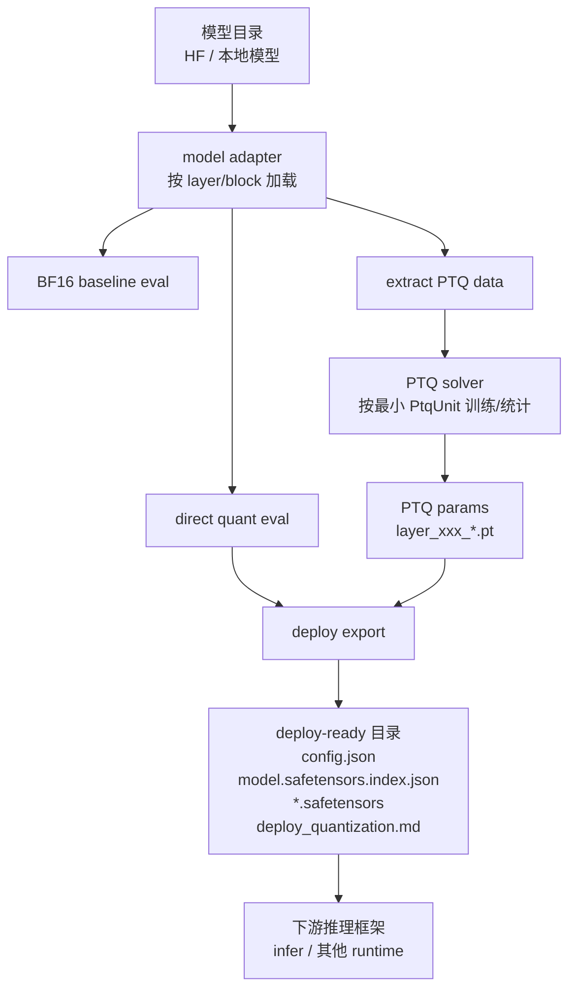
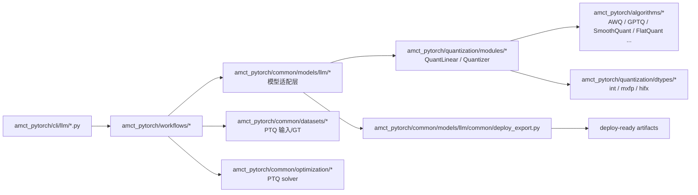
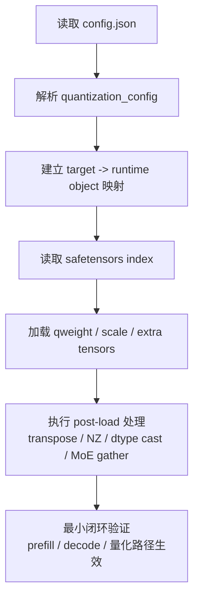

# amct_llm 量化改造框架原理与对接指南

本文档面向两类读者：

- **新人**：希望快速理解 `amct_llm` 的量化框架原理、代码分层和工作流。
- **下游推理框架维护者**：希望快速消费 `amct_llm` 的量化方案和权重，尤其是与 `cann-recipes-infer` 的高效对接。

本文重点回答六件事：

1. `amct_llm` 到底解决什么问题。
2. 它的量化工作流和代码架构是怎么组织的。
3. 它的方法论、技巧和升级策略是什么。
4. 它的输入、中间产物、导出产物各是什么。
5. 下游推理框架如何快速接入，尤其是 `infer` 仓如何对接。
6. 它和主流量化适配方案相比，差异、优缺点分别是什么。

---

## 1. 一句话理解 amct_llm

`amct_llm` 不是一个“只做推理加载”的量化运行时，而是一个**面向大模型量化实验、PTQ 训练和部署导出的统一离线框架**。

它的核心价值是：

- 用 **blockwise** 方式把超大模型拆开做评测、数据提取和 PTQ。
- 用 **模型适配层 + 通用量化模块 + 算法插件** 的方式支持不同模型族。
- 在实验结束后，把结果导出为**尽量接近 HuggingFace 目录结构**的 deploy-ready 产物。
- 把“量化方案说明”也当作正式交付物，而不是只交一堆权重文件。

从定位上看：

- `amct_llm` 更偏 **离线量化研发框架**。
- `cann-recipes-infer` 更偏 **在线推理运行时 / 部署优化框架**。

两者关系不是替代，而是上下游：

- `amct_llm` 负责“怎么量化、怎么训练 PTQ 参数、怎么导出权重和说明”。
- `infer` 负责“怎么加载这些产物、怎么结合并行/融合/图模式在昇腾上高效跑起来”。

---

## 2. 全链路流程图

更具体一点，当前主链路通常是：

1. `eval(bf16)`：拿浮点基线。
2. `eval(quant)`：先做直转量化验证。
3. `extract_ptq_data`：提取最小 PTQ 单元输入。
4. `ptq`：只在必要时，对最小量化目标做 PTQ。
5. `deploy`：导出部署目录和量化说明。

这条链路的关键思想是：**先用最小成本判断是否值得量化，再逐步升级，而不是一上来做全模型重型 PTQ。**

---

## 3. 代码架构图

### 3.1 各层职责

| 层 | 主要位置 | 职责 | 设计原则 |
| --- | --- | --- | --- |
| CLI | `amct_pytorch/cli/llm/` | 参数解析、启动 workflow | 不放模型逻辑 |
| Workflow | `amct_pytorch/workflows/` | 编排 eval / extract / ptq / deploy | 不放模型细节 |
| Model adapter | `amct_pytorch/common/models/llm/...` | 按层加载 block、构建 quant block、拆 `PtqUnit`、做模型特有映射 | 新模型适配主入口 |
| Quant modules | `amct_pytorch/quantization/modules/` | 通用量化 wrapper，如 `QuantLinear`、`WeightQuantizer`、`ActivationQuantizer` | 保持通用、可复用 |
| Algorithms | `amct_pytorch/algorithms/` | 具体量化算法和结构变换 | 通过 registry 以 target 维度挂接 |
| DType | `amct_pytorch/quantization/dtypes/` | 定义实际 fake-quant / export-deploy 格式 | 和算法解耦 |
| Optimization | `amct_pytorch/common/optimization/` | 训练型或统计型 PTQ 求解 | 不混入模型特例 |
| Export | `amct_pytorch/common/models/llm/common/deploy_export.py`、`amct_pytorch/workflows/llm_deploy.py` | 导出权重、索引、量化配置 | 输出面向下游消费 |

### 3.2 最关键的抽象

`amct_llm` 里最值得抓住的是下面四个抽象：

- **`BaseModel`**：定义模型适配器的统一边界。
- **`build_quant_block(layer_idx)`**：把某一层转换成量化版 block。
- **`PtqUnit`**：最小 PTQ 单元，不一定是一整层，可能是 attention、MLP、某个 expert。
- **`export_deploy()`**：量化模块最终对外吐出的部署张量契约。

这四个抽象把“模型差异”和“量化共性”隔离开了。

---

## 4. amct_llm 的核心原理

## 4.1 Blockwise，而不是整模硬上

`amct_llm` 默认优先 **blockwise** 执行大模型量化实验。

原因很直接：

- 大模型在单卡上很难完整放下。
- 新模型适配时，很多问题都出现在某一层或某一类模块，不需要整模一起调。
- PTQ 的本质常常是“对局部模块重建”，不是对全模型做统一训练。

因此，`BaseModel` 会把模型拆成：

- embedding / head
- 每个 decoder layer block
- block 内的更小量化目标

这使得 `amct_llm` 可以：

- 先做 block 级离线前向；
- 再只对目标模块收集输入和 GT；
- 最后只保存这个模块自己的 PTQ 参数。

对超大模型而言，这是整个框架最关键的工程前提。

## 4.2 量化目标不是“模型名”，而是“运行对象”

`amct_llm` 不是按“某模型统一量化”来做，而是按 `quant_target` 做：

- `mlp`
- `moe`
- `attn-linear`
- `attn-cache`

这背后的方法论是：

- **量化决策应该围绕模块类型，而不是围绕模型家族。**
- 同一个模型里，attention、MLP、MoE、KV cache 的敏感度和部署需求都不同。
- 下游推理框架最终也更关心“这是 Linear、MoE 还是 Cache”，而不是“这是某模型第几个子类”。

所以，`amct_llm` 内部虽然以模型 adapter 适配各种模型，但对外导出时会尽量收敛到更稳定的运行对象。

## 4.3 算法与 dtype 分离

这是 `amct_llm` 很值得保留的一个设计。

在这个框架里：

- **算法**解决“怎么变换张量、怎么收集统计量、怎么求更优参数”。
- **dtype**解决“最终用什么数值格式表示、怎么 fake-quant、怎么导出”。

例如：

- `AWQ`、`GPTQ` 属于 **weight target** 算法。
- `SmoothQuant`、`FlatQuant` 属于 **structure target** 算法。
- `int`、`mxfp` 属于 **dtype/export format**。

这意味着：

- 同一个算法可以配不同 dtype。
- 同一个 dtype 可以配不同算法。
- 下游推理框架需要重点对接的，通常是 **dtype 导出的结果 + 结构变换说明**，而不是训练时的全部细节。

## 4.4 先直转，再决定是否升级 PTQ

`amct_llm` 的工作流不是“默认就做 PTQ”，而是：

1. 先拿 BF16 baseline。
2. 先跑直转量化。
3. 如果直转掉点太大，再考虑算法升级。
4. 如果算法升级后仍然不够，再做最小范围 PTQ。

这种策略的优点是：

- 大量模型其实直转就够用，不需要 PTQ。
- 即便需要 PTQ，也往往只是某个 target 或某几层，而不是全模型。
- 工程成本、实验成本、推理框架对接成本都会明显更低。

这是一个非常实用的“工程优先”量化策略。

## 4.5 PTQ 只针对最小可解释单元

`LlmPtqWorkflow` 当前明确要求一次只处理**单一 `quant_target`**。

然后 workflow 会：

1. 对 layer 构建 quant block。
2. 通过 `iter_ptq_units()` 把 block 再拆成多个 `PtqUnit`。
3. 对每个 `PtqUnit`：
   - 读取缓存输入；
   - 在浮点模块上生成 GT；
   - 用 solver 做重建；
   - 保存这个单元自己的 PTQ 参数。

这套方法论的好处是：

- 问题边界清晰，容易定位。
- 导出的 PTQ 参数天然是模块级的。
- 下游若只想复用某一类 target，也更容易做增量接入。

## 4.6 导出与量化决策分离

`deploy` 阶段不重新判断方案好不好，只负责把“已经接受的方案”变成可消费产物。

这意味着：

- 量化实验阶段回答“值不值得量化”。
- deploy 阶段回答“怎么把结果交给下游”。

这是很正确的边界。

如果把这两个阶段搅在一起，导出层往往会背上过多实验逻辑，最后谁都不好维护。

---

## 5. 量化方法论与技巧

下面这些，是我认为 `amct_llm` 最值得新人理解的“方法论”。

## 5.1 方法论一：模型特例收在 adapter，不污染主链

新模型适配时，特殊逻辑优先放在 `amct_pytorch/common/models/llm/...`：

- layer 权重前缀差异
- packed experts / expert 重组
- 特殊 attention mask
- `trust_remote_code` 兼容
- 某些 shape patch

这样 workflow、solver、quant module 不会被模型家族越改越脏。

## 5.2 方法论二：观察、训练、导出三件事分开

量化模块内部通常会经历三个状态：

- **observe**：收统计量，不真正量化；
- **enable quant**：走 fake quant；
- **export deploy**：导出 `qweight` 和附加系数。

这比“一个 forward 做所有事”要清晰得多，也更适合 PTQ 和导出分离。

## 5.3 方法论三：结构变换优先视作运行时契约

像 `SmoothQuant`、`FlatQuant` 这种结构类算法，不只是“训练时技巧”，它们会改变：

- 输入要不要预处理；
- 权重要不要做逆变换；
- 推理时是否有新增计算；
- 下游是否必须支持某些额外参数。

所以这类算法不能只在训练阶段存在，必须在导出说明里写成**运行时契约**。

这是 `deploy_quantization.md` 必须存在的核心原因之一。

## 5.4 方法论四：下游不要逆向 Python 代码

一个常见误区是：量化框架导出完权重后，下游靠读上游 Python 源码来猜怎么加载。

这会导致：

- 对接速度慢；
- 算法一变，下游就断；
- 责任边界模糊。

`amct_llm` 当前的正确方向是：

- 导出 `config.json`
- 导出 `model.safetensors.index.json`
- 导出 `*.safetensors`
- 再补一份 `deploy_quantization.md`

让下游只读交付物，不依赖上游 Python 细节。

## 5.5 方法论五：优先把 target 映射成下游稳定对象

对 `infer` 这类运行时来说，最稳定的不是“AWQ/GPTQ/FlatQuant 名字”，而是：

- `Linear`
- `MoEGMM`
- `KVCache`

所以 `amct_llm` 的量化产物最好始终回答：

- 这是哪类运行对象；
- 需要读哪些张量；
- 有无后处理；
- 可否回退。

这会显著降低下游接入成本。

---

## 6. 输入、中间产物、导出产物

## 6.1 输入

### 运行输入

| 类别 | 典型参数 | 说明 |
| --- | --- | --- |
| 模型输入 | `--model`、`--model_name` | 模型目录 + 仓内 adapter 名 |
| 量化目标 | `--quant_target` | `mlp` / `moe` / `attn-linear` / `attn-cache` |
| 量化格式 | `--quant_dtype` | 如 `int`、`mxfp` |
| bit 配置 | `--bit_config` yaml（顶层 w_bits/a_bits、moe.routed/shared 分组、attn-cache q/k/p/v） | 分线性与 cache 两类 |
| 算法开关 | `--algos` | `awq`、`gptq`、`smoothquant`、`flatquant` 等 |
| PTQ 训练 | `--data_dir`、`--output_dir`、`--epochs` | 数据、日志、参数目录 |
| 导出输入 | `--attn_linear_param_dir`、`--attn_cache_param_dir`、`--moe_mlp_param_dir` | 可选 PTQ 参数目录 |

### 为什么这些输入设计成这样

`amct_llm` 把输入拆成了三层：

- **模型层**：模型目录和 adapter；
- **量化策略层**：target、dtype、bits、algos；
- **实验/导出层**：data_dir、output_dir、param_dir。

这样同一个模型可以反复复用：

- 相同 adapter；
- 不同量化 target；
- 不同算法；
- 不同导出路径。

## 6.2 中间产物

### PTQ 数据

`extract_ptq_data` 会把 block 输入和必要 kwargs 落盘，例如：

- `block_{layer_idx}_{target}_in.pkl`
- `position_ids.pkl`
- `position_embeddings.pkl`
- `attention_mask.pkl`

这意味着 PTQ 阶段并不需要重新跑整模型采样，而是直接复用离线缓存输入。

### PTQ 参数

PTQ 结果按 unit 保存，例如：

- `layer_3_mlp.pt`
- `layer_20_expert_7.pt`
- `layer_5_self_attn.pt`

这种粒度非常适合：

- 分 target 增量实验；
- 分层失败回退；
- 与下游按模块对接。

## 6.3 最终导出产物

`deploy` 阶段最终导出的是一个接近 HuggingFace 的模型目录：

| 文件 | 作用 |
| --- | --- |
| `config.json` | 模型配置 + `quantization_config` |
| `model.safetensors.index.json` | 张量到 shard 的索引 |
| `layer_*.safetensors` / `rest_*.safetensors` | 量化权重和剩余原始权重 |
| `deploy_quantization.md` | 下游消费说明书 |

其中最重要的是两类信息：

### A. 权重张量

当前典型导出 payload 包括：

- `qweight`
- `weight_scale`
- `weight_bias`（部分 int4/int8 方案）
- 结构算法或 cache 相关附加张量

### B. 配置张量

`config.json` 中最关键的是 `quantization_config`，通常至少包含：

- `quant_method`
- `format`
- `config_groups`
- `ignore`
- `kv_cache_scheme`（如果有）

对下游来说，这些字段比“训练时用了哪个 optimizer”重要得多。

---

## 7. export 交付物应该怎样被下游消费

## 7.1 建议的最小消费协议

如果一个推理框架想高效接 `amct_llm`，建议只依赖四样东西：

1. `config.json`
2. `model.safetensors.index.json`
3. `*.safetensors`
4. `deploy_quantization.md`

不要把“阅读 amct_llm 源码”当作接入前提。

## 7.2 下游加载的推荐顺序

## 7.3 下游真正需要知道的，不是“量化理论全集”

下游真正需要的是下面这些“可执行信息”：

- 这个模块属于 `Linear` 还是 `MoEGMM` 还是 `KVCache`
- 需要读取哪些张量
- 这些张量的 shape / dtype / 广播规则是什么
- 前向执行顺序是什么
- 是否需要额外的输入预处理 / 输出后处理
- 哪些模块允许回退

这也是为什么 `deploy_quantization.md` 应该写成运行规格，而不是实验复盘。

---

## 8. infer 仓如何更高效快速对接

## 8.1 最快的对接路径：优先走 Route A

对 `cann-recipes-infer` 来说，最快的路径是：

- 让 `amct_llm` 导出尽量稳定的 **HF + compressed-tensors 风格目录**
- infer 按 `Route A` 去消费

也就是：

- `config.json`
- `model.safetensors.index.json`
- `*.safetensors`
- `deploy_quantization.md`

这条路的好处是：

- 不需要额外 patch 外部框架；
- 不需要每个模型重写一套转换脚本；
- 更适合沉淀成 infer 仓内通用 runtime 能力。

## 8.2 infer 真正要补的，不是“再做一遍量化”

infer 侧的工作重点应该是：

1. **解析配置**
   - 读 `quantization_config`
2. **映射运行对象**
   - `Linear`
   - `MoEGMM`
   - `KVCache`
3. **加载附加张量**
   - `weight_scale`
   - `weight_bias`
   - 结构变换参数
4. **执行 post-load**
   - transpose
   - NZ
   - scale dtype cast
   - packed MoE / expert gather
5. **做最小验证**
   - 确认量化路径真的生效

也就是说，infer 不是量化实验框架，它应该是**量化产物解释器 + 高性能运行时**。

## 8.3 infer 与 amct_llm 的边界差异

| 维度 | amct_llm | infer |
| --- | --- | --- |
| 目标 | 量化实验、PTQ、导出 | 高性能推理、并行、融合、图模式 |
| 优先级 | 方案正确、实验可控 | 运行时性能、部署稳定 |
| 抽象中心 | `quant_target`、`PtqUnit` | `runtime object`、`kernel path` |
| 产物 | 权重 + 配置 + 说明 | 可运行模型目录 + runner 能力 |
| 关键问题 | 哪种量化方案更合适 | 如何让量化权重高效跑起来 |

一句话总结：

- `amct_llm` 解决“**产什么**”。
- `infer` 解决“**怎么跑**”。

## 8.4 infer 快速对接建议

如果后续希望 infer 更快接 amct_llm，我建议默认对齐下面这套“快速协议”：

### 必须稳定的字段

- `quant_method`
- `format`
- `config_groups`
- `ignore`
- `kv_cache_scheme`（如果有）

### 必须稳定的张量命名

- `qweight`
- `weight_scale`
- `weight_bias`（如果有）
- 结构类附加张量命名规则

### 必须稳定的文档字段

- 模块目标映射表
- 导出张量清单
- 模块级运行时契约
- 回退策略
- post-load 要求

如果这三组东西稳定，下游接入速度会大幅提升。

---

## 9. 主流量化适配方案是什么

当前主流量化适配，大体可以分成四种路线。

## 9.1 路线 A：统一 checkpoint 格式 + runtime 解析

典型代表：

- Hugging Face `compressed-tensors`
- 部分 vLLM 路线

核心思路：

- 用 `quantization_config` 描述量化方案；
- 用权重目录描述实际张量；
- runtime 根据配置替换相应模块。

优点：

- 标准化程度高；
- 对接链路短；
- 适合多 runtime 复用。

缺点：

- 对复杂结构（MoE、特殊 cache、结构变换）仍需要额外约定；
- 若配置表达力不够，下游还是会回头猜源码。

## 9.2 路线 B：框架原生预量化格式

典型代表：

- vLLM 支持多种预量化格式；
- SGLang 支持 offline quantized checkpoints；

核心思路：

- 推理框架自己定义能识别的量化格式；
- 用户把预量化模型直接喂给 runtime。

优点：

- 跑起来快；
- 框架内核可以做深度优化；
- 用户体验通常较好。

缺点：

- 容易绑定单一 runtime；
- 迁移到别的框架时往往还要再转一次；
- 某些格式对外部自定义算法不够友好。

## 9.3 路线 C：框架/引擎专用 conversion pipeline

典型代表：

- TensorRT-LLM
- infer 仓里的某些模型专用转换脚本

核心思路：

- 先把权重转成框架或引擎最适合的布局；
- 再走专用 runtime 或 engine。

优点：

- 性能上限高；
- 可以深度利用硬件特性和 kernel。

缺点：

- conversion 成本高；
- 格式专用性强；
- 新模型、新算法、新 target 的接入门槛高。

## 9.4 路线 D：离线实验框架 + 通用导出规格

典型代表：

- `amct_llm`

核心思路：

- 先解决量化实验和 PTQ；
- 再输出通用目录结构和详细说明；
- 下游 runtime 只做解释与执行。

优点：

- 研发和部署边界清楚；
- 更适合快速试新模型、新 target、新算法；
- 便于做 blockwise / unit-wise 实验。

缺点：

- 如果导出契约不够稳定，下游接入仍然痛苦；
- 文档质量直接决定对接效率；
- 对“只想立刻上线”的团队来说不如 runtime-native 方案直接。

---

## 10. 主流方案 vs 本地方案：差异与优缺点

| 方案 | 代表 | 主要特点 | 优点 | 缺点 |
| --- | --- | --- | --- | --- |
| 统一 checkpoint 协议 | HF `compressed-tensors` | 配置驱动加载 | 通用性好、易流转 | 复杂模块仍需补契约 |
| runtime-native 预量化 | vLLM / SGLang | 直接消费预量化模型 | 上手快、推理友好 | 容易绑定框架 |
| conversion / engine-first | TensorRT-LLM、部分 infer 路线 | 先转再跑 | 性能上限高 | 改造成本高、专用性强 |
| 本地方案 `amct_llm` | `amct_llm` + infer | 离线量化研发 + 通用导出 + 运行时接入 | 适合新模型和实验迭代，边界清楚 | 需要维护好导出契约和说明文档 |

### 我对本地方案的判断

本地方案最好的地方在于：

- **对新模型友好**：adapter 边界清楚；
- **对量化研发友好**：可以快速试 target、试算法、试 PTQ；
- **对 infer 友好**：如果导出契约稳定，就能逐步沉淀通用加载能力。

它最需要继续补强的是：

- **导出协议稳定性**
- **附加张量命名稳定性**
- **`deploy_quantization.md` 的规范化**
- **目标到 runtime object 的稳定映射**

如果这几件事做好，本地方案会比“每个模型单独写转换脚本”更可持续。

---

## 11. 新人快速上手建议

如果你是第一次读 `amct_llm`，建议按这个顺序看：

1. `README.md`
2. `docs/agent/repo-map.md`
3. `amct_pytorch/cli/llm/args.py`
4. `amct_pytorch/workflows/llm_eval.py`
5. `amct_pytorch/workflows/llm_extract_ptq_data.py`
6. `amct_pytorch/workflows/llm_ptq.py`
7. `amct_pytorch/workflows/llm_deploy.py`
8. `amct_pytorch/common/models/llm/common/base.py`
9. `amct_pytorch/common/models/llm/common/quant_apply.py`
10. `amct_pytorch/quantization/modules/quant_base.py`
11. `amct_pytorch/quantization/modules/quant_linear.py`
12. 任选一个模型 adapter：如 `amct_pytorch/common/models/llm/deepseek/...` 或 `amct_pytorch/common/models/llm/qwen/...`

理解路径建议是：

- 先看 workflow 怎么串起来；
- 再看 `BaseModel` 怎么定义适配边界；
- 再看 quant module 怎么把算法和 dtype 接进去；
- 最后看 deploy 怎么导出。

不要一上来钻单个模型实现，不然容易只看到局部 patch，看不到框架主线。

---

## 12. 给 infer 对接者的最短 checklist

如果你在 infer 仓接 `amct_llm`，优先只确认下面这些：

1. `config.json` 里有没有稳定的 `quantization_config`
2. `model.safetensors.index.json` 是否完整
3. `deploy_quantization.md` 是否写清楚：
   - target -> runtime object
   - 张量清单
   - post-load
   - 回退策略
4. 当前模型是：
   - Dense `Linear`
   - `MoEGMM`
   - `KVCache`
   - 还是 route-specific
5. 当前量化路径是否能证明“真实生效”

如果这五步都回答清楚了，接入工作通常就不会失控。

---

## 13. 延伸阅读

### 仓内关键文件

- `README.md`
- `docs/agent/repo-map.md`
- `amct_pytorch/workflows/llm_eval.py`
- `amct_pytorch/workflows/llm_extract_ptq_data.py`
- `amct_pytorch/workflows/llm_ptq.py`
- `amct_pytorch/workflows/llm_deploy.py`
- `amct_pytorch/common/models/llm/common/base.py`
- `amct_pytorch/common/models/llm/common/deploy_export.py`
- `skills/quant-tools/deploy-export/reference/deploy_quantization_template.md`

### 对接 infer 时建议一起读

- 在 `cann-recipes-infer-bot_3785` 仓中，建议重点阅读：
  - `module/quantization/__init__.py`
  - `.claude/skills/model-infer-quantization/references/quantized-artifact-integration-contract.md`

### 主流框架官方文档

- Hugging Face Compressed Tensors: [https://huggingface.co/docs/transformers/en/quantization/compressed_tensors](https://huggingface.co/docs/transformers/en/quantization/compressed_tensors)
- vLLM Quantization: [https://docs.vllm.ai/en/latest/features/quantization/index.html](https://docs.vllm.ai/en/latest/features/quantization/index.html)
- vLLM Compressed Tensors API: [https://docs.vllm.ai/en/latest/api/vllm/model_executor/layers/quantization/compressed_tensors/compressed_tensors/](https://docs.vllm.ai/en/latest/api/vllm/model_executor/layers/quantization/compressed_tensors/compressed_tensors/)
- SGLang Quantization: [https://docs.sglang.ai/advanced_features/quantization.html](https://docs.sglang.ai/advanced_features/quantization.html)
- TensorRT-LLM Quantization / Precision: [https://nvidia.github.io/TensorRT-LLM/reference/precision.html](https://nvidia.github.io/TensorRT-LLM/reference/precision.html)

---

## 14. 最后结论

如果只用一句话总结：

`amct_llm` 的最佳定位，不是“另一个推理框架”，而是 **把量化实验、PTQ 训练和部署导出标准化的离线量化工厂**。

它的长期价值，不在于某一个模型今天能不能量化，而在于能否稳定输出：

- 统一的量化配置，
- 统一的权重目录，
- 统一的部署说明，
- 以及可被 infer 这类运行时快速消费的契约。

只要这套交付物稳定，`amct_llm -> infer` 的链路就会越来越短，新增模型的量化适配成本也会越来越低。
