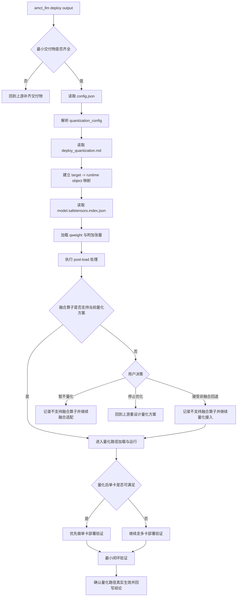
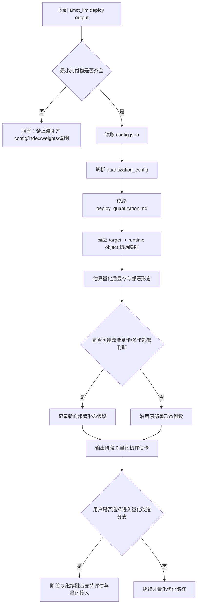
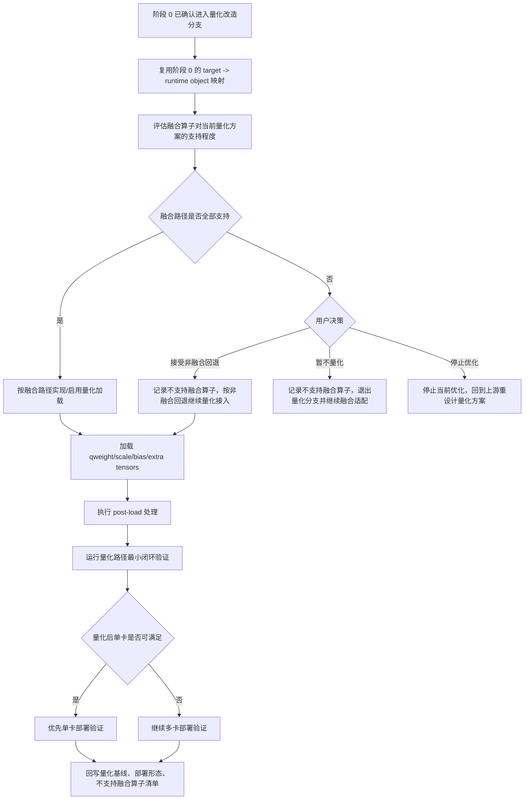

# amct_llm -> infer 对接执行流图

这份文档只聚焦一件事：

- 当 `amct_llm` 已经产出量化工件后，infer 侧应该按什么执行顺序完成对接

这里优先保留仓内已确认的交付物和当前可成立的对接步骤，不展开外部框架细节。

---

## 最小交付物

对接前，先确认上游目录里至少有这四类工件：

1. `config.json`
2. `model.safetensors.index.json`
3. `*.safetensors`
4. `deploy_quantization.md`

如果这四类交付物不齐，先不要进入 infer 接入实现。

---

## 执行流图

---

## 阶段 0：量化方案初评估子流程

阶段 0 的目标不是改 infer 代码，而是先判断“当前量化工件是否值得进入后续优化流程”。

阶段 0 应产出的是评估结论，不是代码改造。建议至少写清：

- 量化工件是否齐全
- `quantization_config` 是否可解析
- `target -> runtime object` 是否能建立初步映射
- 量化后显存与部署形态是否可能变化
- 是否建议进入阶段 3 的量化改造分支

---

## 阶段 3：量化实施接入子流程

阶段 3 只有在用户选择进入量化改造分支后才执行，目标是完成 infer 侧真实加载与验证。

阶段 3 的关键不是“能把文件读进来”，而是证明量化路径真实生效。建议至少回写：

- 使用的运行对象映射
- 加载的量化张量清单
- 执行过的 `post-load` 处理
- 不支持的融合算子及处理方式
- 量化后单卡/多卡验证结论
- 最小闭环验证结果

---

## 执行步骤说明

### 1. 收齐交付物

infer 侧接入时，默认只依赖交付物，不依赖上游 Python 细节。

最低要求是：

- `config.json`
- `model.safetensors.index.json`
- `*.safetensors`
- `deploy_quantization.md`

### 2. 先读配置，再读说明

推荐顺序是：

1. 先读 `config.json`
2. 再解析 `quantization_config`
3. 再读 `deploy_quantization.md`

这样做的原因是：

- `config.json` 决定量化配置入口
- `deploy_quantization.md` 决定运行时解释方式

### 3. 建立运行对象映射

infer 侧不要先绑定模型名字，而应优先建立：

- `target -> runtime object`

通常优先映射到这些稳定对象：

- `Linear`
- `MoEGMM`
- `KVCache`

如果当前 target 不能稳定落入这些对象之一，就要尽早判断这是通用接入还是 route-specific 接入。

### 4. 读取权重并执行 post-load

按 `model.safetensors.index.json` 找到 shard 后，infer 侧应加载：

- `qweight`
- `weight_scale`
- `weight_bias`，如果有
- 其他 extra tensors

然后再执行必要的 post-load，例如：

- transpose
- 布局转换
- dtype cast
- expert gather

### 5. 在量化接入前先评估融合支持

如果当前模型路径依赖融合算子，先判断：

- 当前量化方案是否支持这条融合路径
- 若不支持，是否允许非融合回退

如果不支持，建议只保留三种决策：

1. 接受非融合回退，继续量化接入
2. 暂不量化，继续做融合适配
3. 停止优化，回到上游重设计量化方案

### 6. 再判断单卡还是多卡

量化接入完成后，不要默认沿用原部署形态。

要重新确认：

- 量化后单卡是否已可满足
- 若单卡可满足，优先做单卡验证
- 若仍需多卡，再进入多卡验证

### 7. 最终必须做最小闭环验证

最小闭环验证至少应回答：

1. 权重是否加载成功
2. 关键对象是否走到了量化路径
3. prefill / decode 是否都能跑通
4. 输出是否没有明显异常
5. 回退逻辑是否可控

如果只能证明“模型能启动”，但无法证明“量化路径已生效”，这次对接还不能算完成。

---

## 一页版执行原则

- infer 只消费交付物，不逆向理解上游训练细节
- 先解析配置和说明，再做代码接入
- 先评估融合支持，再决定是否继续量化接入
- 量化后重新判断单卡/多卡部署形态
- 最终必须证明量化路径真实生效
