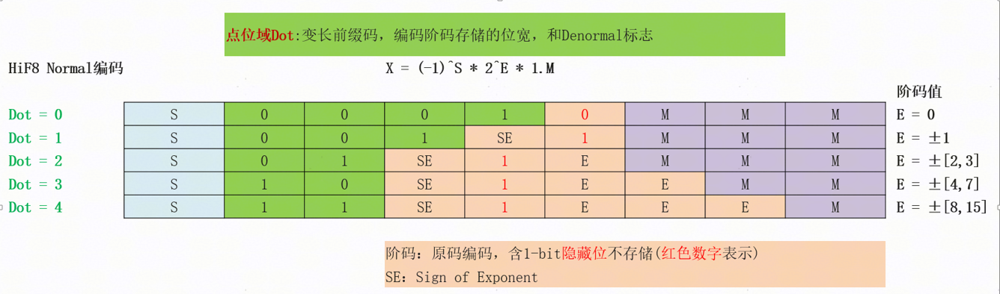
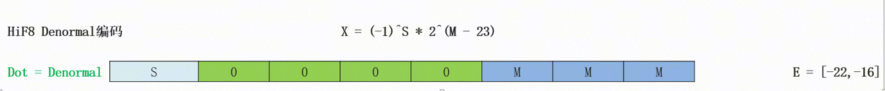
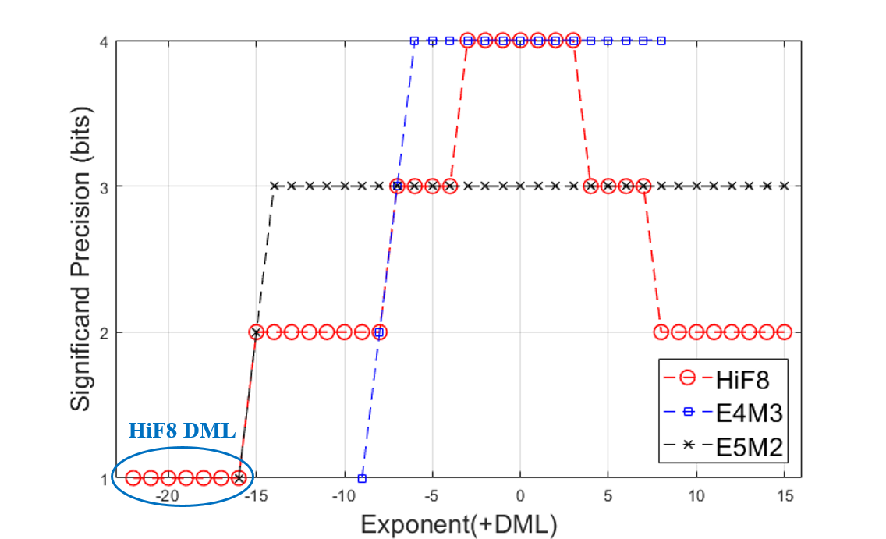
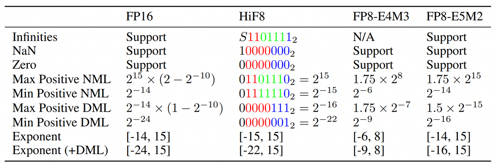

# HiFloat8 数据格式介绍
HiFloat8是华为自研的8-bit浮点数据格式，相较于传统的FP8格式，HiFloat8通过引入变长前缀编码的点位域Dot，优化阶码和尾数的分配，显著提升了动态范围和表示精度。

如表 1 所示，HiFloat8式由**​符号（Sign）、​**​​**点位（Dot）**​、**​阶码（Exponent）​**和**​尾数（Mantissa）​**四个核心字段组成。

**表 1：HiF8 的字段结构**

| 字段 | 宽度（bit） | 说明 |
| - | - | - |
| 符号（S） | 1    | 数值符号，1表示负，0表示正 |
| 点位（D） | 2\~4 | 指示指数域宽度及**Denormal 编码模式（DML）** |
| 阶码（E） | 0\~4 | 采用符号-幅度编码（Sign-Magnitude） |
| 尾数（M） | 1\~3 | 省略前导1的尾数位 |

字段说明：

* ​符号域 (Sign Field)：1 位，用于决定 HiF8 数值的正负符号。1 表示负号，0 表示正号。
* ​点位域 (Dot Field)​：2 到 4 位，采用前缀编码，用于显示指示阶码存储的位宽和denormal标志，不同编码长度对应不同的 Dot 值，如表 2 所示。
* ​阶码域 (Exponent Field)​：0 到 4 位，使用有符号整数编码，最高位为符号位。
* ​尾数域 (Mantissa Field)​：1 到 3 位，使用无符号整数编码。对于 HiF8 的规格化数，尾数表示有效数字中的小数部分，即二进制小数点右侧的部分。

**表 2：Dot 编码**

| 位宽 | 编码 | 编码值 |
| - | - | - |
|  2  |  11   | 4 |
|  2  |  10   | 3 |
|  2  |  01   | 2 |
|  3  |  001  | 1 |
|  4  |  0001 | 0 |
|  4  |  0000 | **DML** |

## 1.1 Normal 编码模式

**图 1：HiF8 的 Normal 编码模式结构及其阶码幅值分配示意图**

图 1 展示了 HiF8 的 Normal（规格化）编码模式。为确保不同位宽阶码域对应的指数范围互不重叠，并实现​**无冗余编码**​，HiF8 采用 **Sign-Magnitude ​**编码方案，并将幅值的最高位设为隐含位，不占用实际存储空间。

具体而言：

* 当 Dot = 0 时，说明阶码不占据位宽，且 E 直接等于 0；
* 而当 Dot = 1\~4 时，固定阶码幅值的最高位为 1（图 1 中的红色数字）。

即：

* Dot = 1，阶码 E 只能等于 ±1，不包含已经编码的 0；
* Dot = 2 时，阶码 E 只能表示 ±[2, 3]，不包含已经编码的 [-1, 1]。以此类推，Dot 域指示的 0\~4 共五种位宽阶码，共编码了 [-15,  15] 的指数，且彼此之间不重复，实现了无冗余编码。

此外，HiF8 采用大位宽的 Dot 域匹配小位宽(小幅值)阶码域的设计，从而实现了尾数精度的平滑渐变而非断层式跳变。观察可见，在 E = [-3,  3] 时，有 3-bit 尾数。然后随着阶码幅值变大，Normal 模式下的尾数位宽才逐渐收缩至 1-bit。这种精度渐变的特性，正是 HiF8 优于其借鉴对象 Posit 数据格式的关键所在。

## 1.2 Denormal 编码模式

**图 2：HiF8 的 Denormal 编码模式结构及其阶码幅值分配示意图**

为了支持更大的动态范围，HiF8 还采用了不同于 IEEE 754 风格的 Subnormal / Denormal 方案。如图 2 所示，在**​ ​**Denormal（非规格化）模式下：

* 当 Dot 域指示当前数值处于 Denormal 模式时，HiF8 不再保留阶码域，3-bit 尾数空间，**用于映射并扩展极小值的指数表示范围**​。
* Normal 模式支持 [-15,  15] 共 31 个指数；Denormal 模式支持 [-22,  -16] 共 7 个指数。HiF8 整体实现了覆盖 [-22,  15] 共 38 个指数的大动态范围，非常接近 FP16 的 [-24,  15] 的指数覆盖范围。
* 由于 [-15,  -8] 区间本身是 1-bit 尾数，新增扩展的 [-22,  -16] 区间对应 0-bit 尾数，Normal 模式到 Denormal 模式的过渡在表示精度上保持连续，而非突变。

## 1.3 特殊值

**表 3：HiF8 的特殊值定义**

| 条件 | 输出 X | HiF8 (二进制) | HiF8 (十六进制) | 含义 |
| - | - | - | - | - |
| S=0, D=DML, M=3'b0 | **Zero** | `00000000` | `0x00` | 零 |
| S=1, D=DML, M=3'b0 | **NaN** | `10000000` | `0x80` | 非数字 |
| D=4, Es=4'b0111,  M=1 | **±Inf** | `X1101111` | `0x6F`/`0xEF` | 正负无穷大 |

如表 3 所示，HiF8 完整支持 Zero、NaN 和 ±Inf 等特殊值。HiF8 不区分正 0 和负 0，而是采用单一编码模式的统一表示。这种设计有效节省了编码空间，使 HiF8 成为一种数值表达完备且高效的 8-bit 单格式。

## 1.4 HiF8 的核心特性

HiF8 具备一系列专为大模型（LLM）训练量身定制的优良特性，核心优势主要体现在以下三个方面：

* ​**锥形精度（Tapered Precision）**​：传统的 FP8（E4M3/E5M2）因阶码位宽固定，往往难以同时兼顾深度学习所需的动态范围与有效精度。考虑到神经网络的参数与激活值通常呈现类高斯分布，HiF8 创新性地采用了​**锥形精度分布**​（如图 3 所示），将更高的精度集中在高频出现的数值区间，从而更好地匹配模型数据特征。

    根据锥形精度的特点，可以将HiF8数据分为以下几段：
    * 高精度区间：E=[-3,3]，7个二进制指数，4-bit有效位
    * 中精度区间：E=±[4,7]，8个二进制指数，3-bit有效位
    * 低精度区间：E=±[8,15]，16个二进制指数，2-bit有效位
    * 极小值区间：E=[-22,-16]，7个二进制指数，1-bit有效位

**图 3：8-bit 浮点数格式有效位-指数示意图**

* ​**无冗余编码**​：HiF8 的阶码采用原码编码，并将固定的 1-bit 高位设为隐含位，不占用实际存储空间，从而确保不同位宽阶码的表达范围互不重叠，最终实现无冗余编码。
* ​**大动态范围**​：表 4 对 HiF8、FP8 与 FP16 的典型值及关键特征进行对比。可以看到，HiF8 在 8-bit 位宽限制下，通过匹配数据分布的锥形精度特性，在保证神经网络训练与推理所需精度的前提下，显著扩大了格式的动态范围，为神经网络提供了能力更全面的 8-bit 单格式表示。

**表 4：HiF8，FP8 和 FP16 的典型值和关键特征**

