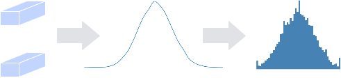
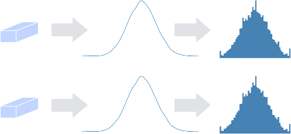
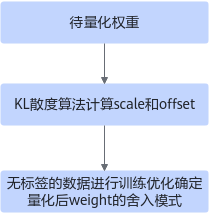
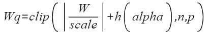
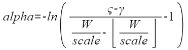
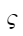
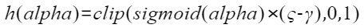
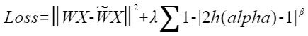
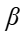

# Algorithm Introduction

## Weight-Only Quantization Algorithms

### ARQ

ARQ (Adaptive Range Quantization) algorithm is an algorithm that directly quantizes weights. This algorithm provides two methods: channel_wise (whether to use different quantization factors for each channel, for parameter explanation please refer to [Post-Training Quantization Configuration Parameters](../context/训练后量化配置参数.md)) quantization and non-channel_wise quantization. The quantization principle diagrams are as follows:

**Figure 1**  Non-channel_wise quantization<a name="fig7600113961719"></a.  

**Figure 2**  channel_wise quantization<a name="fig6351104815177"></a.  

In the quantization configuration, the parameter channel_wise provided by ARQuantize (taking PyTorch framework as an example, for parameter explanation please refer to [Table 1](../训练后量化简易配置文件.md#zh-cn_topic_0240188735_table1225503375617)) is used to select the quantization method:

- When channel_wise is False, select [Figure 1](#fig7600113961719) quantization method. All filters are analyzed together for data distribution and quantized. All different channels in a certain layer share one quantization factor.
- When channel_wise is True, select [Figure 2](#fig6351104815177) quantization method. Each filter performs data analysis independently and then is quantized. Each channel in the same layer has an independent quantization factor.

Generally, each filter is quantized independently, that is, performing [Figure 2](#fig6351104815177) quantization, which has higher quantization accuracy. If the data volume of each filter is relatively small, the quantization effect will be relatively poor. In this case, it is recommended to use [Figure 1](#fig7600113961719) quantization.

Note: Fully connected layers and average downsampling layers Pooling (downsampling method is AVE, and not global pooling) have no channels. When channel_wise is set to True, an error message will be prompted.

### ADA

When quantizing neural networks, the main method is to assign each floating-point weight to its closest fixed-point value. However, this is not the optimal quantization strategy. This paper introduces AdaRound (Adaptive Rounding), **a better weight rounding mechanism for post-training quantization that can adapt to data and task loss**, and only requires a small amount of unlabeled data.

The ADA weight quantization algorithm is used in the PTQ process. Since the rounding pattern of quantized weights affects model accuracy, ADA mainly fine-tunes the rounding pattern, adaptively adjusting the rounding pattern up or down for each quantized data, requiring unlabeled data for training optimization to determine different rounding patterns. The overall process is shown in the following figure. First, the KL divergence algorithm is used to calculate the initial quantization factor scale and offset of the weight, and then unlabeled data is used for training to adjust the rounding pattern of the weight.

**Figure 1**  ADA weight quantization algorithm  

The calculation formula for the quantized weight is as follows:

, where n and p are the upper and lower bounds after quantization, respectively.

The training process mainly optimizes the alpha parameter, with the goal of making h(alpha) equal to 0 or 1:

, where  and  are scaling parameters, taking values of 1.1 and -0.1, respectively.

Quantize the original weight, and after quantization is complete, add h(alpha) to dequantize it, introduce the dequantized weight into the final operator calculation, and finally output the result with quantization error:

The loss function is calculated as follows:

The regularization term (the latter part of the Loss function) is used to constrain h(alpha) to converge to two values, 0 and 1. In the early stage of iteration, a larger  value can make the regularization term have a greater proportion of influence on the overall loss, which will prompt the optimization process to quickly adjust h(alpha) to approach the optimal solution region. In the later stage of iteration, at this time h(alpha) is already in the optimal solution region, using a smaller  will not cause the regularization term to change drastically due to tiny parameter changes, thereby making the model more stable when fine-tuning parameters, avoiding missing the optimal solution due to over-adjustment, and making h(alpha) approach the optimal solution.
