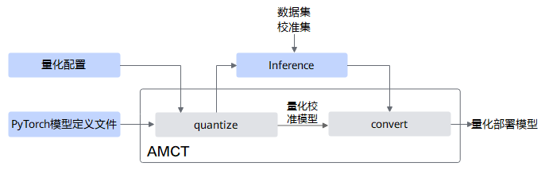

# Compression Feature Introduction

Model compression is a collection of techniques that achieve model miniaturization and inference acceleration by reducing the number of parameters, computational load, memory usage, and bandwidth requirements while ensuring that the model performance remains basically unchanged.
The core methods of model compression include quantization, pruning, knowledge distillation, and low-rank decomposition, etc.

Quantization is the process of converting high-precision data such as FP32/FP16/BF16 to low-precision data such as INT8/FP8/INT4/FP4. By reducing the number of bits per parameter, it reduces storage usage and memory bandwidth, while using hardware low-precision computing units to achieve inference acceleration.
According to different optimization objects, quantization can be divided into weight quantization, activation quantization, and KV-cache quantization. For the explanation of the above concepts about compression features, please refer to [Compression Concepts](../压缩概念.md).

## AMCT Quantization Process

The quantization process is shown in the following figure:

The blue part is implemented by the user, and the gray part is implemented by the user calling the API provided by AMCT. The brief process is as follows:

1. The user first constructs the original PyTorch model (please ensure that the original model can perform normal inference) and quantization configuration, then calls the [quantize](../api/quantize.md) interface to modify the original model and generate a quantized calibration model. During the modification process, different data categories are used and different quantization algorithms are applied.

2. The user calls the [convert](../api/convert.md) interface to convert the quantized calibration operators to the corresponding NPU quantized deployment operators, and outputs the quantized deployment model (type is torch.nn.Module).
