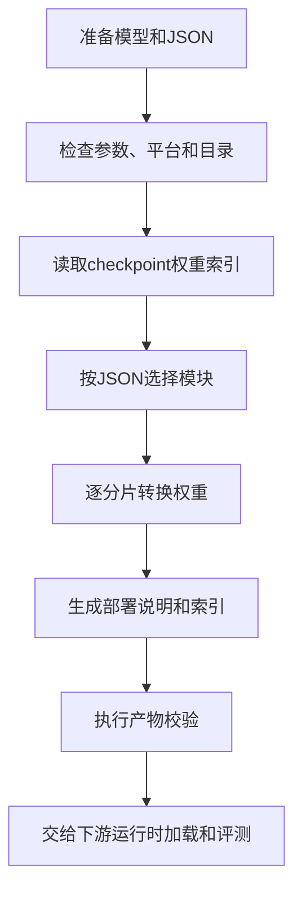

# 部署导出

本文介绍如何将AMCT LLM checkpoint导出为部署目录。Deploy负责权重转换与文件校验；模型加载和实际推理需要在目标运行时完成。

## 部署前准备

### Deploy在量化流程中的位置

Deploy通常位于量化评估之后：

```text
准备BF16模型
  ↓
评估BF16基线
  ↓
（可选）提取校准数据并执行PTQ
  ↓
评估量化结果
  ↓
Deploy导出部署权重
  ↓
下游运行时加载并评测
```

Deploy命令使用模型checkpoint、模型名称、部署平台和模块选择JSON生成部署目录。

### 基本命令

```bash
python -m amct_pytorch.deploy \
  --model /data/qwen3_6-bf16 \
  --model_name qwen3_6 \
  --granularity tensor \
  --quant_layers_config amct_pytorch/configs/deploy/qwen/qwen3_6/qwen3_6_w8a8_int.json \
  --deploy_platform A3 \
  --output_dir /data/qwen3_6-a3-w8a8
```

常用参数如下：

| 参数 | 说明 |
|---|---|
| `--model` | 本地模型目录。目录中应包含`config.json`和safetensors权重；通常还需要tokenizer文件。 |
| `--model_name` | AMCT已注册的模型名称，例如`qwen3_6`、`qwen3_6_moe`、`deepseek_v4`、`deepseek_v4_1`。 |
| `--granularity tensor` | Deploy命令使用tensor粒度，必须显式传入。 |
| `--quant_layers_config` | 模块选择JSON，必须提供。JSON同时声明待量化模块、dtype和位宽。 |
| `--deploy_platform` | `A3`或`ascend950`。不填写时公共路径默认按A3检查，DeepSeek部署建议显式填写。 |
| `--output_dir` | 导出目录，必须是新目录或空目录，不能与源目录重叠。 |
| `--trust_remote_code` | 是否允许Transformers加载远程模型代码，默认关闭；需要自定义模型代码时再开启。 |

结构化tensor JSON同时定义模块选择和位宽配置，因此通常不需要同时传入`--quant_target`、`--bit_config`或`--quant_dtype`。

### 模型和目录要求

使用前确认：

- 源目录是未量化、未旋转的BF16 checkpoint；普通路径不接受已经带有量化声明或旋转权重的目录。
- 权重使用safetensors格式，可以是单文件`model.safetensors`，也可以带`model.safetensors.index.json`的多分片checkpoint。
- 输出目录与源目录分离，并且为空。
- JSON中的模块名称与checkpoint的真实tensor key一致，包括模型前缀和大小写。

DeepSeek V4/V4.1有专属的源权重处理逻辑，可以处理特定的官方FP8来源；这不代表任意低比特checkpoint都能直接作为Deploy输入。

## Tensorwise导出

### 导出流程

当`--granularity tensor`时，导出流程如下：



导出过程中会：

1. 检查源目录、输出目录和权重分片。
2. 根据JSON选择需要转换的模块，并检查模型是否支持这些模块。
3. 按safetensors分片读取权重。选中的权重转换为部署格式，其他权重保留为浮点或按模型适配规则处理。
4. 写出量化说明、权重索引和配置文件。
5. 重新读取导出结果，检查文件、tensor名称、dtype、shape、scale和索引是否一致。

如果检查失败，Deploy会生成失败报告并抛出异常，不会自动修复产物。

### 配置JSON

示例：

```json
{
  "quant_layers": [
    {
      "pattern": "model.language_model.layers.*.mlp.gate_proj",
      "quant_dtype": "int",
      "w_bits": 8,
      "a_bits": 8
    },
    {
      "pattern": "model.language_model.layers.*.mlp.up_proj",
      "quant_dtype": "int",
      "w_bits": 8,
      "a_bits": 8
    },
    {
      "pattern": "model.language_model.layers.*.mlp.down_proj",
      "quant_dtype": "int",
      "w_bits": 8,
      "a_bits": 8
    }
  ],
  "ignore_layers": [
    "model.language_model.embed_tokens",
    "model.language_model.norm",
    "lm_head",
    "mtp.layers.*"
  ]
}
```

字段说明：

| 字段 | 说明 |
|---|---|
| `quant_layers` | 待量化模块规则，不能为空。tensor Deploy使用结构化对象规则。 |
| `pattern` | 大小写敏感的模块glob，例如`model.layers.*.mlp.gate_proj`。不要添加`.weight`后缀。 |
| `quant_dtype` | 支持`int`、`mxfp`、`hifp`，最终是否可用还取决于平台和模型适配器。 |
| `w_bits` | 权重位宽，当前仅支持8。 |
| `a_bits` | 激活位宽，当前仅支持8。 |
| `ignore_layers` | 明确排除的模块，优先级高于`quant_layers`。可用于排除embedding、输出头和MTP模块。 |

配置规则：

- 所有量化规则必须使用同一套完整方案，不能在同一次导出中混用dtype或位宽方案。
- 每条量化规则都应至少命中一个真实模块；零命中会报错。零命中的ignore规则只产生警告。
- 一个模块不能同时被多条未忽略的量化规则命中。
- ignore后不能一个模块都不剩。
- 模型适配器可能要求成组选择，例如完整的QKV、QKVO、MLP projection或全部MoE expert。
- MTP模块不能被通用Deploy量化，通常应加入`ignore_layers`。

### 常用部署方案

| 方案 | 平台 | 主要输出 | 适用说明 |
|---|---|---|---|
| `int/W8A8` | A3、`ascend950` | INT8 weight、BF16 scale和zero offset | 当前最通用的整数方案。 |
| `mxfp/W8A8` | `ascend950` | FP8 E4M3 weight、UINT8分组scale | 输入维度需要满足32列分组。 |
| `hifp/W8A8` | `ascend950` | UINT8 HiFloat8 weight、FP32 scale | 需要模型适配器提供对应的HiFloat8导出能力。 |

一次导出只选择一套方案。平台支持方案不等于每个模型都支持该方案：DeepSeek V4/V4.1对可用dtype还有额外限制。

MXFP的逻辑输入维度必须能被32整除。INT的scale必须为有限正数，offset为全零；MXFP和HiFloat8不生成offset。

### 模型适配范围

当前源码中可以确认以下适配关系：

| 模型 | 部署选择特点 |
|---|---|
| Qwen3.6 dense | 支持MLP、full attention和linear attention的部分projection；部分模块需要成组选择。 |
| Qwen3.6 MoE | 支持routed expert和attention；通常要求同层全部expert及相关projection一起选择。 |
| DeepSeek V4/V4.1 | 使用专属源权重处理和tensor converter；支持范围受平台、源格式和`quant_dtype`共同限制。 |

JSON文件必须和模型名称、checkpoint前缀及目标平台匹配。当前样例按模型分目录，例如：

```text
amct_pytorch/configs/deploy/qwen/qwen3_6/
amct_pytorch/configs/deploy/qwen/qwen3_6_moe/
amct_pytorch/configs/deploy/deepseek/deepseekv4/
amct_pytorch/configs/deploy/deepseek/deepseek4_1/
```

样例文件名只表示配置意图，不能代替实际兼容性检查。

### MoE和特殊来源

标准packed MoE权重可以展开为逐expert的`gate_proj`、`up_proj`、`down_proj`，前提是checkpoint的布局和config中的expert数量符合约定。其他MoE布局需要模型适配器专门处理。

对于普通BF16 checkpoint，通用路径要求选中的weight是非空二维BF16 tensor。DeepSeek V4/V4.1可以读取特定源格式的scale，先还原源权重，再写出目标量化格式；缺少配套scale或shape不匹配时会失败。

HiFloat8需要native `torch_npu`支持。通用`hifp` dtype当前没有通用的8-bit `export_deploy()`实现，不能仅因为JSON和平台检查通过，就认为所有模型都支持HiFloat8。

## 输出产物

### 目录示例

```text
<output_dir>/
├── config.json
├── model.safetensors或多个源分片
├── model.safetensors.index.json
├── quant_model_description.json
├── deployment_validation.json
├── tokenizer.json / tokenizer_config.json
└── 其他支持文件
```

Tensorwise导出通常复用源分片文件名。

### 文件作用

| 文件 | 作用 |
|---|---|
| `*.safetensors` | 保存实际部署tensor。选中模块会包含量化weight和所需scale；未选中模块通常保持浮点。 |
| `model.safetensors.index.json` | 记录每个tensor属于哪个shard，并更新`metadata.total_size`。 |
| `config.json` | 保存模型结构和下游运行时需要的配置。不同adapter的刷新方式可能不同。 |
| `quant_model_description.json` | 说明每个tensor是`FLOAT`还是哪种量化类型，例如`W8A8_DYNAMIC`、`W8A8_MXFP8`、`W8A8_HIFP8`。 |
| `deployment_validation.json` | 保存Deploy侧的静态校验结果、统计信息和错误明细。 |
| tokenizer等支持文件 | 由源目录复制，供下游加载和推理使用。 |

### `config.json`的注意事项

不同模型的配置刷新方式可能不同：

- 部分Qwen tensor导出会保留源`config.json`，量化描述主要记录在`quant_model_description.json`。
- DeepSeek适配器会根据INT或HiFloat8路径更新配置。
- Transformers、vLLM或其他下游框架能否加载，取决于运行时版本和对应插件，需要在目标环境中验证。
