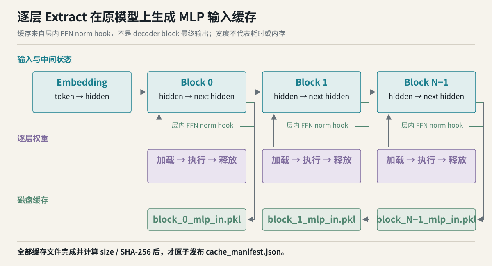
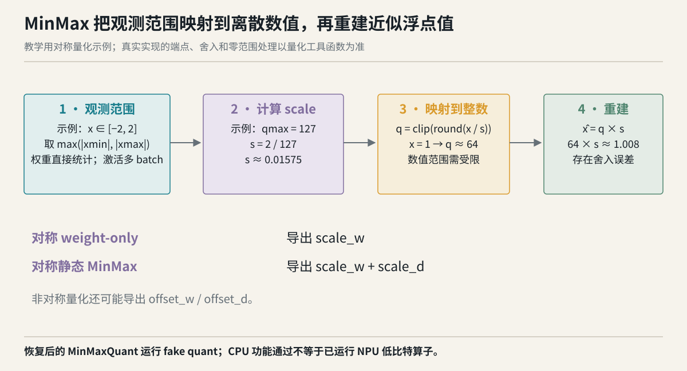

# 里程碑 2：Classic 逐层量化软件设计说明书

| 文档属性 | 内容 |
|---|---|
| 版本 / 日期 | 2.0 / 2026-09-28 |
| 范围 | Week 5–8 的 Classic layerwise P0；当前代码事实与后续接入点分开说明 |
| 输入依据 | [需求规格说明书](classic_layerwise_requirement.md) FR-001～FR-016 |
| 验证依据 | [测试用例及测试报告](classic_layerwise_test_report.md) TC/QW/BT |
| 实现根目录 | `amct-layerwise-dev` |

## 修订记录与设计摘要

2026-09-23 初版记录入口、数据、PTQ 与参数产物设计。2026-09-28 修订补入设计理由、当前调用链、四周独立交付和风险分析；校正 Solver 未接入、缓存身份不足及真实测试断言边界。本文不修改代码，不把计划设计画成已经执行的路径。

系统用一个 Classic 入口组织本地模型的逐层操作：准备配置与 Adapter，按需 Extract 原模型的 MLP 输入，逐真实 Linear 计算 MinMax 参数，再复用 V2 Writer 发布 artifact。消费端以对应 fresh 原模型和 V2 Reader 恢复参数。主调度仍直接驱动 Classic `MinMaxQuant`；`CalibrationSolver` 的组件能力已经存在，统一 `solve/finalize` 调用尚未接入。


## 1 六个对象、两个完成标志

| 对象 | 产生者 | 消费者 | 为什么需要 |
|---|---|---|---|
| `LayerwiseArgs` | 配置翻译 | Adapter / Provider / PTQ | 把外部 config 转成已有内部组件可消费的类型化合同 |
| `LayerwiseQuantizationPlan` | prepare 阶段 | run 阶段 | 将已检查参数、模型 config、唯一 Adapter 一起交接 |
| activation cache | Extract | MLP 输入加载与校准 | 将原模型前向与之后的多轮 PTQ 分开 |
| `PlannedLinearUnit` | unit 规划 | Writer / PTQ | 冻结层路径、所属层及 skip 决策，明确应该写多少 unit |
| `MinMaxQuant` | 当前逐 Linear 主路径 | 前向校准 / 参数导出 | 复用 Classic 的数值行为与最小恢复状态 |
| V2 artifact | `QuantResultWriter` | Reader / reload | 跨阶段传递参数并证明文件完整、身份一致 |

`cache_manifest.json` 完成的是“激活可用”；`quant_manifest.json` 完成的是“量化参数可交付”。两者都使用最后发布的完成标志，但管理对象、目录和复用规则不同。恢复量化参数不依赖工作缓存，依赖对应源模型与参数 artifact。

## 2 系统上下文与总体调用链

### 2.1 依赖边界

外层使用者只调用 Classic Python API。内部依赖本地 checkpoint、模型注册表与 Adapter、`datasets`、tokenizer、`LlmPtqDataProvider`、Classic 量化模块和 V2 Writer/Reader。实现复用这些底层能力，不把 CLI 的 `Workflow.run()` 直接嵌入公共入口。

这样做的原因是，CLI 的命令行默认值、网络数据准备和目录组织不应自动成为 Python API 的隐式合同。Classic 可以显式决定输入、支持范围、结果目录与错误阶段，底层模型执行能力仍由 Adapter 承担。

### 2.2 当前真实顺序

```text
quantize(model, config, quant_result_dir)
  ├─ full → 原整网路径
  └─ layerwise
      └─ prepare_layerwise_quantization()
          ├─ 本地 config 与 model_type
          ├─ 结果路径、config 翻译、P0 校验
          └─ 构造唯一 Adapter → Plan
      └─ run_layerwise_quantization(plan)
          ├─ 注册组件、准备结果目录
          ├─ 规划 Linear units、计算 source fingerprint
          ├─ 创建 Writer 与 DataProvider
          ├─ 按需：缓存校验 → 数据加载 → Extract → cache manifest
          ├─ _run_ptq()
          │   ├─ 当前实现再次规划 / 分组 units
          │   ├─ 按层构建 block，必要时读激活并捕获真实输入
          │   └─ 按 Linear：MinMaxQuant 前向 → 导出 → write_unit
          └─ publish_if_complete() → 返回结果目录
```

这里没有 `solver.solve()` 或 `solver.finalize()`。图文中若讨论这两个方法，均应放在 DS-011 的组件能力与待接入设计下。

### 2.3 两条路径的差别

| 阶段 | weight-only | 静态 MinMax |
|---|---|---|
| 配置与 Adapter | 都需要 | 都需要 |
| 读取校准 dataset | 跳过 | 必须，或使用有效缓存 |
| Extract | 跳过 | 缓存无效时执行 |
| Linear 输入 | 构造 shape 兼容的占位输入 | 从 MLP 原始输入还原各投影真实输入 |
| 参数来源 | 权重范围 | 权重范围 + 输入激活范围 |
| 对称示例输出 | scale_w | scale_w + scale_d |
| 最终发布 / reload | 同一 V2 合同 | 同一 V2 合同 |

“跳过数据”指校准 dataset 与 Extract。Adapter 构造仍可能初始化 tokenizer，因此不能把 weight-only 描述为完全无 tokenizer 依赖。

## 3 Week 5：建立可检查的入口合同

本周独立目标是把用户意图翻译为唯一可执行计划。输入为 model、config、result dir，输出为 Plan。验收重点是正确分派、可诊断拒绝和构造顺序。

### DS-001：入口分派（FR-001）

`quantize.py::_resolve_pipeline()` 读取 `config.pipeline`。未指定时根据 model 类型推断；显式值优先。`nn.Module` 默认 full，字符串默认 layerwise；layerwise 不接受已实例化模块；full 暂不接受模型路径。


不新增同名关键字参数，是为了避免 `pipeline=` 和 `config.pipeline` 两个来源发生优先级冲突。旧 full 实现隔离在 `_quantize_full()`，其调用形式和返回语义不应因新增路径改变；layerwise 当前执行完成返回结果目录。

| 组合 | 结果 | 设计理由 |
|---|---|---|
| nn.Module + 缺省/full | full | 调用方已经完成整网加载 |
| str + 缺省/layerwise | layerwise | 工具负责本地目录的逐层编排 |
| nn.Module + layerwise | TypeError | 输入对象不符合本地 checkpoint 合同 |
| str + full | TypeError；说明当前未实现 | 避免暗中选择加载策略 |
| 非法 pipeline | TypeError/ValueError | 防止拼写错误改变实验路径 |

对应 TC-001～TC-005。

### DS-002：模型与 Adapter 解析（FR-002）

`load_model_config()` 使用本地文件读取 config，要求 UTF-8、JSON object、非空 model_type，并拒绝重复 key。此步骤不导入远端模型代码。之后按 `MODEL_REGISTRY` metadata 进行 model_type 反查；目标类型延迟注册，未知类型不触发无关模型依赖。

唯一匹配时才构造 Adapter。零匹配列出可用项，多匹配明确报错，避免注册顺序决定行为。目录名只表示位置，不参与模型类型猜测。实际 safetensors 权重映射、MLP 和投影结构在后续执行中继续校验。

本设计还保留 `trust_remote_code` 的布尔配置，默认 False；“读取本地 config 不执行远端代码”与 Adapter 之后加载模型依赖是不同阶段，不能混为一个承诺。对应 TC-006～TC-009。

### DS-003：配置翻译与早期边界（FR-003）

`build_args_from_config()` 先验证外部配置结构，再借助 `QuantConfig` 解析量化配置，执行 P0 检查、采样参数规范化、dense/MoE 判断，最后形成内部参数。

| 参数组 | 内部字段 | 约束与目的 |
|---|---|---|
| 模型 | model / model_name | 本地目录和注册名称 |
| 量化目标 | quant_target | P0 为单个 mlp；MoE 拒绝 |
| 位宽 | w_bits / a_bits / bit_policy | int4/int8 权重；未激活量化记为 a_bits=16 |
| 算法 | algos | 空或 minmax；静态激活要求 minmax |
| 采样 | batch_num / cali_bsz / nsamples / seq_len | nsamples=batch_num×cali_bsz，均为正整数 |
| 路径 | work_dir / data_dir / output_dir / quant_result_dir | 工作目录和产物目录分离 |
| 数值策略 | strategy / symmetric / group_size | 传递 Classic 量化配方 |
| 执行 | device / trust_remote_code | 默认 device 为 npu:0；CPU 实验显式改为 cpu |
| 跳过 | skip_layers | 集合化匹配 unit 的全局层名 |

当前缺省采样为 128 样本、batch size 1、128 batch，seq_len 缺省为 4096。部分指定时推导缺少项；有矛盾不能四舍五入或自动改写。work_dir 缺省从结果目录派生为 `result_dir + '.work'`，数据目录进入其 `ptq_data/mlp`。

为什么保留内部 CLI-shaped 字段：现有 Adapter 已经消费这些字段，类型化翻译可减少重复实现；为什么不暴露成公共对象：未来内部组件变化不应迫使用户跟随修改调用。对应 TC-010～TC-013。

**Week 5 交接检查：** Plan 只包含合法配置和唯一 Adapter；prepare 阶段与 run 阶段区分，不能把“准备成功”描述为“量化完成”。

## 4 Week 6：校准数据与激活缓存

本周独立目标是生成有来源、有完整性标记的原模型激活。输入为 Plan 和本地 dataset；输出为按 block 保存的 MLP 输入及 cache manifest。weight-only 路径仍可以不经过本周数据步骤而继续量化。

### DS-004：固定窗口数据加载（FR-004）

`load_calibration_data(adapter)` 先检查 dataset 路径，再调用 `load_from_disk`。DatasetDict 恰好一个 split；Dataset 有 text 列；实际消费到的记录必须为非空字符串，编码结果不能为空。token 按 dataset 顺序拼接，达到 `nsamples×seq_len` 后停止读取，最后切成固定窗口。


举例：要求 3 个长度 4 的样本时，需要至少 12 个 token；第一条记录编码为 5 个、第二条为 8 个，会拼成 13 个并取前 12 个，形成三个 `[1,4]` tensor。切窗可以跨文本边界；它不等价于“一条文本一个样本”。没有额外宣称随机抽样，manifest 中的 seed=0 仅属于固定采样描述。

总 token 不足时返回精确数量错误，不能重复文本偷偷补齐。选择固定窗口是为了让输入规模与缓存身份可解释；它对自然语料分布和任务精度是否合适，属于独立校准集设计。对应 TC-014～TC-016。

### DS-005：Extract 条件与逐层顺序（FR-005）

`_needs_extract()` 是 `a_bits < 16 and not activation_dynamic and 'minmax' in algos`。P0 已在入口拒绝动态激活，但判断保留激活统计语义。

`_run_extract()` 使用 Adapter 暴露的 FFN norm 名，缺省为 `post_attention_layernorm`；先 reset 当前 target 缓存，再调用 embedding forward，之后逐 block forward。Adapter 在相应 hook 位置写入 block 输入，前向返回的中间状态交给下一层。全部层完成后由外层发布 cache manifest。



逐层结构意在避免所有执行层长期同时驻留设备；source fingerprint 和 unit 规划仍会遍历权重或构建 block，不能把整体开销简化为“只加载一次每层”。没有内存实测前，只把释放策略作为设计措施。对应 TC-017～TC-018。

### DS-006：缓存身份的精确范围（FR-006）

`_activation_cache_manifest()` 将身份 payload 规范化为 canonical JSON 后计算 SHA-256。payload 的具体字段如下：

| 字段 | 当前取值 | 能识别的变化 |
|---|---|---|
| model_path | realpath | 模型目录位置 |
| model_fingerprint | model_type、config_sha256、state_dict_sha256 | 配置及实际 tensor 内容 |
| dataset | dataset realpath | 数据目录位置；不识别同路径内容覆盖 |
| tokenizer | 模型 realpath + tokenizer.json 可选摘要 | 此 JSON 内容变化；不覆盖全部关联文件 |
| num_samples / batch_size / seq_len | 规范化采样参数 | 采样数量和分组方式 |
| target / hook | mlp 与对应 FFN hook | 激活目标位置 |
| sampling | dataset 顺序、concatenate=True、seed=0 | 固定策略描述 |

bit、量化算法、symmetric、strategy、group size 不在 key 中。其理由是 Extract 运行原模型，同一原模型与输入在这些 PTQ 配方变化时不应重新前向。

这个排除规则依赖“缓存的是未被前一轮量化改变的原模型激活”。未来若改成逐层量化传播或重构优化后的激活，必须重新定义缓存身份，不能沿用当前 key。当前最直接的缺口是数据只按路径识别，应先固定不可变数据版本，后续以 BT-01 增加内容摘要与 tokenizer 完整身份规则。对应 TC-019。

### DS-007：缓存完整性、复用与失败（FR-007）

manifest 的 files 为每层的预期 `block_i_mlp_in.pkl`，包含 name、size 和 SHA-256。`_has_valid_activation_cache()` 读旧清单，重新构造期望身份与文件记录，要求 key 和 files 一致；已捕获的读取/解析异常、缺文件或摘要变化判为无效。当前缓存检查不是严格 schema 验证：合法 JSON 若为 list、数值等非 mapping，调用 `.get()` 可能抛出未捕获的 AttributeError，尚需补类型防御与负例。

无效缓存按 target 全量清理后重抽。manifest 写入 `.tmp`，flush、fsync，再 `os.replace()` 原子替换。这样未完成的 Extract 不会因为文件名已出现就被当成缓存命中。这里没有逐层完成位或安全续抽状态机，因此不能支持部分复用。


`cache_manifest` 是本地中间数据的完整性记录，不是来自不可信方的认证签名；pickle 中间缓存也不应被当成任意外部输入协议。结果消费者只使用 V2 参数 artifact。

mock 测试明确记录 Extract 调用次数，因此能检查复用和损坏重抽。真实脚本只比较前后文件数量及源身份，尚不能排除重写了同名 28 个文件；BT-02 要将调用与文件不变性同时纳入真实验证。对应 TC-020～TC-022。

**Week 6 交接检查：** 缓存身份字段可解释，文件齐全且未损坏；数据内容指纹的缺口已记录，不被“SHA-256”这个术语掩盖。

## 5 Week 7：逐 Linear PTQ 与参数发布

本周独立目标是将原始权重和正确激活变成可定位、可恢复的量化参数。输入为 Plan、权重和必要缓存，输出为全部 expected units 与最后发布的 manifest。

### DS-008：稳定 unit 规划（FR-008）

`_plan_linear_units()` 遍历 Adapter 层数，构建 block，定位 mlp，并检查三个子模块。unit 的层名由 Adapter prefix 与相对投影名组合；每个全局名字必须唯一。`PlannedLinearUnit` 记录 layer_idx、relative_name、layer_name、skip。Writer 的 expected units 排除 skip 项。

当前结构检查接受真实 `nn.Linear`，也接受通过 `.linear` 包含真实 Linear 的包装器。Qwen `QuantGatedMLP` 中的 `QuantLinear` 属于后者。持久化记录原模块类型 `Linear`，而不是把包装器或整个 MLP 作为恢复目标。

当前 `_run_ptq()` 会再次调用规划并按层分组；设计上首次计划和执行计划必须稳定。未来可把冻结的 unit_plan 显式传入执行，减少重复构建并避免动态 Adapter 产生两份不同计划。这是可改进点，不描述为已经优化。对应 TC-023～TC-024。

### DS-009：真实输入捕获与 dtype（FR-009）


`_capture_linear_inputs()` 在 gate/up/down 子模块挂 hook，并在 `finally` 中移除。普通 MLP 直接 forward；`QuantGatedMLP` 特殊路径显式执行：

```python
gate = mlp.gate_proj(inputs)
up = mlp.up_proj(inputs)
mlp.down_proj(mlp.act_fn(gate) * up)
```

捕获 gate/up 的参数 x，以及 down 的乘积输入。包装器子模块的入参就是相应投影需要的输入；量化前再通过 `_linear_child()` 解析真实 Linear。必须捕获齐三个名字，缺任何一个立即报错。

为什么不能把 MLP 缓存直接给 down：若 x 的 hidden_size 与中间 FFN 宽度不同，先产生 shape 错误；即便巧合相同，非线性与逐元素乘法也改变了数值范围。应以语义和数值对照验证，不能以能 forward 或捕获字典非空代替。

`_quantize_linear()` 在构建 UnitBatch 前将输入转换为 `module.weight.dtype`，用于解决真实 bf16 权重与默认 float32 占位/中间输入不匹配。转换不应改变样本维度、目标设备和捕获来源。现有代码路径与包装兼容有证据，独立的三投影数值断言列为 BT-03。对应 TC-025。

### DS-010：Classic MinMax 的当前生命周期（FR-010）

当前 `_quantize_linear()` 做以下事情：取真实 Linear；选择真实捕获输入或 weight-only 占位零输入；经 Provider 生成 UnitBatch；实例化 solver；若其 model 不是 `MinMaxQuant`，构造 Classic `MinMaxQuant` 并遍历 batch 调用；最后直接 `export_quant_params()`，写 unit。

weight-only 占位输入形状取 `(1, module.in_features)`，其中 in_features 来自解析后的真实 nn.Linear。weight-only 的 scale_w 在 MinMaxQuant 初始化阶段由权重范围产生。占位输入不是数据校准，不意味着 scale 来自零张量；它用于满足当前统一调用组织。静态路径逐 batch 更新 data_min/data_max，在 `cur_batch == batch_num` 时生成 scale_d。继续前向会进入 fake quant 路径。



对称量化的核心是 `scale = max(abs(min), abs(max)) / quant_scope`。真实 `calculate_scale_offset()` 会按整数位宽、极值方向选择 quant_scope，并通过 `process_scale()` 处理数值边界。图中的 qmax=127 是讲解正端主导的 INT8 例子，不能当成全部端点规则。非对称分支先把观测范围扩展到包含零，再计算 scale 与 offset；offset 最后取整并转 int32。

| 配置 | 主要统计 | 对称示例导出 | 必须注意 |
|---|---|---|---|
| weight-only | 权重 min/max | scale_w | 不读取校准 dataset |
| 静态 MinMax | 权重范围 + 多 batch 输入范围 | scale_w、scale_d | 必须到达 batch_num |
| 非对称 | 相应范围与零点 | 还可能有 offset_w/offset_d | 不可用对称示例限制所有产物 |

`_export_quant_params()` 兼容 `(tensors, metadata)` 或单个字典，tensor 做 detach/cpu/contiguous，非 tensor 值进入 metadata。artifact 保存最小恢复参数，并不把 MinMax 的所有原权重再复制成低比特模型文件。对应 TC-026～TC-027、QW-01～QW-04。

### DS-011：Solver 组件与待接入点（FR-011）

注册算法 `amct_pytorch/algorithms/quant/minmax.py::MinMax` 负责 registry metadata 与范围观测；Classic `MinMaxQuant` 负责现有 Classic 数值量化、导出和恢复。两者名称接近但职责不同。

`CalibrationSolver` 注册名为 calibrate。它不建立 optimizer state，`solve(data, kwargs)` 在 no_grad 下逐 batch forward，`finalize()` 优先调用 `export_quant_params()`，否则尝试 `export_ptq_params()`。多输入 batch 目前拒绝。

| 项目 | 当前状态 | 证据/后续 |
|---|---|---|
| solver 选择与实例化 | 主路径执行 | `_select_solver_cls` 与 `_quantize_linear` |
| solve/finalize 组件能力 | 已实现 | 三项组件测试 |
| 主路径调用 solve/finalize | 未执行 | 源码没有该调用 |
| 主路径实际统计导出 | Classic MinMaxQuant 直接驱动 | 当前功能产物来源 |
| 统一 Solver 调度 | 待接入 | BT-04：调用计数、结果一致性、失败语义 |

接入顺序应先明确 solver 的 model 是原 Linear、量化包装模块还是算法组合，再把 batch 迭代和完成导出交给它。否则仅机械增加 `solve()` 可能造成双重校准或对未包装 Linear 做无效前向。对应 TC-028～TC-029。

### DS-012：V2 Writer 与 manifest-last（FR-012）

Writer 在 PTQ 前接收 expected units 和 source_model。每次 `write_unit()` 提交全局 layer_name、tensors、non_tensor_params、quant_config、quant_module_type、ori_module_type。Writer 负责文件名/重复 unit、schema、摘要、写后回读和发布前复验。


| 状态 | 允许行为 | 对外含义 |
|---|---|---|
| 已创建，尚未完整 | 写剩余 units | 目录不可当成完整结果 |
| 部分 units 完成 | 继续写或因错误终止 | 可有 safetensors，不应有完成 manifest |
| 全 units 完成且复验成功 | 原子发布 manifest | 参数 artifact 可由 Reader 校验 |
| 已发布 | 消费结果 | 新实验使用新结果目录 |

`run_layerwise_quantization()` 在 `publish_if_complete()` 为 False 时抛出包含 pending units 的错误。它没有 PTQ per-unit resume 协议，因此失败恢复选择新目录全部 PTQ；完整激活缓存仍可复用。

为什么不从已有文件名猜完成：文件可能属于不同 source、配置或未完成写入；只有固定 expected set、元数据和文件摘要共同成立，才能判断此次交付完成。对应 TC-030～TC-032，严格写中中断由 BT-05 补足。

### DS-013：流式源指纹与 fresh reload（FR-013）

`_source_model_fingerprint()` 计算 config 的 canonical JSON SHA-256 和 checkpoint tensor-byte SHA-256。权重映射来自单文件 safetensors 或 index.json；按 tensor name 排序，依次把 key、dtype、shape 的规范表示与实际字节加入 hash。字节按 1 MiB 块更新，避免为 hash 再拼一份整体权重大字节串。

`_checkpoint_state_dict_sha256()` 与整网 `compute_model_fingerprint()` 采用相同规则，`TestSourceFingerprint` 对这点做比较。config 也必须使用相同 `to_jsonable_lossy()` 规范化，不能生产端自行换序列化约定，否则同源 fresh 模型会被判不匹配。

权重摘要包含完整 tensor 内容，强于只比较层名和形状，但需要遍历 checkpoint，带来磁盘读取与计算成本。它识别的是加载出来的规范 tensor 表示；改变 dtype、配置规范化结果或权重内容均可能改变身份。不能为了性能随意跳过这些字段。

消费端沿用 V2 Reader：校验 manifest、单位文件、层路径、模块类型和参数，准备所有替换模块后再作用到 fresh model。恢复后 MinMaxQuant 可执行 fake quant；与原模型数值误差及 NPU convert 是其他验收层。对应 TC-033～TC-034。

### DS-014：错误阶段与资源释放（FR-014）

| 阶段 | 失败示例 | 已知结果 | 不能推导的结论 |
|---|---|---|---|
| 准备 | 非法 pipeline/config/model_type | 校验处报错；相应早期错误不构造 Adapter | 所有运行错误都会早失败 |
| 数据 | 无 text、空文本、token 不足 | 不开始此次 Extract | 已有历史缓存一定被删 |
| Extract | block 前向失败 | 不发布本轮 cache 完成清单 | 不存在任何中间文件 |
| 规划 | 非 dense / 缺 Linear | Writer 创建前或执行规划处报错 | 已写 unit 后事务一定测过 |
| PTQ | 输入缺失、前向或导出失败 | 异常传播，不完成 manifest 发布 | 全外层过程可回滚 |
| 发布 | pending、文件损坏 | 不发布完成清单 | 部分文件自动清理 |
| reload | 身份/文件/参数错误 | Reader 应保持 live model 未部分替换 | NPU 部署一定支持 |

block 的处理使用 finally 调 `_release_device()`；模块移回 CPU，容器递归处理，清理后调用 GC，NPU 可用时 empty_cache。释放局部引用与清空 allocator cache 不等于操作系统 RSS 马上下降，不能把代码存在解释为性能测量。

hooks 必须 finally remove，避免下一次捕获重复安装。失败时保留可诊断异常比返回成功路径更重要；不提供不可审计的静默降级。对应 TC-035。

**Week 7 交接检查：** unit 计划、真实输入、参数定稿、文件发布和源身份能互相对应。Solver 组件未接入和写中故障注入缺口明确列出。

## 6 Week 8：真实验证与兼容保护

### DS-015：Classic full 的回归边界（FR-015）

full 与 layerwise 共享部分 Classic 量化模块、V2 文件协议与 reload。新增算法注册或导出行为可能影响旧路径，所以需要同时运行相关回归。

历史独立 full 脚本用两个随机初始化 1024×1024 Linear，中间 SiLU，bf16，两个校准 batch。MinMax/GPTQ 使用 `torch.equal(direct, reloaded)`，比较的是落盘前后量化模型，不是与原 FP 模型完全相同。AWQ 只打印最大误差并检查有限性；`0.005859375` 是观测值，不是被断言的阈值。独立小型 AWQ 单测有 rtol=0.05、atol=0.05 的比较，需另行标注。

这组证据保护文件协议与恢复语义，不能说明 Qwen 上 AWQ/GPTQ 已测，更不能说明 layerwise 支持它们。对应 TC-036～TC-038。

### DS-016：真实 Qwen 与证据记录（FR-016）

真实脚本分 weight-only、静态 MinMax 和不支持算法拒绝三个部分。Qwen3-0.6B 的 28×3=84 units 验证真实层结构与完整层覆盖；静态路径写出 28 个 block cache，84 组 scale_w/scale_d。重新加载 fresh bf16 模型，比 source fingerprint，恢复后检查首尾模块及 logits `(1,16,151936)` 和 finite。

该样本是功能冒烟输入，静态文本为重复英语短句，1×16 token。它可以暴露 dtype、包装、源身份和参数恢复问题，但不足以评估完整语料精度、长序列、吞吐或内存收益。第二轮运行能生成 artifact，严格零 Extract 仍需 BT-02。


历史证据分三类保存：pytest 完整日志、真实脚本、真实结果报告摘录。后者缺完整独立运行日志，原 `/tmp` 产物也已不存在，因此新一轮验证应归档完整环境、命令、stdout/stderr、配置、数据摘要、manifest 和产物摘要，不只复制 PASS 文本。对应 TC-039～TC-040、QW-01～QW-05。

**Week 8 独立交付标准：** 能指出真实运行对象、输入规模、断言、输出与证据位置；未执行项有明确下一步判据。真实模型功能验证与算法质量、NPU 部署、性能分别判断。

## 7 数据结构、接口与目录

### 7.1 类型合同

```text
LayerwiseQuantizationPlan
  args: LayerwiseArgs
  adapter: 当前已解析出的模型 Adapter
  model_config: 本地 config 对象

PlannedLinearUnit
  layer_idx: int
  relative_name: gate_proj | up_proj | down_proj
  layer_name: 全局层路径
  skip: bool
```

LayerwiseArgs 的参数组见 DS-003；它还包含 granularity、solver、起止 block 与兼容字段，当前固定的兼容值不表示外部支持任意分块范围或其它 target。内部存在字段与公共支持声明是两件事。

### 7.2 manifest 内容

cache manifest 包括 format、schema_version、model_path、model_fingerprint、model_type、dataset、tokenizer、采样字段、target、hook、sampling、cache_key、files。V2 manifest 复用已有 schema，记录 source_model 与 units，每 unit 关联模块类型、quant_config、tensor 元数据、non_tensor_params、文件大小和摘要及 entry_digest。

不在此复制一份可误当成完整 schema 的简化 JSON。实现应以 V2 schema 校验器为准，新增字段先处理兼容性，再更新需求与负例。

### 7.3 接口职责

| 接口 | 输入/输出 | 约束 |
|---|---|---|
| quantize | model/config/dir → full 原语义或 layerwise 结果目录 | 用户入口 |
| prepare_layerwise_quantization | 本地路径/config/dir → Plan | 不代表执行完成 |
| run_layerwise_quantization | Plan → 已发布结果目录 | 按需数据、PTQ、发布 |
| load_calibration_data | Adapter → list[Tensor] | 本地 text；固定窗口 |
| CalibrationSolver.solve/finalize | batches → 前向/导出 | 组件能力；尚未主调度接入 |
| reload_quant_params | fresh model + artifact → 原模型实例 | V2 验证后恢复 |


## 8 关键取舍与失效分析

### 8.1 取舍总表

| 选择 | 收益 | 代价 / 后续 |
|---|---|---|
| config 决定 pipeline | 单一配置来源，旧调用自然兼容 | 用户需理解 model 类型与 pipeline 组合 |
| 本地数据固定切窗 | 输入可解释，不隐式联网 | 代表性与分布由实验设计负责 |
| 原模型激活缓存与 PTQ 分离 | bit/配方变化时可复用 | 未来量化传播需重定义身份 |
| 每个真实 Linear 一个 unit | 恢复定位精确、expected set 可检查 | unit 多，文件与校验开销增加 |
| 复用 Classic MinMaxQuant | 保持已有数值与导出协议 | 当前统一 Solver 架构尚未贯通 |
| manifest-last | 消费者有明确完成标志 | 不自动提供失败回滚或 resume |
| 完整权重指纹 | 严格绑定源模型内容 | 需要遍历 checkpoint |
| P0 拒绝复杂算法 | 支持边界可测试 | 算法扩展需单独设计生命周期 |

### 8.2 SFMEA

| 失效模式 | 影响 | 控制措施 | 剩余风险与验证 |
|---|---|---|---|
| pipeline 拼写错误 | 走错实验路径 | 显式枚举校验 | TC-004/005 |
| model_type 多注册 | Adapter 不确定 | 多匹配报错 | TC-008 |
| 缓存同路径换数据 | 用旧激活校准新实验 | 当前只记路径；要求版本目录 | BT-01 必须补内容识别 |
| 缓存文件损坏 | 输入不可用或错误 | size+SHA-256+预期文件集 | TC-021；真实复用 BT-02 |
| down 输入误用 x | scale_d 错误 | 按实际 gated forward 捕获 | 独立数值断言 BT-03 |
| solver 重复/无效前向 | 校准次数或导出状态错误 | 当前直接 Classic 路径明确 | 接入时 BT-04 |
| 写到一半中断 | 半成品被误消费 | manifest-last、Reader 拒绝 | 精确 mid-write 注入 BT-05 |
| config 序列化不一致 | 同源模型无法 reload | 共用规范化规则、指纹测试 | TC-033 |
| 模型替换中失败 | 留下半量化模型 | Reader 两阶段准备/替换 | TC-034 |
| CPU 冒烟被当部署通过 | 使用者误判能力 | 状态分层、skip 原因明示 | BT-06～08 |

## 9 修改设计时的检查清单

1. 入口变化同时检查缺省分派、显式组合与旧 full 返回行为。
2. 新配置字段更新白名单、内部字段、支持范围和负向用例；不靠忽略字段维持兼容。
3. 缓存身份变化说明旧 cache 如何失效；新增算法先确认缓存仍来自同一原模型。
4. unit 路径变化同步 Writer expected set、skip_layers 与 Reader 定位。
5. MLP 捕获变化用独立计算验证 down 输入，而不只断言 hook 被执行。
6. Solver 接入明确 model 包装层次，禁止先直接 forward 又调用 solve 造成重复统计。
7. 参数 key/shape/dtype 变化同时验证导出、safetensors、Reader 和 fake quant。
8. 结果中断验证发生在目标阶段；用例名称不能代替故障注入位置。
9. 每次真实实验保存独立日志与 manifest 摘要，报告运行日期、数据规模与环境。
10. 精度、NPU 与性能使用各自标准，不把一个层级的通过扩展成另一个层级。

## 10 依据与需求追踪

DS-001～DS-016 与需求文档 FR 同号一一对应。TC/QW/BT 的具体操作、断言和状态见测试报告，不在设计文档重复声明执行成功。

代码定位：`amct_pytorch/classic/quantize.py:60`、`amct_pytorch/classic/layerwise.py:339`、`amct_pytorch/classic/layerwise.py:370`、`amct_pytorch/classic/layerwise.py:608`、`amct_pytorch/classic/layerwise.py:691`、`amct_pytorch/classic/layerwise.py:867`、`amct_pytorch/common/optimization/calibration_solver.py:32`、`amct_pytorch/classic/quantize_op/minmax_module.py:42`。行号为本轮审查快照定位，后续源码变更时以函数名为准。

老师文档仓链接仅作为关联背景：[scripts/docs](https://gitcode.com/yaoguangxiu/scripts/tree/main/docs)。本文技术结论来自可核源码与留存测试；未获得原文快照的建议不标成老师原话。
