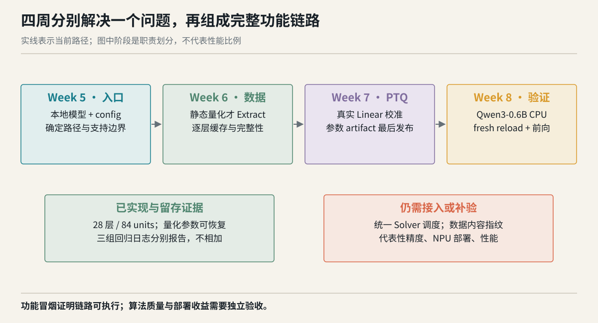
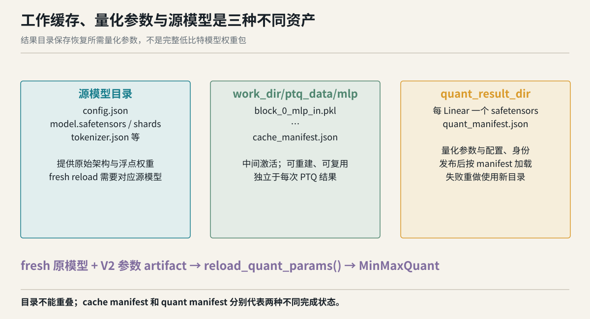
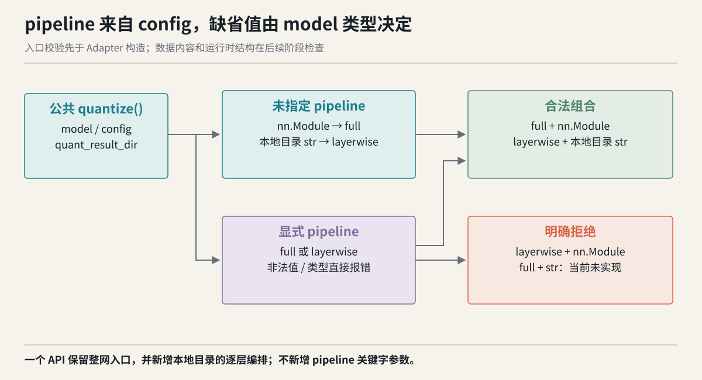
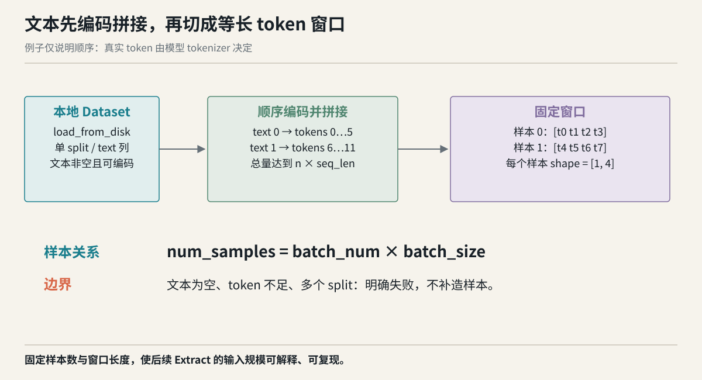
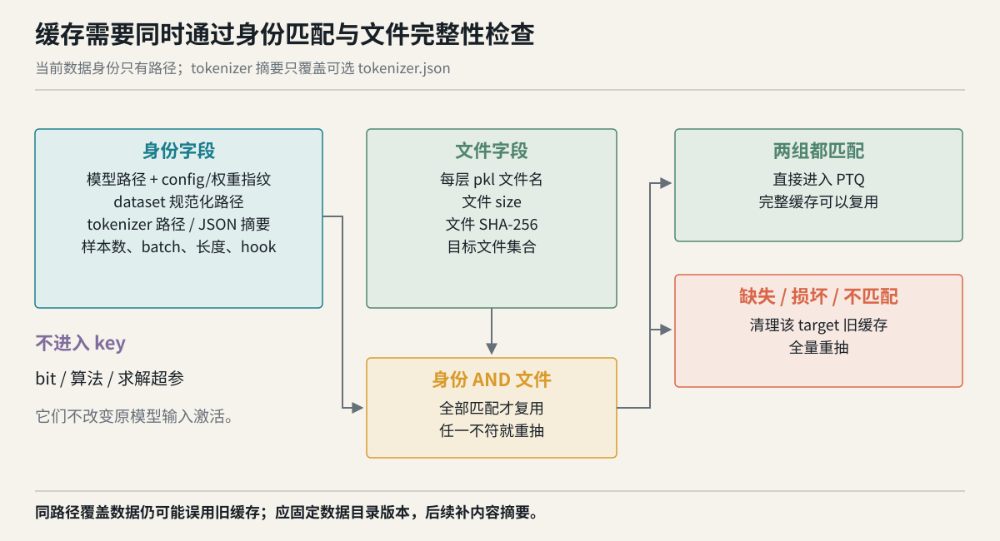
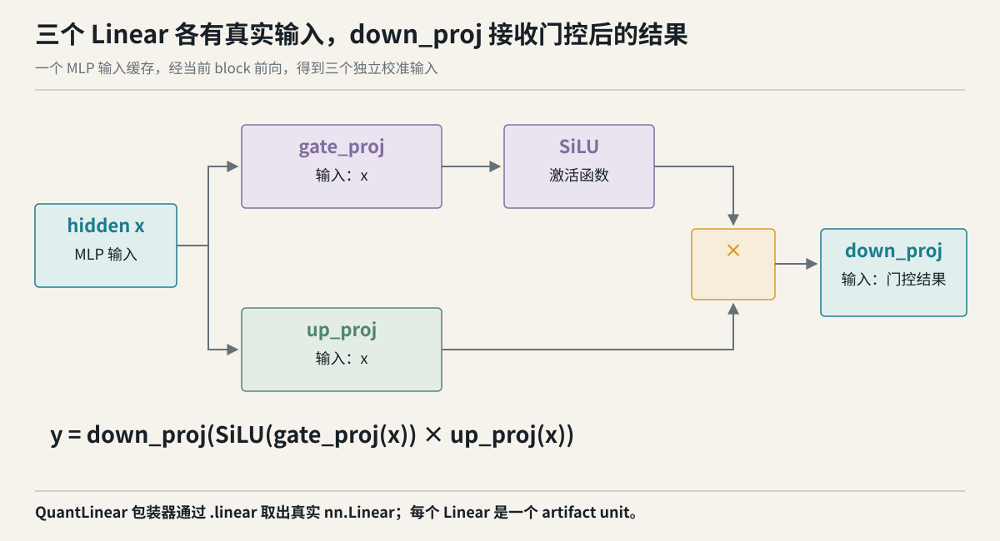
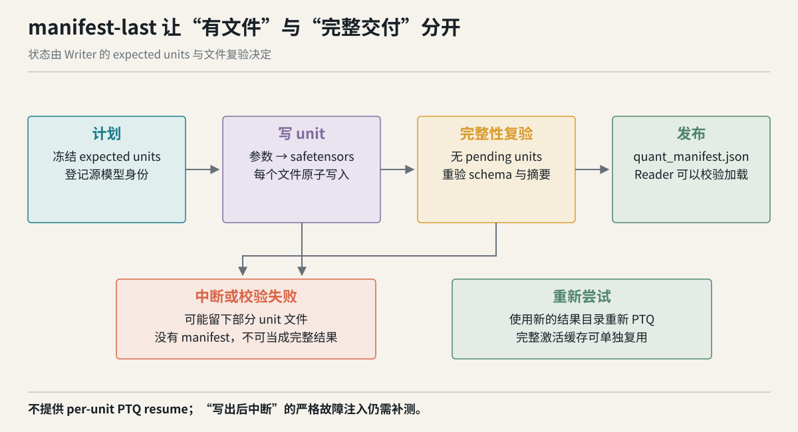
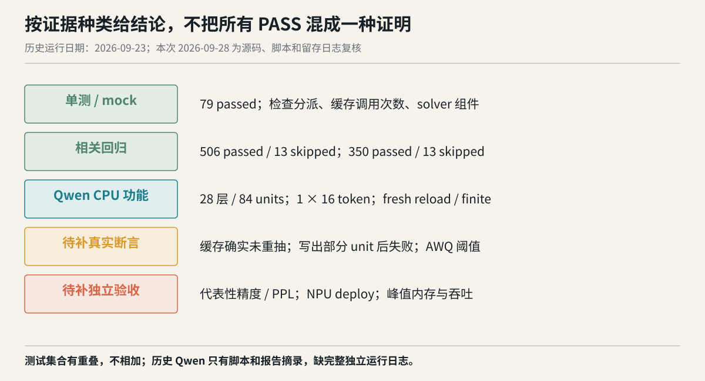

# 里程碑 2：Classic 逐层量化需求规格说明书

| 文档属性 | 内容 |
|---|---|
| 范围 | Week 5–Week 8；Classic layerwise；兼容当前 Adapter 的 dense FFN |
| 版本 | 2.0，2026-09-28 |
| 状态 | 依据当前源码和 2026-09-23 留存证据修订；本次未重跑模型 |
| 配套 | [软件设计说明书](classic_layerwise_design.md)、[测试用例及测试报告](classic_layerwise_test_report.md) |
| 阅读方式 | 本文说明承诺与验收；DS 编号在设计文档展开；TC/QW/BT 编号在测试文档展开 |

## 修订记录

| 日期 | 版本 | 修改 |
|---|---|---|
| 2026-09-23 | 1.0 | 汇总入口、校准数据、缓存、逐 Linear PTQ、V2 参数产物和 Qwen 功能验证 |
| 2026-09-28 | 2.0 | 增加独立周叙事和图示，建立 FR→DS→TC 追踪；修正 Solver 接入、缓存身份、真实测试、AWQ 误差与部署边界 |

## 1 文档目的与一句话结论

使用者应能向 Classic `quantize()` 提供本地模型目录、量化配置和结果目录，得到可恢复到对应原模型的量化参数 artifact。静态激活量化由系统准备本地数据并逐层抓取激活；weight-only 路径直接处理权重。用户不需要手工拼接 Extract 与 PTQ 的临时目录。

当前已有从本地入口到 V2 参数发布、fresh model reload 的 P0 功能链路。支持范围是兼容当前 Adapter 合同及 `gate_proj / up_proj / down_proj` 结构的 dense FFN，算法为无显式算法的权重量化或 MinMax。历史 Qwen3-0.6B CPU 冒烟覆盖 28 层、84 个 FFN Linear unit。统一 Solver 的 `solve/finalize` 尚未接入主调度；代表性精度、NPU 部署和性能不属于已验证结论。



**读图：** 四个阶段分别回答“如何进入”“激活从哪里来”“参数怎样生成并发布”“哪些证据支持结果”。下方两个区域区分已实现链路和待接入、待验收项目。箭头仅表示执行依赖，不表示各阶段耗时或内存比例。

## 2 问题背景与目标使用者

### 2.1 为什么需要逐层入口

整网 Classic 路径接收已经实例化的 `nn.Module`，调用直接，但调用方需要先加载完整模型。已有逐 block 流程能在层级上组织加载与释放，却把命令、配置和工作目录的一致性留给使用者维护。层数增加后，人工串联阶段容易出现错数据、错目录和半成品误用。

里程碑 2 将逐层编排纳入 Classic API。它复用已有 Adapter、数据 Provider、Classic 量化模块与 V2 Writer/Reader，减少使用者维护中间状态的工作。逐层加载释放有利于控制设备驻留规模，但本轮没有峰值内存曲线或整网对照，因此不承诺某个显存/RSS 降幅。

### 2.2 目标使用者与任务

| 使用者 | 典型任务 | 最关心的结果 |
|---|---|---|
| 量化实验者 | 对同一模型比较 W4/W8 或不同校准设置 | 配置明确，缓存身份可解释，每次产物独立 |
| 模型适配开发者 | 增加符合合同的 dense 模型 Adapter | 模型解析、层路径和真实 Linear 输入有明确规则 |
| 结果消费者 | 重新加载模型并恢复量化参数 | 产物完整、源模型匹配、错误时不留下半恢复模型 |
| 测试与评审者 | 判断每周功能及整个里程碑是否可靠 | 需求能追踪到实现、断言及证据，不把不同验证层混同 |

### 2.3 三个必须分清的对象

1. **源模型**包含架构、原始权重及 tokenizer 等文件，是生成激活和 fresh reload 的基础。
2. **工作缓存**保存原模型产生的逐层输入激活，可以在相同身份条件下复用，也可以删除后重建。
3. **量化参数 artifact**保存各 Linear 的量化参数、配置、源身份和文件摘要；它不是完整低比特模型权重包。



**读图：** 左侧源模型与右侧量化参数需要共同参与恢复；中间工作缓存服务于生成过程。`cache_manifest.json` 表示激活缓存完成，`quant_manifest.json` 表示量化参数交付完成，不能互相替代。

## 3 范围、支持矩阵与明确限制

### 3.1 当前承诺

| 维度 | P0 范围 | 说明 |
|---|---|---|
| 入口 | `quantize(model, config, quant_result_dir)` | pipeline 在 config 中；不增加同名公共关键字参数 |
| layerwise 模型 | 本地目录字符串 | 有合法 config、safetensors 权重及已注册 Adapter |
| 结构 | 兼容当前 Adapter 的 dense FFN | 三个目标投影能解析为真实 `nn.Linear` |
| target | 一个 MLP target | 不承诺 Attention、KV cache 或多 target |
| 权重 | INT4 / INT8 | 具体 strategy/group 仍需符合配置校验 |
| 激活 | 静态 INT8 MinMax | weight-only 不需要校准 dataset |
| 数据 | `datasets.save_to_disk` 产生的本地数据目录 | 一个 split，包含 text 字符串列 |
| 结果 | V2 JSON manifest + safetensors 参数文件 | 可由对应 fresh 原模型恢复 |
| 重试 | 新结果目录重新 PTQ | 完整激活缓存可复用，不做 per-unit PTQ resume |

### 3.2 显式不支持

layerwise P0 拒绝 AWQ、GPTQ、SmoothQuant、组合算法、MoE、动态激活、KV cache、多 target 和模糊层配置。`full + str` 当前明确未实现；已有整网流程继续接收 `nn.Module`。模型类型已注册也不自动代表任意结构都支持，运行期还会检查 MLP 与 Linear 合同。

Classic full 上的 MinMax/AWQ/GPTQ 回归只保护既有参数协议及恢复行为，不能变成 layerwise AWQ/GPTQ 的支持声明。恢复后的 `MinMaxQuant` 可执行 fake quant 前向，不能据此宣布已运行 NPU 低比特部署算子。

### 3.3 为什么 P0 先选 MinMax

MinMax 的参数来自观测范围，weight-only 可以直接从权重获得统计，静态激活则通过有限校准 batch 获得范围。这让“入口、数据、参数导出、文件发布、重新恢复”各环节能够先建立完整合同。

AWQ 需要尺度搜索，GPTQ 需要与二阶信息及优化后权重相关的生命周期，SmoothQuant 涉及跨模块变换。只在配置中接受这些名字不会自动满足逐层调度与持久化要求，因此当前选择早期拒绝。后续扩展应以各算法的输入、完成时点和最小恢复状态为依据。

## 4 Week 5：把本地模型交给正确路径

### 4.1 本周问题、输入与输出

本周解决“用户的一次调用应进入哪个流程，哪些错误应在重资源操作前发现”。输入是 model、config 和结果目录；输出是经过校验的内部计划，包含参数与唯一 Adapter。

内部 `LayerwiseArgs` 用来衔接已有 Adapter 字段，不是要求用户直接构造的新公共 API。使用者应继续通过 config 描述意图。



### 4.2 FR-001：pipeline 分派与兼容

`config.pipeline` 只接受 `full` 或 `layerwise`。缺省时，字符串 model 推断为 layerwise，`nn.Module` 推断为 full。显式 layerwise 配 `nn.Module` 应拒绝；显式 full 配字符串应说明当前未实现。未知值和非字符串值不能静默回退。

**为什么：** model 的形式本身区分“调用方已加载整网”与“工具负责从磁盘组织层级执行”。保留缺省行为减少旧调用迁移，同时显式配置可让实验意图可读。

**验收：** 各组合进入唯一预期路径；错误组合在 Adapter/权重操作前失败。追踪 DS-001，TC-001～TC-005。

### 4.3 FR-002：本地模型解析

只接受可访问的本地目录；`config.json` 必须为合法 JSON 对象，含非空 `model_type`。按注册 metadata 查找 Adapter，零匹配应给出可用项，多匹配应拒绝歧义。不能根据目录名字猜模型，也不能因未知类型导入所有模型依赖。

**为什么：** 目录名可以重命名，真正的结构身份在 config 和注册信息中；唯一匹配防止相同模型被错误实现接管。

**验收：** 非法路径、非法 JSON、重复 key、缺 model_type、零/多匹配有可诊断错误；合法项只构造目标 Adapter。追踪 DS-002，TC-006～TC-009。

### 4.4 FR-003：配置翻译与支持边界

样本参数必须满足 `num_calibration_samples = batch_num × batch_size`；缺省与部分指定按既定规则规范化，矛盾、非正数或错误类型应报错。当前缺省关系是 128 个样本、batch size 1、128 个 batch。未知字段和不支持算法不得被忽略；work_dir 与结果目录不得重叠。

配置结构、已知支持边界及明显类型错误应在 Adapter 构造前检查。数据目录是否可读、实际 token 是否足够、运行期 MLP 是否符合合同，在对应阶段检查，不要求所有错误都在入口出现。

**本周独立交付标准：** 给定合法本地模型和配置，可以确定路径、参数和唯一 Adapter；给定错误配置，可以知道错在哪里，而且没有开始重资源流程。追踪 DS-003，TC-010～TC-013。

## 5 Week 6：让激活的来源与复用条件可解释

### 5.1 本周问题、输入与输出

静态激活范围取决于实际输入。本周输入是 Week 5 计划及本地校准数据，输出是逐层 MLP 输入缓存与完整性清单。weight-only 不需要激活统计，应跳过读取 dataset 和 Extract。



### 5.2 FR-004：本地校准数据合同

数据通过 `datasets.load_from_disk` 读取。DatasetDict 只接受一个 split；数据必须包含可用的 text 字符串列。文本依次由模型 tokenizer 编码，拼接后切固定窗口。每个样本 shape 为 `[1, seq_len]`，样本数等于规范化后的 num_samples。空文本、不可用 token 或总 token 不足时明确失败，不自动补造数据。

**为什么：** 固定顺序、固定长度使 Extract 的输入规模可复现；本地加载将数据选择交回使用者，避免隐式联网数据带来实验差异。追踪 DS-004，TC-014～TC-016。

### 5.3 FR-005：需要激活时才 Extract

静态激活满足 `a_bits < 16`、非动态、算法包含 MinMax 时需要 Extract。流程先 embedding forward，再逐 block forward，通过对应 FFN norm hook 保存 MLP 输入。weight-only 应在没有 dataset 的情况下完成参数产物生成。

**为什么：** 对不依赖激活的路径读取数据既增加成本，也引入无关失败点。追踪 DS-005，TC-017～TC-018。

### 5.4 FR-006：缓存身份明确且不夸大

cache key 应记录模型路径、模型 config/权重指纹、model_type、数据规范化路径、tokenizer 路径与可选 tokenizer.json 摘要、样本数、batch size、seq_len、target、hook 和固定采样描述。量化 bit、算法和求解超参不参与当前 key，因为缓存来自原模型前向，而这些设置影响后续 PTQ。

**当前限制：** dataset 没有内容摘要，同路径覆盖数据可能无法自动识别；tokenizer 身份没有覆盖全部关联文件或运行版本。使用者应给数据使用不可变版本目录，替换同路径数据或 tokenizer 行为后主动清理缓存。数据内容指纹列为补强项，不能在现状文档中写成已完成。追踪 DS-006，TC-019，BT-01。

### 5.5 FR-007：完整性检查后才能复用

所有预期 pkl 文件应记录 name、size、SHA-256。身份字段匹配且全部文件完整才允许复用；缺失、损坏或已覆盖身份变化时，该 target 全量重抽。全部文件完成后才原子发布 cache manifest。当前不支持逐层断点续抽。缓存清单尚未采用严格 schema 校验；合法 JSON 若不是对象，仍有未覆盖的异常路径，需要补类型防御。



**为什么：** 缓存命中不能只看目录存在，否则上一轮中断或被截断的文件可能进入校准。完整重抽使状态简单、容易解释，代价是中断后要重复整个 Extract。

**本周独立交付标准：** 可以说明每份激活由哪个模型、路径和采样配置生成；mock 用例可证明有效缓存不增加 Extract 调用，损坏缓存会重抽。真实 Qwen 第二轮历史脚本只检查文件数量和源身份，严格“没有重抽”仍待补断言。追踪 DS-007，TC-020～TC-022，BT-02。

## 6 Week 7：把逐层校准结果变成可恢复交付物

### 6.1 本周问题、输入与输出

输入是有效计划、原始权重及必要的激活缓存；输出是逐 Linear 的量化参数、V2 清单和可恢复的层路径。重点是每个 unit 都有正确输入、参数在正确时点导出、全部 unit 完成后才发布。



### 6.2 FR-008：一个真实 Linear 对应一个 unit

每层的 `gate_proj`、`up_proj`、`down_proj` 应分别形成 unit。路径例如 `model.layers.0.mlp.gate_proj`，全局唯一，能在 fresh model 中定位。包装器须解析到其内部真实 `nn.Linear`；当前 Qwen `QuantLinear` 通过 `.linear` 解析。

**为什么：** 整个 MLP 包含多个输入分布和权重形状；以真实 Linear 为单位，参数与恢复目标一一对应，也能明确 expected units 的完整性。追踪 DS-008，TC-023～TC-024。

### 6.3 FR-009：校准各 Linear 的真实输入

gate/up 接收 MLP 输入 x，down 接收 `act_fn(gate_proj(x)) × up_proj(x)`。静态校准必须按真实数据流捕获，不能把 x 复制给三个投影。捕获输入应按权重 dtype 对齐；关键输入缺失时不能继续写该 unit。

**为什么：** down 输入经过非线性和乘法，数值范围不同；错误输入可能仍能计算，却得到错误 scale。形状通过不等于校准正确。追踪 DS-009，TC-025，BT-03。

### 6.4 FR-010：MinMax 参数充分且可恢复

weight-only 从权重产生统计参数；静态 MinMax 逐 batch 累计激活范围，在校准批数达到要求后产生激活参数。对称示例分别导出 `scale_w` 或 `scale_w + scale_d`；非对称配置还可能需要 offset，不能把两种示例概括为所有配置都只保存 scale。

导出 tensor 应脱离计算图并转换为 CPU contiguous 数据交给 Writer。结果记录其配置、模块类型和源模型身份。恢复后的假量化行为与 NPU 部署转换分别验收。追踪 DS-010，TC-026～TC-027，QW-01～QW-04。

### 6.5 FR-011：区分 Solver 组件与主调度

`CalibrationSolver` 提供无梯度逐 batch 前向与参数导出能力，并有组件测试。当前主流程虽然选择和实例化该 solver，实际由 Classic `MinMaxQuant` 完成 forward 与 `export_quant_params()`，未调用 solver 的 `solve()`、`finalize()`。

**验收口径：** 组件能力按组件验收；统一 Solver 编排作为待接入项，不用组件单测代替主链路接入证明。接入后应验证调用次数、导出路径与原主路径参数一致性。追踪 DS-011，TC-028～TC-029，BT-04。

### 6.6 FR-012：完整量化参数最后发布

Writer 以 expected units 为完整性依据。每个 unit 文件原子写入并复验；全部预期 unit 完成后才发布 `quant_manifest.json`。没有 manifest 的目录不能作为完整结果加载。PTQ 中断后允许存在未发布文件，但必须使用新的结果目录重做，当前不提供 per-unit resume。



**为什么：** 文件可能逐个产生，“目录已有几个 safetensors”无法证明完整。manifest 最后出现，为消费者提供一个明确的完成标志。追踪 DS-012，TC-030～TC-032，BT-05。

### 6.7 FR-013 / FR-014：源模型匹配与失败语义

FR-013 要求 artifact 能与对应 fresh 原模型建立身份关联并恢复到目标 Linear；使用 config 与原始权重摘要保持 layerwise 生产端和 full model 消费端一致。恢复过程沿用 V2 Reader 的校验与事务替换语义，失败时不应留下部分替换。追踪 DS-013，TC-033～TC-034。

FR-014 要求错误发生后可判断阶段和产物状态：准备错误不给出成功结果，Extract 未完成不发布缓存完成清单，PTQ/文件复验失败不发布结果清单。现有“第二层构建失败”用例可能在 unit 规划阶段触发，不能单独证明已写出第一层后的事务行为；该情形另有补测计划。追踪 DS-014，TC-035，BT-05。

**本周独立交付标准：** 每个 unit 的层路径、输入与参数可解释；正常完成可发布，失败无法伪装成完整 artifact；消费端使用对应源模型进行恢复。

## 7 Week 8：用真实权重验证功能链路

### 7.1 本周问题与实验对象

Week 8 把前三周合同放进真实 Qwen3-0.6B，而不是只让 mock Adapter 接口对齐。模型为本地 28 层 Qwen3，每层三个 FFN Linear，共 84 units；历史执行设备为 CPU，模型加载为 bfloat16，静态校准为 1 个 16-token 样本。

选择这个规模的原因是能在当前 CPU 条件下覆盖真实层命名、Adapter 包装、dtype、权重指纹及完整 28 层执行，同时保留可检查的产物规模。这是功能冒烟规模，不是代表性精度校准规模。

### 7.2 FR-015：保护 Classic full 与既有文件协议

新增 layerwise 不应改变旧 full 调用语义。V2 Writer、Reader、模块导出和 reload 回归应继续运行。Classic full 的独立双 Linear 实验中，MinMax/GPTQ 比较落盘前后的量化模型输出；AWQ 历史脚本只记录最大差值与有限性，未断言误差阈值。独立小型 AWQ 回归的 `assert_close` 是另一项证据，应单独列出。追踪 DS-015，TC-036～TC-038。

### 7.3 FR-016：测试结论必须与断言及环境一致

| 验证层 | 现有证据 | 可得结论 | 不可外推 |
|---|---|---|---|
| 单元/组件 | 79 passed 历史日志 | 入口、mock 流程、solver 组件相应断言通过 | 所有真实模型、部署性能 |
| 相关回归 | 506/13 skipped；350/13 skipped | 指定测试集合的回归结果 | 三组相加为唯一测试数 |
| Qwen weight-only | 84 scale_w units，fresh reload，finite | 真实全层功能链路可执行 | 对原始模型精度无损 |
| Qwen static | 28 缓存文件，84 组 scale，finite | 静态激活参数链路可执行 | 代表性校准质量 |
| Qwen 第二轮 | 文件数均 28，source_model 相同 | 第二轮可以生成产物 | 单靠数量证明从未重抽 |
| NPU deploy | 13 个相关 skip | 环境前置条件未满足 | 部署已通过 |



真实 Qwen 留存的是脚本和旧报告输出摘录，没有对应完整独立运行日志；历史临时产物现已不在原 `/tmp` 位置。本轮材料更新是证据复核，不是新模型运行。追踪 DS-016，TC-039～TC-040，QW-01～QW-05，BT-06～BT-08。

## 8 典型调用与使用约束

以下演示 weight-only P0 入口。模型目录、结果目录由调用方选择；已有发布结果应使用新目录。CPU 示例用于功能验证，不代表部署配置建议。

```python
import amct_pytorch as amct

config = {
    "pipeline": "layerwise",
    "device": "cpu",
    "work_dir": "/data/experiment/work",
    "batch_num": 1,
    "batch_size": 1,
    "num_calibration_samples": 1,
    "max_seq_length": 16,
    "quant_cfg": {
        "weights": {"type": "int8", "symmetric": True, "strategy": "channel"},
    },
    "algorithm": {"minmax": {}},
}
result_dir = amct.quantize(
    "/data/models/Qwen3-0.6B", config, "/data/experiment/result-01"
)
```

静态 MinMax 在上述 config 中增加本地 dataset，并在 `quant_cfg` 中增加 `inputs={"type":"int8", "symmetric":True, "strategy":"tensor"}`。所给 batch、样本数与 seq_len 仅用于说明接口，正式精度实验需要独立设计代表性数据与阈值。

调用后首先使用 V2 Reader 检查 manifest 与 unit 完整性，再为对应 fresh 原模型执行 `reload_quant_params()`。无需为了消费参数 artifact 再次执行校准；如需要 NPU deploy，应在满足环境条件后运行部署转换与等价性测试。

## 9 总体验收与后续补强

### 9.1 当前可以签收的范围

可以签收 P0 的本地入口、配置分派、逐层缓存机制、逐 FFN Linear MinMax 参数产物及 fresh reload 功能实现；历史日志支持相应单测与回归，历史 Qwen 记录支持真实全层 CPU 冒烟。以这组有限承诺描述里程碑，不使用“所有算法、全部部署、正式精度性能均通过”的结论。

### 9.2 必须独立补齐的验收

| 补强项 | 可判定的完成标准 | 追踪 |
|---|---|---|
| 数据内容身份 | 同路径改 text 导致 key 变化或明确强制重抽；tokenizer 相关变更有覆盖规则 | BT-01 |
| 真实缓存复用 | 第二轮 Extract 调用数为零，缓存 size/hash/mtime 不变，同时新 artifact 完成 | BT-02 |
| 输入语义 | 对 gate/up/down 的捕获输入作数值比较，down 与独立门控公式一致 | BT-03 |
| Solver 主调度 | solve/finalize 在实际 layerwise 中被调用并产生预期参数 | BT-04 |
| 写中失败 | 已至少写出一个 unit 后注入失败；无 manifest；Reader 拒绝；新目录重跑成功 | BT-05 |
| 精度 | 固定代表性数据、baseline、指标和预先约定阈值；保存完整日志 | BT-06 |
| NPU | 逐项重跑 13 个 skip；真实设备 direct/reload/convert 前向和模块检查 | BT-07 |
| 性能与证据归档 | 同条件测峰值内存、吞吐/时延；保存脚本、配置、数据身份、产物摘要与日志 | BT-08 |

### 9.3 非功能要求与可观察性

错误信息应指出输入字段、目标路径或缺失 unit，使使用者能够区分配置错误、来源不匹配、文件损坏和设备不满足条件。诊断不能仅返回“量化失败”，也不能吞掉异常后留下一个看似成功的结果目录。路径检查和支持边界检查应尽量在重资源操作前完成；只有数据加载或模型执行后才能知道的错误，在对应阶段及时停止。

文档和运行记录应同时报告模型版本、设备、配置、数据规模与结果状态。一个示例用一条短文本完成前向，只能作为可执行性示例；要作为质量验收，必须新增独立数据、指标和预先约定的误差阈值。文档中的示意图不按真实耗时或内存绘制，所有性能数字必须有实际测量来源。

维护性要求体现在三处：配置字段有统一翻译点，产物 unit 与模型层路径一一对应，需求、设计和测试编号可以双向查找。扩算法时应先说明它需要哪些输入、何时定稿、恢复时需要什么状态，再接入编排与文件协议，不能仅通过放宽算法名校验宣布支持。

## 10 术语、追踪总表与依据

PTQ 指训练后量化；Extract 指在原模型上抓取中间激活；unit 指可独立持久化并定位恢复的 Linear；artifact 指 manifest 管理的一组参数文件；fake quant 指数值上模拟量化/反量化的浮点计算；fresh model 指从源 checkpoint 新加载、尚未应用本次量化参数的模型。

| 需求 | 设计 | 主要验收 |
|---|---|---|
| FR-001～FR-003 | DS-001～DS-003 | TC-001～TC-013 |
| FR-004～FR-007 | DS-004～DS-007 | TC-014～TC-022；BT-01/02 |
| FR-008～FR-011 | DS-008～DS-011 | TC-023～TC-029；QW-01～04；BT-03/04 |
| FR-012～FR-014 | DS-012～DS-014 | TC-030～TC-035；BT-05 |
| FR-015～FR-016 | DS-015～DS-016 | TC-036～TC-040；QW-01～05；BT-06～08 |

实现依据为本地 `amct_pytorch/classic/layerwise.py`、`amct_pytorch/classic/quantize.py`和 `amct_pytorch/classic/quant_result.py`。历史依据为 [2026-09-23 留存证据](../evidence/历史测试报告_20260923.md)及本目录归档脚本、日志；本轮纠错依据见 [技术事实审查](../qa/technical_audit.md)。

老师文档仓入口为 [scripts/docs](https://gitcode.com/yaoguangxiu/scripts/tree/main/docs)。本轮未获得可逐条复核的原文快照，因此本文中的实现取舍和审查发现按本地代码事实说明，不归因为“老师要求”。
