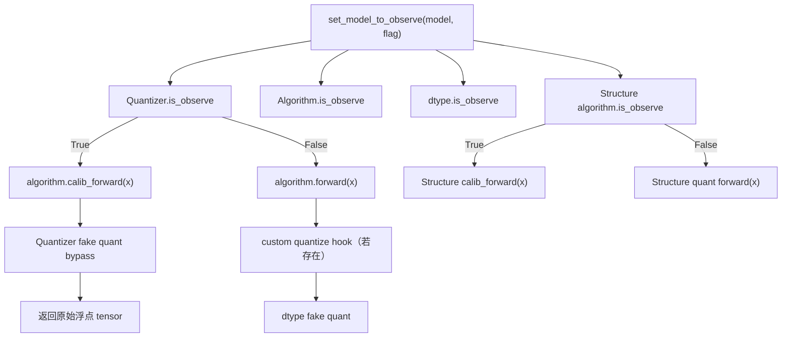
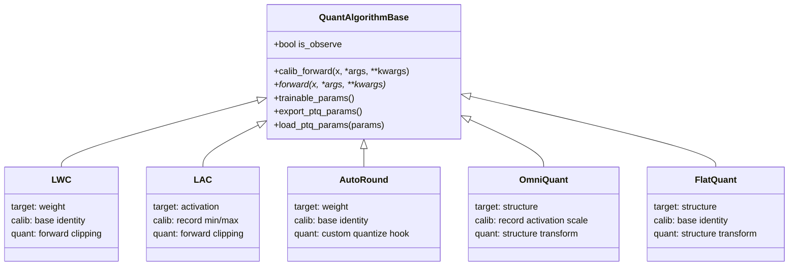

# LLM 量化算法状态控制与开发指南

## 1. 文档目的

本文总结 LLM 量化算法 observe 状态控制优化，并说明 `QuantAlgorithmBase`、现有量化算法、Quantizer 和 dtype 之间的关系。新增量化算法或调整已有算法时，应遵循本文的接口、注册和测试约束。

本文仅说明 `amct_pytorch` 非 `experimental` 目录下的 LLM 量化实现。

## 2. 本次优化概述

本次优化统一使用 `is_observe` 表示当前是否处于校准数据采集状态：

- `is_observe=True`：处于 calibration/observe 阶段。算法只允许记录校准所需的统计信息，必须返回原始浮点 tensor；dtype 和 Quantizer 的伪量化通路直接 bypass。
- `is_observe=False`：处于 PTQ 训练、PTQ eval 或正常量化阶段。算法执行量化路径，dtype 可以执行 fake quant。

优化后删除了以下冗余状态控制接口：

- `set_quantizer_state()`
- `set_weight_quantizer_state()`
- `set_act_quantizer_state()`
- `set_model_act_quant_state()`
- `set_model_weight_quant_state()`
- `ActivationQuantizer.set_observe()`
- `WeightQuantizer.set_observe()`

模型量化状态统一由 [`set_model_to_observe()`](../../amct_pytorch/common/models/llm/common/quant_apply.py) 控制：

```python
def set_model_to_observe(model, flag):
    for mod in model.modules():
        if hasattr(mod, "is_observe"):
            mod.is_observe = flag
```

该接口递归设置模型子树中所有具有 `is_observe` 属性的模块，包括：

- `ActivationQuantizer` 和 `WeightQuantizer`
- Quantizer 内注册的 algorithm
- Quantizer 内注册的 int、mxfp、hifp dtype 实现
- 不经过 Quantizer 调用的 Structure algorithm

生产代码不得只修改某个 Quantizer 的 `is_observe`。只修改单个模块会导致 Quantizer、algorithm 和 dtype 状态不一致，使校准数据遗漏或 fake quant 被错误 bypass。

## 3. 状态控制和前向路径



### 3.1 ActivationQuantizer

`ActivationQuantizer.forward()` 根据自身 `is_observe` 选择算法路径：

```python
x = algo.calib_forward(x) if self.is_observe else algo(x)
```

observe 状态下，所有激活算法依次接收激活 tensor。需要采集激活分布的算法可以更新内部统计，但最终必须返回输入 tensor 本身；随后 `fake_quant()` 直接返回输入。

### 3.2 WeightQuantizer

`WeightQuantizer` 在 observe 状态下调用每个权重算法的 `calib_forward()`，不解析和执行自定义 `quantize()` hook。因此 AutoRound 等仅用于权重量化、且不依赖校准分布的算法会使用基类默认校准实现，直接返回原始权重。

非 observe 状态下：

- 普通权重算法通过 `forward()` 执行。
- 带 `quantize()` hook 的算法延迟到普通算法处理完成后执行。
- 同一个 `WeightQuantizer` 只允许存在一个带 `quantize()` hook 的算法。

### 3.3 Structure algorithm

OmniQuant、FlatQuant 属于 Structure algorithm，由模型结构或量化线性层直接调用，不经过 ActivationQuantizer/WeightQuantizer 的 algorithm 分发。因此 Structure algorithm 必须在自身 `forward()` 内保留 `is_observe` 判断：

```python
def forward(self, x, inv_t=False, name=None):
    if self.is_observe:
        return self.calib_forward(x, inv_t=inv_t, name=name)
    return self.quant_forward_impl(x, inv_t=inv_t, name=name)
```

## 4. QuantAlgorithmBase 算法基类

所有注册到 `ALGO_REGISTRY` 的 LLM 量化算法都必须继承 [`QuantAlgorithmBase`](../../amct_pytorch/algorithms/quant/algorithm_base.py)。注册器会在注册阶段校验继承关系，非基类子类会直接触发 `TypeError`。

### 4.1 公共状态和接口

| 接口或属性 | 基类行为 | 子类要求 |
| --- | --- | --- |
| `is_observe` | 在 `__init__()` 中初始化为 `False` | 通过继承获得，不应重复定义另一套状态变量 |
| `calib_forward(x, ...)` | 直接返回 `x` | 仅需要采集校准统计的算法重写 |
| `forward(x, ...)` | 抽象接口 | 每个算法必须实现量化路径 |
| `trainable_params()` | 返回当前算法的全部 parameters | 只有参数筛选规则不同时才重写 |
| `export_ptq_params()` | 导出所有 named parameters 的 CPU tensor | 需要额外导出 buffer 时重写 |
| `load_ptq_params(params)` | 按名称恢复 parameter，忽略未知名称，并匹配目标 device/dtype | 参数结构或 buffer 恢复规则不同时重写 |

### 4.2 calib_forward 契约

`calib_forward()` 用于 calibration data 采集阶段，必须满足以下约束：

1. 返回传入的同一个 tensor 对象，即 `output is x`。
2. 不对输入 tensor 做原地修改。
3. 不执行裁剪、变换、舍入或 fake quant。
4. 可以更新算法内部的统计量或 buffer。
5. 统计计算应避免保留不必要的计算图，例如使用 `detach()`。
6. 接口参数必须兼容实际调用方；Structure algorithm 需要正确传递 `inv_t`、`name` 等上下文。

不依赖 calibration data 的算法无需重写 `calib_forward()`，直接复用基类 identity 实现。

### 4.3 参数导出和恢复

基类公共实现只处理 `named_parameters()`。如果算法的 PTQ 产物还包含 buffer 或其他非 Parameter 状态，需要重写导出和恢复接口。

例如 LAC 除可训练的裁剪参数外，还需要导出和恢复 `maxval`、`minval` buffer，因此保留自定义实现。

## 5. 当前算法继承关系



| 算法 | 注册 target | 是否重写 `calib_forward()` | observe 行为 | 量化路径特点 |
| --- | --- | --- | --- | --- |
| LWC | `weight` | 否 | 基类直接返回权重 | `forward()` 执行可学习权重裁剪 |
| LAC | `activation` | 是 | 更新 `maxval`、`minval`，返回原激活 | `forward()` 执行可学习激活裁剪 |
| AutoRound | `weight` | 否 | 基类直接返回权重，不执行 hook | 使用自定义 `quantize()` 和 `export_deploy()` |
| OmniQuant | `structure` | 是 | `inv_t=False` 记录激活 scale；`inv_t=True` 直接返回权重 | `forward()` 内自行完成 observe/quant 分发 |
| FlatQuant | `structure` | 否 | 基类直接返回输入 | `forward()` 内自行完成 observe/quant 分发 |

需要注意：`is_observe` 由所有算法从 `QuantAlgorithmBase` 继承，而不是要求每个子类重复声明。Structure algorithm 在 `forward()` 内读取该状态；Activation/Weight algorithm 的校准或量化入口由对应 Quantizer 选择。

## 6. 算法注册注意事项

### 6.1 注册声明

算法通过 `ALGO_REGISTRY.register()` 注册：

```python
@ALGO_REGISTRY.register(
    name="new_algo",
    description="Description of the algorithm",
    targets=("activation",),
)
class NewAlgorithm(QuantAlgorithmBase):
    ...
```

注册时必须满足：

- 注册对象是 `QuantAlgorithmBase` 的子类。
- `name` 在 registry 中唯一，并与配置文件中的算法名称一致。
- 必须提供非空 `targets` 元数据。
- target 使用当前框架识别的 `activation`、`weight` 或 `structure`。
- 一个算法可以声明多个 target，但构造函数和 forward 契约必须兼容每个声明的 target。
- 同一模型位置只允许构建一个 Structure algorithm。

### 6.2 构造函数约定

当前构建逻辑根据 target 传递不同上下文：

| target | 推荐构造函数 | 额外上下文 |
| --- | --- | --- |
| `activation` | `__init__(self, args)` | 无 |
| `weight` | `__init__(self, args, w_bits)` | 当前权重量化位宽 |
| `structure` | `__init__(self, args, ctx)` | `AlgoBuildContext`，包含 `dim_size`、`matrix_size` |

算法构造函数必须首先调用 `super().__init__()`，否则不会初始化基类状态和 `nn.Module`。

### 6.3 注册加载入口

新增算法文件后，还需要在 [`register_algorithms()`](../../amct_pytorch/algorithms/quant/__init__.py) 中导入算法类，使装饰器完成注册：

```python
def register_algorithms():
    ...
    from .new_algorithm import NewAlgorithm  # noqa: F401
```

不要依赖其他模块的偶然 import 完成注册。workflow、eval 和 deploy 流程会显式调用 `register_algorithms()`。

## 7. 新增算法开发示例

### 7.1 需要校准统计的 Activation algorithm

```python
@ALGO_REGISTRY.register(
    name="new_activation_algo",
    description="Activation algorithm with calibration statistics",
    targets=("activation",),
)
class NewActivationAlgorithm(QuantAlgorithmBase):
    def __init__(self, args):
        super().__init__()
        self.register_buffer("running_stat", torch.zeros(1))

    def calib_forward(self, x, *args, **kwargs):
        self.running_stat.copy_(update_stat(x.detach()))
        return x

    def forward(self, x):
        return apply_quant_algorithm(x, self.running_stat)
```

### 7.2 不需要校准统计的 Weight algorithm

```python
@ALGO_REGISTRY.register(
    name="new_weight_algo",
    description="Weight algorithm without calibration statistics",
    targets=("weight",),
)
class NewWeightAlgorithm(QuantAlgorithmBase):
    def __init__(self, args, w_bits):
        super().__init__()
        self.bits = w_bits

    def forward(self, weight):
        return transform_weight(weight, self.bits)
```

该算法不重写 `calib_forward()`；observe 状态自动使用基类 identity 实现。

### 7.3 Structure algorithm

```python
@ALGO_REGISTRY.register(
    name="new_structure_algo",
    description="Structure transform algorithm",
    targets=("structure",),
)
class NewStructureAlgorithm(QuantAlgorithmBase):
    def __init__(self, args, ctx):
        super().__init__()
        self.dim_size = ctx.dim_size

    def calib_forward(self, x, inv_t=False, name=None):
        if not inv_t:
            record_activation_stat(x.detach())
        return x

    def forward(self, x, inv_t=False, name=None):
        if self.is_observe:
            return self.calib_forward(x, inv_t=inv_t, name=name)
        return apply_structure_transform(x, inv_t=inv_t, name=name)
```

Structure algorithm 必须自行实现 observe 分发，且权重逆变换场景是否需要记录数据必须明确。例如 OmniQuant 在 `inv_t=True` 时不记录权重统计。

## 8. 新增算法测试要求

新增算法至少需要覆盖以下测试：

1. 注册成功，且注册类继承 `QuantAlgorithmBase`。
2. `calib_forward()` 返回输入对象本身，并且输入数值未被修改。
3. 不需要校准统计的算法验证基类 identity 行为。
4. 需要校准统计的算法验证统计信息被正确更新。
5. `forward()` 验证量化路径的算法行为。
6. Activation/Weight algorithm 验证 observe 状态不执行量化 `forward()` 和 dtype fake quant。
7. 自定义 `quantize()` hook 验证 observe 状态不会调用 hook。
8. Structure algorithm 分别验证 `is_observe=True/False` 两条路径。
9. 具有参数或 buffer 的算法验证 `export_ptq_params()`、`load_ptq_params()` round trip。
10. 新算法需要加入 registry 参数化契约测试；若构造参数特殊，应同步补充测试 fixture。

对于新增 dtype，还需要验证：

- `is_observe=True` 时 `forward()` 返回输入 tensor 本身。
- observe bypass 位于量化计算之前。
- `deploy()`、`export_deploy()` 不受 observe 状态影响。

## 9. 开发检查清单

提交新增算法前，逐项确认：

- [ ] 算法继承 `QuantAlgorithmBase`，并调用 `super().__init__()`。
- [ ] 注册名称唯一，`targets` 元数据正确且非空。
- [ ] Activation/Weight algorithm 的 `forward()` 只实现量化阶段行为。
- [ ] 仅在需要统计校准数据时重写 `calib_forward()`。
- [ ] `calib_forward()` 满足 `output is x`，且不修改输入数值。
- [ ] Structure algorithm 在自身 `forward()` 内处理 `is_observe`。
- [ ] 未新增独立的 observe setter 或另一套状态变量。
- [ ] 生产状态切换只使用 `set_model_to_observe()`。
- [ ] 自定义 `quantize()` hook 仅用于 Weight algorithm，并处理多 hook 和部署导出约束。
- [ ] 参数和 buffer 的导出、恢复逻辑完整。
- [ ] `register_algorithms()` 已导入新算法。
- [ ] registry、calibration、quantization 和状态同步 UT 已补充。
- [ ] Ruff、format、pre-commit 和本地可执行 UT 全部通过。
- [ ] 涉及 NPU/dtype backend 的行为已在目标环境完成回归。

## 10. 常见错误

- 只设置 Quantizer 的 `is_observe`，没有同步 algorithm 或 dtype。
- 在 `calib_forward()` 内执行裁剪、变换或 fake quant。
- 校准路径返回 `x.clone()` 或其他新 tensor，而不是原始输入对象。
- Structure algorithm 依赖 Quantizer 分发，导致校准时仍执行量化变换。
- 新算法继承普通 `nn.Module`，在注册阶段被拒绝。
- 注册时遗漏 `targets`，导致算法无法按目标筛选。
- 新算法文件未加入 `register_algorithms()`，运行时 registry 中不存在该算法。
- 重复实现与基类完全相同的参数导出、恢复接口，增加维护成本。
- 带自定义 `quantize()` hook 的算法在 observe 状态仍执行 hook。
