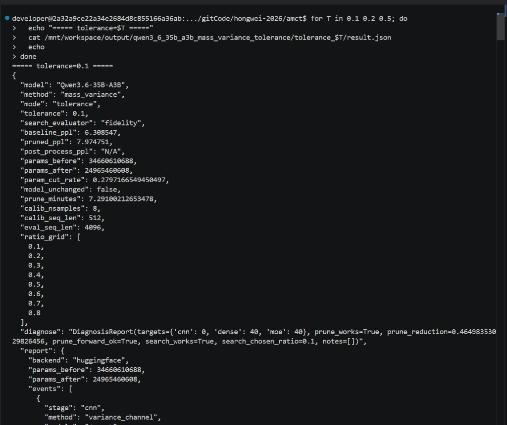
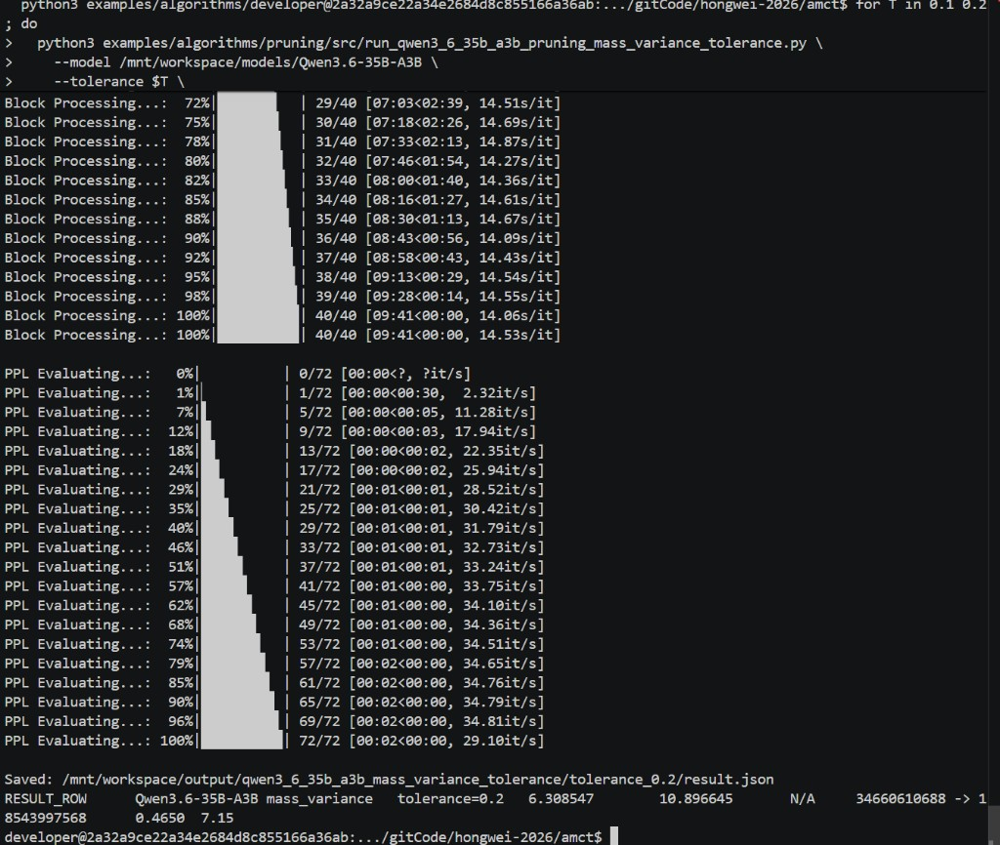

# AMCT Structured Pruning Samples

Calling the `amct_pytorch.pruning` interface across three domains: dense FFN (intermediate dim) /
CNN (channels) / MoE (experts). Samples use randomly-initialized tiny models, run on CPU, download nothing.

> API details: [`amct_pytorch/pruning/README_en.md`](../../../amct_pytorch/pruning/README_en.md).

## 1 Pruning Prerequisites

### 1.1 Install Dependencies

Dependencies are in [requirements.txt](requirements.txt): `torch` and `transformers` (pulled in by the
amct_pytorch import chain). To run on NPU you also need a `torch_npu` matching your Python/torch versions
and an installed CANN package.

### 1.2 Model and Data Preparation

Sample models and data are built by [src/utils.py](src/utils.py) with fixed seeds
(`MiniMLP`/`MiniCNN`/`MiniMoE`); no download, no network. Replace them with real models and calibration
data for actual use.

### 1.3 Pruning Configuration

Pass a dict config directly to `prune()` (same style as `amct.quantize`); pick a method per domain:

| Domain | Method | Description |
|:--|:--|:--|
| dense | `low_variance` | Prune FFN intermediate dim by activation variance (auto-skips attention) |
| dense | `reconstruct` | Least-squares compensation after pruning, recovery in {none, bias, ls} |
| cnn | `variance_channel` | Naive channel slicing by activation variance |
| cnn | `reconstruct` | Output-reconstruction channel pruning |
| moe | `activation_count` | Prune experts by activation frequency, shrink the gate |
| moe | `mass_variance` | Prune experts by expert mass-variance |

Passing only `tolerance` runs auto-pruning: binary-search the largest prune ratio on `ratio_grid` that
meets the tolerance. With a menu config (`MOE_VARIANCE_MENU_CFG` / `DENSE_RECOVERY_MENU_CFG` / `CNN_RECOVERY_MENU_CFG`),
`prune` switches to MENU selection: it measures every candidate on the separate small validation
set given by `eval_data` and applies the best one.

## 2 Pruning Example

### 2.1 Use Interface Method to Call

Run from the current directory (CPU is fine):

```bash
python3 src/run_dense_samples.py   # dense: fixed-ratio / tolerance-auto / recovery-menu / prune+quantize / evaluator
python3 src/run_cnn_samples.py     # cnn: variance vs reconstruct channel pruning / recovery-menu
python3 src/run_moe_samples.py     # moe: activation_count vs mass_variance expert pruning / variance-menu
```

Each sample prints params before/after pruning, the reduction ratio, and runs a forward check.

## 3 Community Sample: Qwen3.6-35B-A3B MoE `mass_variance` + `tolerance`

Corresponds to Issue [#183](https://gitcode.com/cann/amct/issues/183) task 2: structured expert
pruning on a real MoE checkpoint.
Script: [`src/run_qwen3_6_35b_a3b_pruning_mass_variance_tolerance.py`](src/run_qwen3_6_35b_a3b_pruning_mass_variance_tolerance.py).

### 3.1 How to Run

Environment: CANNLab **NPU A3** (910C, host RAM preferably ≥150GB). Pruning runs on CPU; WikiText2
PPL is measured with AMCT blockwise eval on `npu:0` at `seq_len=4096`.

```bash
# repo root
source /home/developer/Ascend/cann/set_env.sh
export MODEL_DIR=/data/models/Qwen3.6-35B-A3B   # placeholder; point to local weights
export HF_ENDPOINT=https://hf-mirror.com
export HF_HUB_DISABLE_XET=1

# baseline once
python3 -m amct_pytorch.eval \
  --trust_remote_code \
  --model "$MODEL_DIR" \
  --model_name qwen3_6_moe \
  --seq_len 4096 \
  --granularity block \
  --device npu:0 \
  --eval_mode bf16 \
  --bit_config amct_pytorch/configs/bf16.yaml

# run each tolerance independently from the original model (default ratio_grid)
# Qwen3.6 local weights need an explicit --trust-remote-code (trusted local dir only)
for T in 0.1 0.2 0.5; do
  python3 examples/algorithms/pruning/src/run_qwen3_6_35b_a3b_pruning_mass_variance_tolerance.py \
    --model "$MODEL_DIR" \
    --trust-remote-code \
    --tolerance "$T" \
    --baseline-ppl <ppl_bf16> \
    --skip-baseline-eval \
    --search-evaluator fidelity \
    --output-dir ./output/qwen3_6_35b_a3b_mass_variance_tolerance
done
```

Key arguments:

| Arg | Meaning |
|:--|:--|
| `--tolerance` | Search tolerance; task requires `0.1` / `0.2` / `0.5` separately |
| `--trust-remote-code` | Allow custom Python from the model dir (off by default). `--model` must be a local directory; enable only for trusted local weights |
| `--search-evaluator fidelity` | AMCT built-in fidelity for search (not comparable with `proxy_ppl`); table PPL is still WikiText2 blockwise |
| `--calib-nsamples` / `--calib-seq-len` | Pileval calibration count/length (default 8 / 512) |
| `--eval-seq-len` | Evaluation sequence length, fixed at 4096 |
| `--output-dir` | Artifact directory (relative / placeholder path) |

Calibration: `mit-han-lab/pile-val-backup`. Evaluation: WikiText2 `wikitext-2-raw-v1` test.
After `save_pretrained`, the script restores VL-nested `config.json` and updates
`text_config.num_experts` so the `qwen3_6_moe` eval path can load the checkpoint.

### 3.2 Diagnosis and Report

Excerpt from a real `tolerance=0.1` / `--search-evaluator fidelity` run (matches `result.json`).

`prune_diagnose()` output:

```text
DiagnosisReport(targets={'cnn': 0, 'dense': 40, 'moe': 40}, prune_works=True,
prune_reduction=0.46498353029826456, prune_forward_ok=True, search_works=True,
search_chosen_ratio=0.1, notes=[])
```

`PruneReport` excerpt (`tolerance=0.1`):

```json
{
  "backend": "huggingface",
  "params_before": 34660610688,
  "params_after": 24965460608,
  "events": [
    {"stage": "cnn", "method": "variance_channel", "detail": "No compatible pruning targets were found"},
    {"stage": "moe", "method": "mass_variance", "detail": "mass-based prune 256 -> 179"}
  ],
  "warnings": []
}
```

`tolerance=0.2` events show `256 -> 128`; `tolerance=0.5` shows `256 -> 51`
(`text_config.num_experts=51`). Full JSON is in each `result.json`.

### 3.3 Results

Measured on CANNLab A3, WikiText2 blockwise BF16, `seq_len=4096`. Search evaluator=`fidelity`.

| Model | Method | Setting | Baseline PPL | Pruned PPL | Post PPL | Params (before → after) | Cut rate | Prune time (min) |
|:--|:--|:--|--:|--:|:--|:--|--:|--:|
| Qwen3.6-35B-A3B | `mass_variance` | `tolerance=0.1` | 6.308547 | 7.974751 | N/A | 34660610688 → 24965460608 | 0.2797 | 7.29 |
| Qwen3.6-35B-A3B | `mass_variance` | `tolerance=0.2` | 6.308547 | 10.896645 | N/A | 34660610688 → 18543997568 | 0.4650 | 7.15 |
| Qwen3.6-35B-A3B | `mass_variance` | `tolerance=0.5` | 6.308547 | 22.681002 | N/A | 34660610688 → 8848922975 | 0.7447 | 7.35 |

Routed experts per layer start at 256; after pruning they are **179 / 128 / 51**.
For `tolerance=0.5`, params/cut-rate are cross-checked from the pruned checkpoint
(`num_experts=51`) against the 0.1/0.2 `params_after` vs expert-count relation; prune time is
diagnose+search+apply on the same script path (excluding post-eval).

### 3.4 Screenshots







